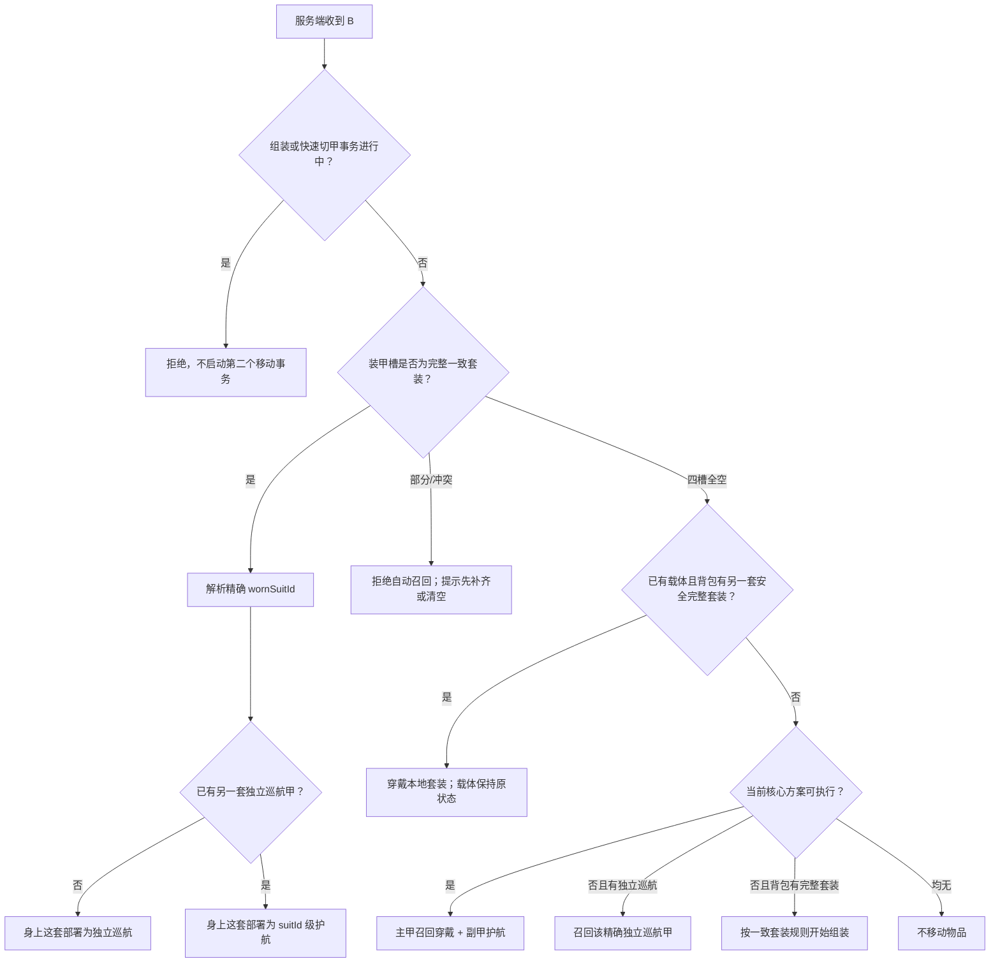

# 2.31 多战甲操作与冲突状态机复审

> 评审版本：Flight Armor `2.31.1`  
> 游戏环境：Minecraft `1.21.1`、Fabric Loader `0.19.3`  
> 评审日期：2026-07-26  
> 评审方式：先做源码状态机审计，再执行 Gradle 编译、契约测试和完整构建；不代替游戏内手动验收  
> 范围：B、K、N、Ctrl+B、Ctrl+Up/Down、核心面板、核心槽、平台交互、实体战甲面板、巡航/护航/待命/返航/召回/切甲、死亡、断线、丢弃与销毁

## 本轮实现状态

2.31 已把复审期间确认的直接冲突收口到以下规则：

- 完整穿甲时，B 始终处理身上精确 `suitId`；已有另一套独立巡航甲时，本套进入护航，不召回或覆盖旧甲。
- 四槽部分占用时，B 只继续当前套装的分件组装；四槽全空时才执行核心编队。
- 身上战甲和每个精确巡航/护航载体使用独立战斗 lane；一套甲的阶段、冷却、能量、过热和延迟弹体不再锁住或清除其他甲。
- 核心 REFRESH 和快照发送成为只读查询；自动发现只会接入“尚未属于任何核心网络”的穿戴甲，不再暗中迁移已有核心成员。
- 手持核心绑定平台先完成容量、身份和背包空间预检，再原子提交；失败恢复旧核心与手持物。
- 核心槽在普通组装和快速切甲期间都被锁定，避免动画中替换核心导致物品或拓扑分叉。
- 核心面板新增“释放当前战甲”，不再要求用户靠含糊的全局 B 状态猜测目标。
- 右键巡航/护航战甲可查看精确状态、设为指令甲、切换跟随/原地待命，并可近距直接召回；未接入当前核心的本人实体甲也保留恢复入口。
- 右键选择指令甲后，R/G/X/J 会优先且仅控制 48 格内选中的精确载体，即使玩家正穿着另一套甲；再次选择同一载体会取消遥控并恢复身上甲输入。服务端每次重验主人、`suitId`、实体 UUID、载体版本、选择会话、维度、距离和目标，并按距离加入约 6–12 tick 响应。
- 指令接受、拒绝、无目标、超距、选择和取消均有服务端 ACK；失败 ACK 回显原始客户端序号。单载体只保留一条执行中指令，忙时明确拒绝新的 R/G/X/J，因此 X 或连续攻击不会再静默覆盖已接受动作。载体近战使用自身视线，机动点被限制在主人 48 格控制球内。
- 守望型背甲已重做为收拢/展开的分段机械翼舱，采用石墨与深钢灰、分段亮青到琥珀/红负载灯；左右 `drone_pod` 在警戒/作战时脱离背甲错相悬停，自动核心炮附带两条独立遮挡校验的 pod 火线，核心炮冷却窗口还可左右交替发射独立小脉冲。pod 当前属于精确载体内的虚拟僚机，不生成可拾取装甲副本，也不能被单独选中或击毁。

本文件后文的开放 P1/P2 是进一步架构加固清单，不代表上述正常操作仍然失败。

## 0. 结论

当前多甲系统已经不再是“核心只记平台、面板不认识巡航甲”的早期实现。2.30 的主干已经具备：

- `coreId + instanceNonce` 分隔的多核心网络；
- 独立核心装备槽以及生存、创造模式的专用同步路径；
- 以 `suitId` 为键的护航载体和位置账本；
- 可识别平台、穿戴、独立巡航、护航、返航和召回阶段的统一快照；
- 带持久化记录、修订号和恢复阶段的快速切甲事务；
- 完整穿戴甲优先的 B 键新语义；
- 组装时按 `suitId + variant + claimed` 选择完整套装；
- 玩家死亡时，独立巡航甲 A 与身上战甲 B 分别保全的双甲路径。

本次复审没有找到“按一次正常操作必然复制或吞掉战甲”的开放 P0，但仍有四类必须优先收口的 P1：

1. **查询会改写拓扑**：打开/刷新核心面板会自动认领并迁移身上战甲，可能把战甲从另一枚核心网络悄悄移走。
2. **整甲位置账本无法表达分件状态**：玩家只丢一件、放进箱子、通过漏斗转移时，核心不能准确知道每个部件在哪里。
3. **事务锁覆盖不完整**：组装、召回或切甲过程中仍存在绑定平台、切换核心、修改网络拓扑的入口。
4. **恢复入口依赖当前核心网络**：属于玩家但尚未接入当前核心的实体护航甲，右键面板可能只显示状态而不允许穿戴，形成“看得见但收不回”的恢复死角。

推荐的总体方向不是继续为每个按钮叠加特殊判断，而是明确两层状态：

- `ownerId` 层只保存全局输入仲裁、当前核心选择和跨甲事务；
- `(ownerId, suitId, slot)` 层保存每一件实物、载体、归航点和生命周期。

任何 owner 级状态都不能在没有精确 `suitId` 的情况下移动、删除或接管物品。

## 1. 与旧评审文档的关系

本文件是“2.30 后复审”，不是对
[`装甲核心面板与统一控制逻辑评审.md`](./装甲核心面板与统一控制逻辑评审.md)
的复制。旧文档仍可作为设计历史阅读，但下列前提已经过时。

| 旧文档假设 | 2.30 当前事实 | 本次结论 |
|---|---|---|
| 面板不识别主独立巡航 | `SuitStateResolver` 已读取 `ArmorCruiseController.runtimeView` 并按 `suitId` 合并 | 已过时 |
| 独立巡航 payload / 状态没有 `suitId` | 运行态和持久化 locator 均可携带 `suitId` | 已过时；仅旧世界空 `suitId` locator 需要兼容 |
| 核心没有专用装备栏 | `ArmorCoreInventory`、`ArmorCoreSlot` 和菜单 Mixin 已提供 SavedData 背书的独立槽 | 已过时 |
| 切换核心会覆盖唯一一份网络 | `CoreRecord.networks` 已按 `coreId + nonce` 分桶 | 已过时 |
| B 一定先处理 owner 级旧巡航甲 | 当前 B 在完整穿戴时先确认身上精确 `suitId` | 已修复 |
| 手持核心右键平台没有专用分支 | 平台方块已优先进入 `bindHeldCoreToPlatform` | 已过时 |
| 核心绑定永久 `suitId`，平台只是可选 home | 当前结构仍以此为目标 | 继续保留 |
| 位置、角色、阶段、home 健康不能压成一个状态 | 当前 `SuitRuntimeSnapshot` 已基本采用该思路 | 继续保留 |
| 激活并绑定平台必须是原子事务 | 当前仍未完全做到 | 仍是 P1 |

旧文档中“穿着副甲按 B 应自动切回主甲”的路线也不再是当前权威语义。最新操作约定为：

- 四槽内有一套完整、身份一致的战甲时，B 只处理这套精确实体甲；
- 如果已有另一套独立巡航甲，身上这套进入护航/巡航，不误控旧甲；
- 四槽全空且已有巡航/护航载体时，若背包另有身份安全的完整套装，B 先穿戴该本地套装并保持场上载体；否则才按当前核心编队召回主甲并部署副甲；
- N 或实体战甲面板负责“把身上的甲切成另一套甲”。

因此 `ArmorCoreController.executeConfiguredRecallPlanForB` 中“穿着副甲时走主甲快速切换”的旧分支已经与入口顺序不一致，属于应删除或重构的陈旧逻辑，而不是需要恢复的行为。

## 2. 权威两层状态模型

### 2.1 owner 层

owner 层只允许保存“一个玩家这一刻只能有一份”的控制状态：

```text
OwnerControlState
├─ ownerId
├─ activeCoreKey?: coreId + nonce
├─ inputReceipt: channel + clientSequence + acceptedOperationId
├─ movementTransaction?
│  ├─ operationId
│  ├─ kind: ASSEMBLY / RECALL / QUICK_SWITCH / RETURN / DEATH_RESCUE
│  ├─ involvedSuitIds[]
│  ├─ expectedSuitRevisions[]
│  ├─ phase
│  └─ rollbackPlan
└─ independentCruiseSlot?
   ├─ exactSuitId
   ├─ carrierId
   └─ phase
```

`ArmorCruiseController.STATES<ownerId, CruiseState>` 可以继续表示“每名玩家最多一套独立巡航甲”，但这个 owner 级槽必须始终携带并校验精确 `suitId`。它不能代表“这个玩家所有战甲”。

### 2.2 suit 和 part 层

战甲实体状态应按套装和部件保存：

```text
SuitState(ownerId, suitId)
├─ membershipCoreKey?
├─ desiredRole: PRIMARY / ESCORT / NONE
├─ variant
├─ home?: platformId + dimension + pos
├─ carrier?: kind + carrierId + phase
├─ revision
└─ parts
   ├─ HEAD  -> PartLocation
   ├─ CHEST -> PartLocation
   ├─ LEGS  -> PartLocation
   └─ FEET  -> PartLocation

PartLocation
├─ WORN(ownerId, equipmentSlot)
├─ PLAYER_INVENTORY(ownerId, inventorySlot)
├─ CONTAINER(dimension, pos, slot)
├─ PLATFORM(platformId, slot)
├─ CARRIER(carrierId, equipmentSlot)
├─ ITEM_ENTITY(dimension, entityId, pos)
├─ TRANSIT(operationId)
├─ DESTROYED(cause, tick)
└─ UNKNOWN(lastEvidence)
```

当前 `ArmorOwnershipSavedData.bindingsBySuit<suitId, Location>` 只能给整套甲保存一个
`CARRIED / PLATFORM / CRUISE / LOOSE`，无法表达“头盔在箱子、胸甲在背包、护腿掉在地上、战靴穿在身上”。这正是丢件与恢复逻辑仍然不稳定的根因。

### 2.3 必须成立的不变量

| 编号 | 不变量 |
|---|---|
| I-01 | 每件认主部件由 `(ownerId, suitId, equipmentSlot)` 唯一标识 |
| I-02 | 每件部件任一时刻只能位于一个物理位置或一个带 `operationId` 的 TRANSIT |
| I-03 | “完整穿戴甲”必须同时满足 owner、suitId、四槽、型号和物品类型一致 |
| I-04 | owner 级独立巡航存在，不代表可以操作玩家身上或其他载体中的另一套甲 |
| I-05 | 状态查询、K 打开面板和 REFRESH 不得迁移核心、认领物品或改变位置账本 |
| I-06 | 每名玩家同一时刻只能有一个移动事务；绑定、换核心等拓扑写入也必须受该锁约束 |
| I-07 | 核心成员关系和平台 home 分离；没有 home 的在线战甲仍是合法成员 |
| I-08 | C2S 操作必须返回 `operationId / sequence / result`，重包只能重放结果，不能重做物理移动 |
| I-09 | 死亡保全按当前物理证据逐个 suit 执行，不能因为 owner 已有巡航甲就提前结束 |
| I-10 | 高级战斗、防御和整甲能力只能由一致身份的完整套装授权；单战靴飞行要单独定义所有者规则 |
| I-11 | 只有明确销毁事件能写入 DESTROYED；区块卸载、断线、合并、拾取都不是销毁 |

## 3. B 键权威路由

### 3.1 当前应保留的新语义



### 3.2 当前入口的正面变化

`ArmorCruiseController.handleRequest` 已经把“完整物理穿戴甲”放到 owner 级巡航 fallback 之前，并通过
`ChargingPlatformController.ensureOwnedEquippedSet` 获取精确 `suitId`。这修复了：

- 独立巡航甲 A 存在、玩家身穿 B，按 B 却召回 A；
- owner 单例状态把 B 当成 A；
- 同一玩家的两套甲共享一次含糊的 B 操作。

`deployWornSuit` 又把“已有另一套独立甲”的新穿戴甲交给
`ArmorEscortController.deployWornSuit`，物品不会覆盖旧 carrier。

### 3.3 仍需清理的 B 路由债务

1. `executeConfiguredRecallPlanForB` 仍保留“完整穿戴主甲/副甲”的旧判断，但当前完整穿戴入口不会到达它。应把该方法明确收缩为“仅四槽全空时的核心编队计划”，避免测试和维护者误以为副甲 B 会切主甲。
2. 当前入口先用 `ModItems.hasFullSet` 做粗判断，再由 `ensureOwnedEquippedSet` 做身份判断。建议统一为一个 `ResolvedWornSuit`，直接返回 `NONE / PARTIAL / CONFLICT / COHERENT_FULL`。
3. 四槽部分占用时，核心 planner 可能先生成命令，最终在具体召回入口才因槽位占用失败。应在 planner 前直接把 PARTIAL 作为阻塞状态，避免副甲已经启动而主甲无法穿戴的批次半成功。

## 4. 操作与冲突矩阵

### 4.1 键盘和核心面板

| 操作 | 权威目标粒度 | 当前前置与锁 | 当前结果或风险 | 推荐规则 |
|---|---|---|---|---|
| B，完整一致穿戴甲 | 精确 `wornSuitId` | 阻止 assembly、quick switch | 部署该套；已有其他独立甲时转护航 | 保留新语义 |
| B，部分穿戴 | 当前只有粗 `hasFullSet` / 下游槽检查 | 可能先规划核心编队后失败 | 容易出现批次部分启动 | 先解析 PARTIAL 并拒绝全部自动移动 |
| B，四槽全空、有场上载体且背包有另一套完整甲 | 背包精确 `suitId`，并排除全部活动载体身份 | assembly/quick switch 锁；账本必须为 `CARRIED` | 穿戴本地套装，场上载体保持原状态 | 保留 2.31.1 新语义 |
| B，四槽全空且核心在线 | 当前核心的全部 linkedSuitIds | planner 检查冲突和阶段 | 主甲穿戴、副甲护航 | 保留；批次增加 operationId |
| B，四槽全空且有独立巡航 | owner 独立槽中的精确 `suitId` | 阶段必须稳定 | 召回穿戴 | 保留 exact-suit 校验 |
| B，无核心但只有平台甲 | 不应猜平台 | 当前提示先装备/绑定核心 | 不移动 | 保留 |
| K | owner 的当前核心槽 | 客户端同 tick 仲裁；服务端不要求核心在线也能开菜单 | 打开面板；快照会触发自动关联副作用 | K/REFRESH 必须只读 |
| N | 当前完整穿戴 suit + 下一个 linked suit | assembly/quick switch 锁；当前甲必须有 home | 平台、护航或独立载体目标可切换；无 home 旧甲被拒绝 | outgoing home 改为可选；无 home 时旧甲留作无攻击护航 |
| Ctrl+B | 当前已穿部件或背包候选套装 | quick switch、assembly 锁 | 整体脱下或整体穿上 | 动画期间同时锁拓扑修改 |
| Ctrl+Up | 下一装备部件 | quick switch、assembly 锁 | 鞋→腿→胸→头逐件穿 | 继续使用同一 `AssemblySetKey` 会话 |
| Ctrl+Down | 下一已穿部件 | quick switch、assembly 锁 | 头→胸→腿→鞋逐件脱 | 事务状态记录精确 ItemStack 指纹 |
| REFRESH | 无物理目标 | 被归类为非移动 | 当前会调用 `reconcileWornSuitAssociation` | 只生成快照，不写数据 |
| BIND_LOOKED_AT | `platformId + suitId + activeCoreKey` | 当前被归类为非移动 | 可在 quick switch/assembly 中迁移核心拓扑 | 归类为 TOPOLOGY_MUTATION 并受全局事务锁 |
| SET_PRIMARY | 精确 `suitId` | 当前按移动操作锁定 | 修改角色 | 保留锁；写入 core revision |
| RECALL_SELECTED | 精确 `suitId` | runtime allowedActions + 移动锁 | 平台/载体召回穿戴 | 保留 |
| RECALL_AS_ESCORT | 精确 `suitId` | runtime allowedActions + 移动锁 | 平台起飞或独立甲转护航 | 保留；home 可选 |
| RECALL_ALL | 当前核心编队 | 一次循环执行多个命令 | 副甲可能已启动而主甲失败 | 改为可重试的 desired-state operation |
| RETURN_ESCORT | 精确 `suitId + home` | 移动锁、home 校验 | 返回平台 | 保留 |
| 攻击模式/范围/跟随待命 | 精确 `suitId` | 当前允许在移动中修改 | 只写护航配置 | 可在稳定 carrier 阶段修改；移动提交阶段暂缓生效 |
| FORGET_MISSING | 精确 `suitId` | fail-closed 多重检查 | 只移除活动核心关联，保留所有权 | 保留区分；补齐箱子、离线玩家和分件证据 |

### 4.2 核心槽、平台和实体面板

| 操作 | 当前行为 | 已有保护 | 开放风险 | 推荐 |
|---|---|---|---|---|
| 生存模式点击核心槽取下 | `removeItem` 清 SavedData 并把副本交给光标 | 快切时拒绝，强制同步 | 静态代码未发现必现吞核心；仍缺真实点击回执 | 加 `coreSlotRevision` 和服务端 post-click receipt |
| 生存模式放入/替换核心 | `setItem` 认主并写 SavedData | 非核心物品、他人核心拒绝 | 只锁 quick switch，不锁 assembly/recall | 使用统一 topology lock |
| Shift 点击核心槽 | `InventoryMenuMixin.quickMoveStack` 专门处理 | 失败不清源槽 | 满背包、延迟和菜单重开必须回归测试 | 保留并补测试 |
| 创造模式点击核心槽 | 仅支持 PICKUP；发送 expected/core/cursor CAS | 延迟包不能覆盖新核心 | 其他复合点击被取消；用户报告“点击消失”尚需运行时证据 | 记录请求、服务端裁决和最终槽/光标哈希 |
| 手持核心右键平台 | 先 `activateAndOpen`，再 bind | 核心分支优先于平台陈列切换 | bind 失败时新核心已经激活、旧核心已退回背包 | 激活 + 绑定 + 旧核心返还一次原子提交 |
| 手持核心 Shift+右键平台 | 仍优先绑定核心 | 不会误切陈列 | 与“Shift 存甲”语义容易误解 | UI 明示：手持核心时 Shift 不存甲 |
| 非核心 Shift+右键平台 | 用身上胸甲作 exact suit 锚点整套入库 | 空平台、完整套装、身份和 ledger CAS | 当前没有整体返航动画 | 逻辑保留，视觉另做，不改变提交点 |
| 空手右键完整平台 | 打开单甲状态面板 | 距离、owner/suitId 重验 | 未接入当前核心时动作可能禁用 | 明确“接入核心”或允许本人近距直接穿戴 |
| 空手右键不完整平台 | 切换展示模式 | owner 校验在方块实体 | 不提供容器式补件 | 符合当前“平台不是物品栏”的设定 |
| 右键独立/护航载体 | 创建 30 秒 exact-suit 会话 | 重新校验 entity、owner、suitId、距离 | primary action 依赖当前核心快照；未链接实体甲可能不可穿 | 本人近距 exact carrier 应有恢复入口，或显式“接入核心并穿戴” |
| 面板切换战甲 | 走 targeted quick switch | exact target + session + runtime | outgoing 无 home 时被拒绝 | 与 N 一起支持 optional home |
| 面板切换平台陈列 | 只对平台 session 开放 | token、距离和身份重验 | 与移动事务没有统一锁 | display 只改视觉可放行；不得改物品 |

### 4.3 生命周期

| 事件 | 当前状态 | 风险 | 推荐 |
|---|---|---|---|
| A 独立巡航、B 稳定完整穿戴后死亡 | B 先转 suitId 级被动护航，A 再进入 OWNER_DOWN | 当前工作树已修复 owner 级提前 return | 保留并加持久化测试 |
| 死亡时无其他独立甲 | 身上整甲转 owner 独立 carrier | 依赖完整身份 | 保留 |
| A 独立、B 正在普通组装时死亡 | B 的 suitId 级 death capture 会被 assembly 锁拒绝 | B 可能进入原版掉落，而不是战甲保全流程 | death rescue 应拥有最高优先级并接管/撤销 assembly |
| 三甲场景中快速切甲时死亡 | quick-switch 自己进入恢复；已有无关独立甲会干扰 `runtimeView` rescuedSuit 判断 | target/outgoing 的保全证据可能不是 owner 独立甲 | Core death handler 同时查询 exact escort 和 independent carrier |
| 复活 | 独立甲恢复 OWNER_DOWN；quick switch 重试 | suitId 级被动护航没有专门的“死亡来源”标记 | 给 death-rescue escort 增加 RESPAWN_WAIT phase |
| 断线 | quick switch 和 carrier locator 持久化，内存输入序列清理 | 正常 | 保留 |
| 服务端重启 | quick switch、独立/护航 locator 可恢复 | in-memory destruction queue 会清空 | 销毁 tombstone 直接持久化或同 tick 原子提交 |
| 玩家丢出一件战甲 | 没有把该 slot 改为 LOOSE 的通用 hook | 整甲 ledger 仍显示 CARRIED，无法定位地面部件 | part ledger + drop hook |
| 放入箱子/漏斗/末影箱 | 普通容器没有被 loaded evidence 扫描 | 面板可能显示失联；显式 forget 可移除活动关联 | 容器转移事件或可索引的 part locator |
| 地面物品被火、仙人掌、爆炸杀死 | ItemEntity KILLED 会排队 tombstone | 一件销毁即移除整套核心记录，但其他三件仍存在 | 记录 DESTROYED slot 和套装 INCOMPLETE，不直接抹掉整套可见性 |
| 地面物品自然 5 分钟消失 | DISCARDED 且 age>=6000 才认定销毁 | 正常 fail-closed | 保留 |
| 创造模式删除、`/clear` | 没有 ItemEntity unload | 核心不能自动刷新 | 在明确删除入口发 part-destroy 事件 |
| 面板“遗忘失联” | 扫在线背包、光标、加载实体，不扫方块容器/离线玩家 | 实物可能仍在箱子或离线物品栏 | 没有完整证据时只隐藏，不删除 ownership；目前后半条已做到 |

## 5. 状态转换矩阵

| 当前物理状态 | 操作 | 目标状态 | 提交条件 | 失败回滚 |
|---|---|---|---|---|
| PLATFORM / IDLE | 空槽 B，目标为主甲 | RECALLING_OWNER → ASSEMBLING → WORN | 平台四件身份一致、槽全空 | 四件回原平台 |
| PLATFORM / IDLE | 空槽 B，目标为副甲 | LAUNCHING → TRANSIT → ESCORT/GUARDING | 载体生成、ledger 与 locator 成功 | 四件回原平台 |
| WORN / coherent | B，无独立甲 | DEPLOYING → INDEPENDENT/GUARDING | exact suit carrier、ledger、locator 全成功 | 四件仍穿在玩家身上 |
| WORN / coherent | B，已有另一独立甲 | LAUNCHING → ESCORT/GUARDING | suitId 级 escort 容量和持久化成功 | 四件仍穿在玩家身上 |
| WORN / partial | B | 不转换 | 必须先补齐或清空 | 不移动任何副甲 |
| INDEPENDENT / GUARDING | B 且槽全空 | RECALLING/PHASING → DOCKING → WORN | exact carrier 可用 | 回到 CRUISING |
| INDEPENDENT / GUARDING | 面板返回 | suitId 级 RETURNING_PLATFORM | home 完整且平台空 | 回到独立巡航 |
| INDEPENDENT / GUARDING | 编队要求副甲 | ESCORT/GUARDING | exact carrier 交接 | owner 独立状态恢复 |
| ESCORT / GUARDING | N/面板切换目标 | EQUIPPING → WORN | outgoing 已安全转移、槽空 | 目标恢复 ESCORTING |
| ESCORT / GUARDING | 返回平台 | RETURNING_PLATFORM → PLATFORM | home 合法、平台空 | 留在被动护航 |
| QUICK_SWITCH outgoing WORN | N | RETRACTING → passive ESCORT | outgoing exact suit 成功部署 | 召回 outgoing 穿回 |
| QUICK_SWITCH target 任意可用源 | N | RECALLING_OWNER → ASSEMBLING → WORN | target exact source 始终存在 | 撤销 target，恢复 outgoing |
| OWNER_DOWN | 玩家复活、槽空 | RECALLING_OWNER → WORN | owner 在线且 carrier 可用 | 继续 OWNER_DOWN |
| LOOSE/UNKNOWN | 召回 | 不转换 | 没有可验证载体不能瞬移造物 | 只允许定位、重绑或保守遗忘 |
| DESTROYED(slot) | 修复/补件 | INCOMPLETE → 完整套装 | 明确的维修或新身份流程 | 不复制原 slot |

“待命”应是载体的行为配置而不是新的物理位置：

- 跟随待命：`CARRIER + ESCORT + GUARDING + FOLLOW + combat OFF`；
- 原地待命：`CARRIER + ESCORT + GUARDING + HOLD + combat OFF`；
- 护航作战：`CARRIER + ESCORT + GUARDING + combat HOSTILE/ALL`。

这样切换待命不会误写 ledger，也不会伪装成平台或穿戴状态。

## 6. 右键战甲面板与 R/G/X/J 新控制需求的冲突风险

### 6.1 当前事实

当前客户端默认键位是：

| 键 | 当前功能 | 目标 |
|---|---|---|
| R | 手部重力脉冲/手炮蓄力意图 | 玩家当前穿戴甲 |
| G | 胸口核心束蓄力意图 | 玩家当前穿戴甲 |
| X | 能量光刃开关 | 玩家当前穿戴甲 |
| H | 独立巡航守卫模式开关 | owner 级独立巡航 carrier |
| V | 俯冲/高速飞行模式 | 玩家飞行状态 |
| J | 当前代码没有注册 | 新需求必须先定义目标与优先级 |

`ArmorAssemblyClient.tick` 会先消费 B、Up、Down、N，并用
`operationCapturedThisTick` 阻止同 tick 的 K、H、R、G、X 和飞行控制。这个机制能避免“一帧同时切甲和开火”，但也会把低优先级点击直接吞掉，没有服务端拒绝回执。

右键战甲面板当前只保存一个短期 `PanelSession`：

- 目标是精确平台或 carrier；
- 保存 ownerId、suitId、载体/平台身份和 30 秒 TTL；
- 主按钮被消费后 session 删除；
- 它不是持续的“当前武器指挥目标”。

### 6.2 不能直接把 J 绑定到 owner 级战甲

如果 J 要用于“选中右键面板里的战甲，再命令 R/G/X 对它开火或切武器”，必须新增显式的
`SelectedSuitCommandTarget`：

```text
SelectedSuitCommandTarget
├─ ownerId
├─ suitId
├─ carrierId
├─ carrierRevision
├─ selectionToken
└─ expiresAt
```

不能只保存 ownerId，也不能沿用 `ArmorCruiseController.STATES.get(ownerId)`，否则：

- 右键选中护航甲 B，R/G/X 可能实际控制独立巡航甲 A；
- B 在右键后返航/被穿戴，旧 J 选择仍可能向已经换身份的 entity 发命令；
- 快速切甲后，同一 carrierId 或旧 session 的视觉状态可能覆盖新穿戴甲；
- 多套护航甲同时存在时，owner 级序列号会误判另一套 suit 的包为重复包。

### 6.3 推荐输入优先级

同一客户端 tick 只接受一个高层操作：

1. 正在运行的服务端事务确认/取消；
2. B、N、Ctrl+B、Ctrl+Up/Down；
3. K、右键面板确认、J 目标选择；
4. X 武器形态切换；
5. R/G 的 PRESS/HOLD/RELEASE；
6. H 护航模式；
7. 飞行方向和加速。

R/G 是持续按压意图，若被更高优先级操作打断，必须发送一次 CANCEL，并要求松键后才能重新 PRESS。当前 `ArmorCombatClient` 已对 assembly capture 做了类似处理；J 和实体面板加入后也要复用同一套 arbiter。

### 6.4 服务端验收规则

- R/G/X 控制玩家身上武器时，服务端重新解析完整一致的 `wornSuitId`。
- R/G/X 控制实体甲时，payload 必须包含 `suitId + carrierId + carrierRevision + actionSequence`。
- J 选择只建立目标，不直接移动物品或开火。
- carrier 返航、召回、换甲、死亡、断线时立即使选择 token 失效。
- 右键面板 token 不能直接充当无限期战斗授权。
- 任何战甲移动事务开始时，服务端取消该 suit 的蓄力、光刃和延迟弹体授权。

## 7. 已修复项

### F-01 组装混用多套同型号战甲

当前 `ArmorAssemblyController.equipSlotsAtomically` 已使用
`AssemblySetKey(suitId, variant, claimed)`：

- 已穿部件会锚定整套身份；
- 已认主与未认主部件不能混为一套；
- 多套同型号时只选择一个完整 `suitId`；
- 提交前再次检查库存槽与预期集合。

这是 2.30 当前工作树中的修复，不应再按旧实现报告为开放 P0。

### F-02 B 被 owner 级旧巡航状态劫持

完整穿戴甲现在先解析 exact suit，再处理 owner 独立巡航。A 巡航、B 穿戴时按 B，不会再把 A 当作 B。

### F-03 死亡时 owner 单例导致第二套穿戴甲掉落

稳定状态下，`captureWornSetForDeath` 会先把 B 转入 suitId 级被动护航，再把 A 置为 OWNER_DOWN，不再因为 A 已存在就直接 return。

### F-04 核心槽的基本复制/延迟包保护

`ArmorCoreInventory` 返回副本并要求所有修改走 `setItem/removeItem`；创造模式同步携带 expected/core/cursor，使用 compare-and-set 拒绝延迟包。静态代码中没有找到当前“普通点击核心必然消失”的确定路径。

这不等于运行时问题已经完全验收。核心槽仍必须覆盖本文件第 10 节的真实点击用例，并在失败时记录服务端裁决。

## 8. 开放问题与优先级

### P1-01 查询触发核心网络迁移

证据路径：

- `ArmorCoreController.sendSnapshot` 调用 `reconcileWornSuitAssociation`；
- reconciliation 调用 `ensureOwnedEquippedSet` 和 `associateSuit`；
- `ArmorCoreSavedData.associateSuit` 会从其他核心网络移除该 suit，并把 binding/profile 迁到当前核心。

可复现场景：

1. 核心 C1 已绑定战甲 A；
2. 玩家穿着 A；
3. 玩家激活 C2 或打开 C2 面板；
4. 仅因发送快照，A 可能从 C1 网络迁到 C2。

修复：

- `sendSnapshot`、K、REFRESH 彻底只读；
- 装备变化产生“发现身上战甲”事件；
- 未关联 suit 可自动加入；
- 已属于其他核心的 suit 只显示冲突，必须显式确认迁移；
- 迁移采用 expected source core + target core + suit revision 的 CAS。

### P1-02 拓扑锁不完整、手持核心绑定非原子

当前：

- `isCoreChangeLocked` 只检查 quick switch；
- 核心槽在普通 assembly/recall 中仍可替换；
- `BIND_LOOKED_AT` 被列为非移动动作；
- 手持核心右键平台先激活并打开，再尝试绑定。

修复：

- 新增 `OperationClass = READ / PROFILE / TOPOLOGY / PHYSICAL_MOVE`；
- TOPOLOGY 与 PHYSICAL_MOVE 互斥；
- 核心槽替换、核心激活、平台绑定、suit 迁移都属于 TOPOLOGY；
- 激活+绑定+旧核心返包一次提交，失败恢复原 core slot、手持栈和 active network。

### P1-03 分件丢弃与容器转移没有权威位置

`ArmorOwnershipSavedData` 只保存整甲位置；普通玩家丢物没有将该部件标为 LOOSE 的入口，
`hasLoadedSuitPartEvidence` 也不扫描箱子等方块容器。

修复需要 part ledger，而不是继续给整甲 Location 增加枚举。

### P1-04 未接入当前核心的实体甲可能无法穿戴

`ArmorSuitPanelController.handlePrimary` 要求目标存在于当前
`SuitStateResolver` 快照并具有 `CAN_RECALL_AND_WEAR`。快照只枚举当前核心 linked suits。

所以属于玩家、身份完整、就在面前的 suitId 级 escort，如果尚未链接当前核心，可能出现：

- 右键能看到 owner 和状态；
- 主按钮禁用；
- B 又只控制 owner 独立甲或核心编队；
- 玩家缺少恢复入口。

修复选择其一：

1. 本人近距、四槽全空时允许 exact carrier 直接穿戴；或
2. 面板提供“接入当前核心并穿戴”，先原子关联再召回。

### P1-05 N 的 outgoing home 被错误当成必需身份

目标 carrier 已支持无平台 home，但 `QuickSwitchRecord` 和完成/恢复代码要求
`outgoingBinding != null`，导致身上无平台旧甲不能 N 切换。

目标设计：

- outgoing home 可选；
- 有 home：成功后旧甲返台；
- 无 home：成功后旧甲保持无攻击护航；
- 失败：无论有无 home，都召回旧甲穿回；
- 持久化记录显式保存 `outgoingDisposition = RETURN_HOME / PASSIVE_ESCORT`。

### P1-06 身份不一致的套装仍可获得战斗/防御能力

`ModItems.hasFullSet/fullSetVariant` 只检查物品类型和型号，不检查 owner/suitId。
战斗、伤害、抗击退和部分飞行上限大量读取这个结果。

因此四件来自不同 suit、甚至他人认主套装，只要型号一致，仍可能取得完整能力；核心移动入口虽然会拒绝，但能力已经授权。

修复：

- 统一 `ResolvedWornSuit`；
- 完整能力读取 `COHERENT_FULL`；
- 单战靴飞行单独判断“未认主或属于当前玩家”；
- carrier 也验证四件 owner/suitId/slot，而不是仅 `fullSetVariant`。

### P1-07 死亡与移动事务叠加的多甲边界

稳定的 A 独立 + B 穿戴已修复，但 B 正在普通 assembly 时
`ArmorEscortController.captureWornSuitForDeath` 会因 assembly 锁拒绝；三甲快速切换时
`ArmorCoreController.handleDeath` 又主要读取 owner 独立 runtime 作为 rescuedSuit。

修复：

- death rescue 优先级高于普通移动；
- 先冻结 operationId，按 exact suit 盘点物理位置；
- assembly 可安全取消则取消，否则接管其已移动部件；
- quick switch 同时查询 outgoing、target 的 escort/independent/platform/worn 证据。

### P1-08 批量编队不是一个收敛事务

`executeFormationCommands` 依次接管独立甲、启动平台副甲，最后召回主甲。主甲失败时，副甲可能已经起飞。

不建议把所有实体移动做成一个超大回滚，而应：

- 保存 desired formation operation；
- 每条 suit command 幂等；
- 主甲失败后，副甲可以保持安全待命并显示“编队部分完成”；
- 下一次 tick/B 从快照继续收敛，而不是重发全部命令。

### P1-09 组装动画运行中的身份校验仍偏弱

组装提交选择已经按 `AssemblySetKey` 修复，但 `stateIsValid` 在后续动画 tick 主要检查物品类型；
如果外部路径在动画期间把某槽换成另一件同物品，动画仍可能被视为有效。

修复：

- `AssemblyState` 保存每个 affected slot 的 owner/suitId/variant/identity fingerprint；
- 每 tick 只读校验；
- 不一致时取消动画并进入明确恢复，不继续授予战靴悬停。

### P2-01 客户端按键会静默丢弃低优先级点击

`ArmorAssemblyClient.tick` 一次 drain B、Up、Down、N，然后只执行一个分支。B+N、Ctrl+B+N 等组合会把后者清掉，服务端看不到也无法回执。

修复：集中 InputArbiter，每次只消费最终获胜动作；其他点击保留或显示本地冲突提示。

### P2-02 Ctrl 组合键与可重绑定疾跑键是两套定义

衣柜组合使用硬编码左右 Ctrl，飞行加速读取可重绑定 sprint。玩家重绑定后，说明文档中的“Ctrl 加速”与实际按键可能不同。

修复：将 wardrobe modifier 和 boost mapping 都显示在键位设置中，并由同一冲突表计算。

### P2-03 销毁队列仅在内存

ItemEntity unload 后先放入 `CONFIRMED_DESTROYED_SUITS`，随后 server tick 才清核心和 ownership；
极端崩溃窗口可能丢掉这条确认。

修复：把 destruction tombstone 直接写 SavedData，处理完成再删除。

## 9. 修复顺序

### 第一阶段：数据不变量

1. 引入只读 `ResolvedWornSuit`，替换 B、N、战斗、防御、死亡的粗 `hasFullSet` 判断。
2. 把快照生成改成纯查询，禁止自动迁移核心。
3. 定义统一 operation lock，覆盖核心槽、核心激活、绑定、角色切换和物理移动。
4. 清理 B 的旧副甲→主甲不可达分支，固定“有完整实体甲处理实体甲，空槽才跑编队”的新语义。

### 第二阶段：恢复能力

1. 右键实体甲提供 exact-suit 恢复/接入当前核心入口。
2. N 支持 outgoing 无 home，并持久化成功处置策略。
3. death rescue 接管 assembly/quick switch 叠加场景。
4. 编队改为可恢复、可继续收敛的 desired-state operation。

### 第三阶段：部件生命周期

1. 引入 `(suitId, slot)` part ledger。
2. 接入玩家丢弃、拾取、容器转移、平台、载体、创造删除和 `/clear`。
3. 核心面板显示四件部件位置、完整度和销毁槽位。
4. “遗忘”与“确认销毁”继续分开。

### 第四阶段：输入与战斗目标

1. 集中 B/K/N/Ctrl/H/V/R/G/X/J 输入仲裁。
2. 为 J 定义 exact-suit 选择 token，不复用 owner 单例。
3. 让 R/G/X 的穿戴甲与实体甲命令都携带 suit/carrier revision。
4. 所有移动事务统一取消蓄力、光刃和延迟攻击。

## 10. 验收用例

### 10.1 组装一致性

| 编号 | 初始状态 | 操作 | 预期 |
|---|---|---|---|
| A-01 | 四槽空；背包有同型号完整 A、完整 B | Ctrl+B | 只穿 A 或只穿 B，不混 suitId |
| A-02 | 身上半套 A；背包有 A 剩余件和完整 B | Ctrl+Up | 只补 A；缺 A 原件时拒绝，不拿 B 补 |
| A-03 | 已认主 A 的三件 + 一件未认主同型号 | Ctrl+B | 拒绝，不把匿名件复制认领为 A |
| A-04 | 四件未认主且同型号 | Ctrl+B | 允许形成一套新的统一身份 |
| A-05 | 四件型号不同 | Ctrl+B | 拒绝，所有槽与背包不变 |
| A-06 | 含另一玩家的认主部件 | Ctrl+B | 拒绝，不能取得完整能力 |
| A-07 | 动画期间用外部路径替换同物品另一 suit | 等待 tick | 动画取消，不授予悬停，不吞任一件 |

### 10.2 B 新语义

| 编号 | 初始状态 | 操作 | 预期 |
|---|---|---|---|
| B-01 | A 独立巡航；玩家完整穿 B | B | A 不变；B 进入 suitId 级护航/巡航 |
| B-02 | 玩家穿当前核心的副甲 B；主甲 A 在线 | B | 仍处理 B，不自动换 A；换甲只能 N/面板 |
| B-03 | 四槽空；核心主甲 A 在平台，副甲 B/C 在平台 | B | A 召回穿戴，B/C 分别护航 |
| B-04 | 四槽部分占用 | B | 不启动任何主/副甲移动 |
| B-05 | A 独立巡航但 locator 尚未加载；玩家穿 B | B | 精确处理 B；不得因 owner locator 拒绝或召回 A |
| B-06 | 无甲、无核心、只有平台绑定账本 | B | 不猜目标，不移动物品 |
| B-07 | A 独立巡航；四槽空；背包有完整 B | B | 穿戴 B；A 的载体、身份和物品保持不变 |
| B-08 | A 独立巡航；背包套装也声明为 A 的同一 `suitId` | B | 拒绝穿戴与召回，双方物品均不移动 |

### 10.3 N 与面板切甲

| 编号 | 初始状态 | 操作 | 预期 |
|---|---|---|---|
| N-01 | 穿 A，A 有 home；B 平台在线 | N | A 转移安全，B 穿戴，A 返台 |
| N-02 | 穿 A，A 无 home；B 护航在线 | N | B 穿戴，A 保持被动护航 |
| N-03 | N-02 目标召回失败 | 等待恢复 | A 被召回穿回 |
| N-04 | 切甲 SEPARATING / INBOUND / RECOVERING 各阶段重启 | 重进世界 | 从持久化修订继续，不复制、不丢甲 |
| N-05 | 实体面板选中 B，随后 B 返航或 carrier revision 变化 | 点击旧按钮 | token 失效，不控制新实体 |

### 10.4 核心槽与拓扑

| 编号 | 初始状态 | 操作 | 预期 |
|---|---|---|---|
| C-01 | 生存核心槽有 C1，背包有空位 | 普通点击取下 | C1 出现在光标，槽为空，重开菜单仍一致 |
| C-02 | 生存核心槽有 C1，背包有 C2 | 光标交换 | C2 入槽、C1 在光标，任何一方都不消失 |
| C-03 | 核心槽有 C1，背包已满 | Shift 点击 | 操作失败，C1 仍在槽内 |
| C-04 | 创造核心槽有 C1 | 普通 PICKUP | 服务端 expected/current/cursor CAS 成功，重开后 C1 在光标 |
| C-05 | 创造模式延迟重放旧点击包 | 网络重放 | 旧包被拒绝，不能清掉新核心 |
| C-06 | quick switch 进行中 | 点击/Shift/创造同步更换核心 | 拒绝并强制回传权威槽 |
| C-07 | ordinary assembly/recall 进行中 | 更换核心或 BIND_LOOKED_AT | 同样拒绝 |
| C-08 | C1 绑定 A，玩家穿 A；激活 C2 后仅 K/刷新 | 查看面板 | A 不应自动从 C1 迁移到 C2 |
| C-09 | 手持 C2 绑定平台但绑定上限已满 | 右键平台 | active core、旧核心位置、手持栈和网络都恢复原样 |

### 10.5 死亡、断线和生命周期

| 编号 | 初始状态 | 事件 | 预期 |
|---|---|---|---|
| L-01 | A 独立、B 稳定穿戴 | 死亡/复活 | A、B 两个 suitId 各自只存在一份，均可恢复 |
| L-02 | A 独立、B 正在组装 | 死亡 | death rescue 接管 B，不进入普通掉落 |
| L-03 | A 独立、B→C 快速切甲各阶段 | 死亡 | outgoing/target/independent 三套分别有唯一位置 |
| L-04 | 护航/独立/快切中 | 断线并重连 | locator 和事务恢复，输入序列重新开始不误判 |
| L-05 | 认主套装只丢头盔 | 丢弃、区块卸载、重载、拾取 | 面板准确显示头盔位置，其余三件仍各自可见 |
| L-06 | 四件放入普通箱子/漏斗/末影箱 | 刷新面板 | 不误判销毁，不允许危险 forget |
| L-07 | 地面部件被火/仙人掌/爆炸杀死 | 等待 tick | 对应 slot 标 DESTROYED，核心立即显示套装缺件 |
| L-08 | 地面部件自然消失 | 6000 tick 前后 | 之前不销毁，达到寿命后确认销毁 |
| L-09 | 创造删除或 `/clear` | 删除 | 明确 destruction hook 刷新核心 |
| L-10 | 物品在未加载区块 | 点击遗忘 | fail-closed，不删除物理所有权 |

### 10.6 同 tick 冲突与 R/G/X/J

| 编号 | 输入 | 预期 |
|---|---|---|
| I-01 | 同 tick B+N | 只接受优先动作；另一个不被无提示吞掉 |
| I-02 | Ctrl+B 与可重绑定 sprint 同键 | 衣柜操作 tick 不加速，松开后恢复 |
| I-03 | R/G 正在蓄力时按 B/N | 服务端收到 CANCEL，移动完成前不能重新 PRESS |
| I-04 | X 光刃展开时开始召回/返航 | 光刃先收回，旧延迟斩击失效 |
| I-05 | 右键选中护航 B，独立 A 同时存在，按 J/R/G/X | 只控制 B，绝不回退到 owner 级 A |
| I-06 | B carrier 换实体或 revision 后重放旧攻击包 | 服务端拒绝 |
| I-07 | 打开核心/战甲面板时按 R/G/X/J | 不积压到关闭界面后误触发 |

## 11. 完成标准

满足以下条件后，才可以把“多战甲交互冲突”从开放清单移除：

1. 所有移动和拓扑入口都通过同一个服务端 operation arbiter。
2. B 的新语义只有一份实现和一份测试，不再保留相反的不可达分支。
3. K/REFRESH 是纯查询，任何核心迁移都有显式操作和回执。
4. N、面板切甲都支持无 home 旧甲的安全处置。
5. 稳定、动画中、快切中三类死亡均通过多 suit 验收。
6. 核心槽生存/创造的真实点击矩阵全部通过，无法再复现点击消失。
7. 每个认主部件的丢弃、容器、载体、平台和销毁位置可追踪。
8. R/G/X/J 的目标始终是精确 suit/carrier revision，不使用含糊 owner fallback。
9. 服务端重启和网络重包不会重复移动任何 ItemStack。
