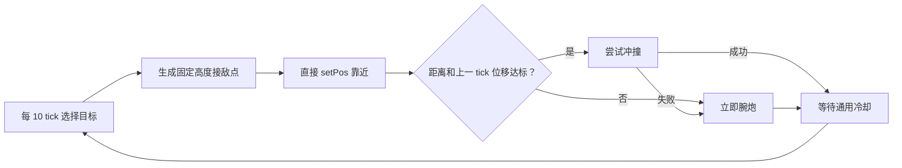
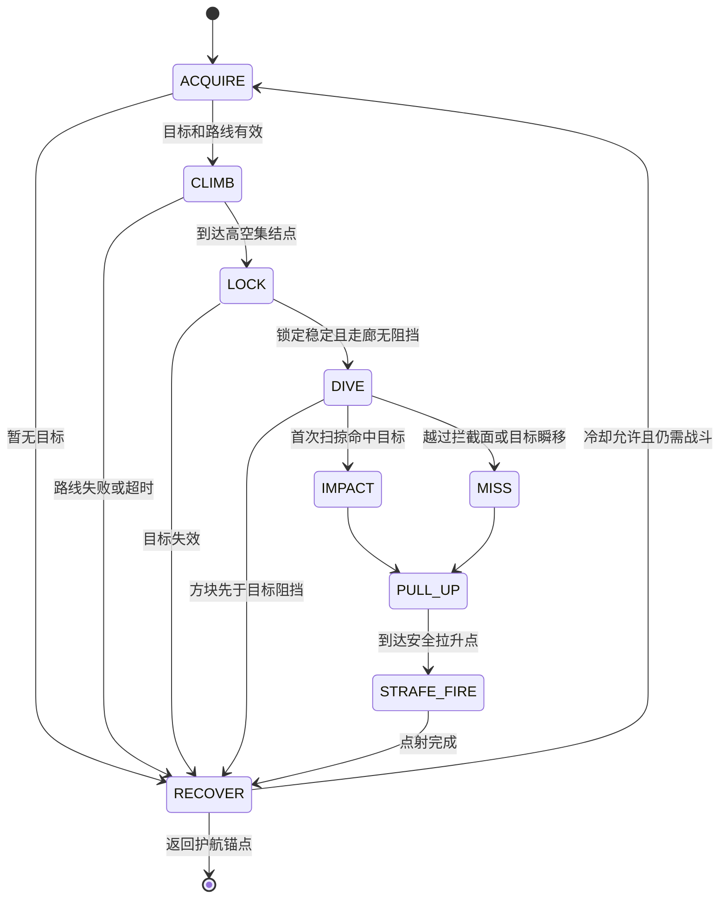
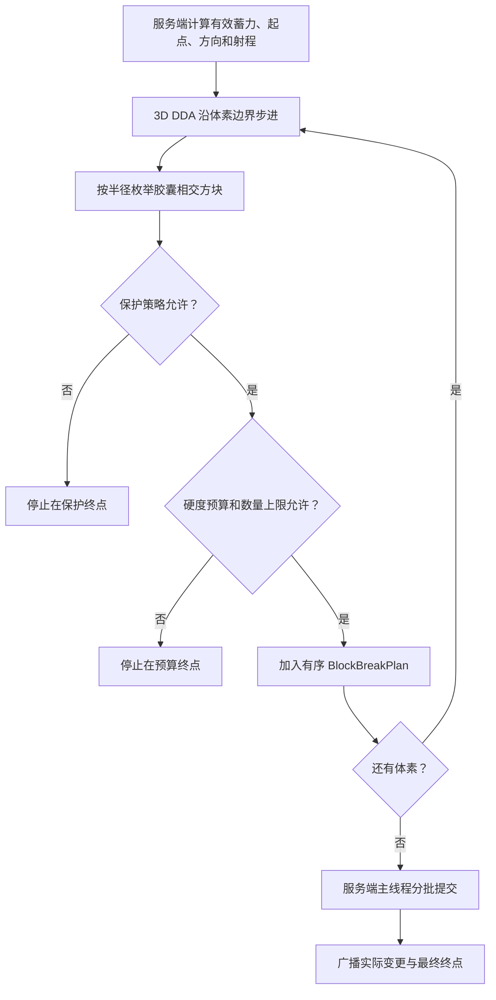

# 护航战斗与破坏性激光重构方案

> 状态：逻辑评审稿，不代表已经实现
> 基线：当前 Fabric 1.21.1 工作树
> 范围：护航战斗、先锋冲撞、hitscan 伤害语义、破坏性核心束、护航破障、视觉声音和验收。
> 本文只规定实现逻辑；本轮不启动游戏、不安装版本、不修改代码。

## 1. 结论和固定决策

当前先锋护航不是“升空后俯冲攻击”，而是每 tick 向固定接敌点直线移动，靠近后尝试冲撞，失败便立即用腕炮。
继续提高速度只会放大穿透、折线追踪和突然命中的观感问题，必须先引入攻击状态机和扫掠碰撞。

固定产品决策如下：

1. 腕炮 `gravity_pulse` 和核心束 `core_beam` 是瞬时能量 hitscan，不是弹丸。
2. 两者必须从 `minecraft:is_projectile` 移除；移除后末影人可以被正常命中。
3. 未来真实导弹使用独立 `armor_missile` DamageType 和真实弹丸实体，并保留 projectile 标签与末影人闪避。
4. 先锋攻击固定为 `ACQUIRE → CLIMB → LOCK → DIVE → IMPACT/MISS → PULL_UP → STRAFE_FIRE → RECOVER`。
5. 玩家 G 核心束按服务端有效蓄力分级破坏方块，不使用原版爆炸。
6. 地形破坏由硬度预算、单块硬度、访问步数和每发数量共同限制。
7. 方块实体默认保护，不可破坏标签和服务器保护规则拥有最高优先级。
8. 守望护航胸炮地形破坏默认关闭，只能从核心面板对每套副甲独立开启。
9. 伤害、碰撞、方块变更和攻击阶段全部由服务端权威裁决。

## 2. 当前代码证据

| 位置 | 当前行为 | 后果 |
|---|---|---|
| `ArmorEscortController.java:241-250` | 目标只转换成一个 `engagementPosition`，随后调用通用 `moveCarrier` | 没有集结点、拦截点、拉升点 |
| `ArmorEscortController.java:505-520` | 战斗节奏只有 `nextAttackTick` | 没有攻击阶段和阶段超时 |
| `ArmorEscortController.java:523-553` | 冲撞不成立便立即回退腕炮 | 无法形成冲撞后再侧射的动作节奏 |
| `ArmorEscortController.java:592-602` | `setPos` 直线移向目标 | 没有俯冲加速曲线和转弯轨迹 |
| `ArmorEscortController.java:605-615` | 载体 `noPhysics=true`、无重力 | 原版物理不会补做高速碰撞 |
| `ArmorEscortController.java:618-644` | 只有飞行、悬停和通用瞄准姿势 | 没有升空、贴臂俯冲、拉升和交替腕炮姿势 |
| `ArmorEscortController.java:729-746` | 生命周期只有五个大阶段；战斗字段只有目标、上一位移和时间点 | 没有攻击序列、轨迹点和单轮命中锁 |

`ArmorEscortAi.java:81-100` 只按目标中心、水平向量、固定距离和固定高度计算接敌点。
先锋参数位于 `ArmorEscortAi.java:162-163`：

```text
standoff = -1.25
heightOffset = 0.20
pursuitSpeed = 2.55
preferredWeapon = IMPACT
```

负 `standoff` 会把期望点放到目标另一侧，导致载体反复横穿目标附近，并不等于从高处俯冲。

当前流程是：



`ArmorCombatController.tryCruiseImpact` 只检查上一 tick 位移、当前中心距离、资源、冷却和 `hurt()` 返回值。
它没有检测“上一位置到当前位置”的整段路径；单 tick 位移超过目标宽度时会直接穿过。

## 3. 双层状态机

现有生命周期 `LAUNCHING / TRANSIT / ESCORTING / RETURNING / EQUIPPING` 保留。
只有 `ESCORTING` 且攻击策略允许时运行先锋战术子状态；返航、着装、跨维度、主人失效和核心关闭攻击均可高优先级中止本轮攻击。



### 3.1 各阶段行为

| 阶段 | 建议时间 | 服务端职责 | 武器许可 |
|---|---:|---|---|
| `ACQUIRE` | 1～5 tick | 固定目标 UUID 和攻击序列；验证阵营、维度、指令半径、区块、路线 | 禁止 |
| `CLIMB` | 10～30 tick | 飞向目标上方 8～12 格、预测运动反方向 6～10 格的集结点 | 禁止 |
| `LOCK` | 6～10 tick | 预测拦截点，要求视线和碰撞走廊连续稳定 | 禁止 |
| `DIVE` | 10～18 tick | 沿锁定轨迹单调加速，每 tick 扫掠实体和方块 | 禁止 |
| `IMPACT` | 1 tick | 每个序列只结算一次 `gravity_impact` | 禁止 |
| `MISS` | 1 tick | 记录落空/闪避，不伤害、不发送命中事件 | 禁止 |
| `PULL_UP` | 8～14 tick | 飞向目标后方 8～14 格、上方至少 6 格的拉升点 | 禁止 |
| `STRAFE_FIRE` | 12～24 tick | 侧向飞行，左右腕最多交替发射 1～2 次 | 仅腕炮 |
| `RECOVER` | 8～16 tick | 回到护航速度，等待冲撞冷却或返回锚点 | 默认禁止 |

每套先锋至少保存：

```text
combatPhase
phaseStartTick / phaseDeadlineTick
attackSequenceId
targetUuid
stagingPoint / interceptPoint / pullUpPoint
diveVelocity
hitCommitted
result = NONE | HIT | MISSED | TARGET_DODGED | BLOCKED | ABORTED
lastSafePosition
routeRevision
```

`attackSequenceId + hitCommitted` 是伤害和表现的幂等键。
网络重发、区块重新加载或客户端重复事件均不能产生第二次伤害、冲击波或音爆。

### 3.2 路线规则

- 拦截点采用 `targetCenter + clampedVelocity × estimatedDiveTicks`，不直接追目标当前中心。
- `CLIMB` 生成左、右、后三个候选集结点，按无阻挡、指令半径、与其他护航甲间距排序。
- 只在已加载区块规划，不为一次攻击强制加载新区块。
- `LOCK` 后目标若瞬移超过阈值，本轮进入 `MISS → PULL_UP`，不在高速中突然折线追踪。
- 多套先锋按 suit UUID 错开集结角和起始 tick，避免完全重合。

## 4. 高速扫掠碰撞

离散距离检测只看两个端点：

```text
上一 tick 位置 -------- 目标 -------- 当前 tick 位置
```

当两个端点都离目标较远时，即使路径穿过目标，当前实现也会判定未命中。
载体又是 `noPhysics`，所以必须自建连续碰撞。

每个 `DIVE` tick 执行：

1. 保存 `previousPosition`、上一帧载体 AABB 和候选位移 `delta`。
2. 计算 `sweptBounds = previousAabb.expandTowards(delta).inflate(hitPadding)`。
3. 查询宽阶段范围内的实体。
4. 把目标 AABB 按载体半尺寸和冲撞余量做 Minkowski 扩张。
5. 计算载体中心线段与扩张 AABB 的首次交点 `entityT ∈ [0,1]`。
6. 沿移动胶囊体检查方块碰撞形状，取得最早 `blockT`；不能只射中心线，否则肩甲仍会穿墙。
7. 比较最小接触参数：
   - `blockT < entityT`：停在方块前，结果 `BLOCKED`；
   - 锁定目标最先命中：结算一次冲撞，进入 `IMPACT`；
   - 主人、友军或宠物最先进入路径：阻挡并中止；
   - 无接触：提交候选位置，继续 `DIVE`。
8. 命中点使用 `previousPosition + delta × t`，方向使用服务端 `diveVelocity`。

单 tick 位移很长时可增加最多 4 个物理子步，但伤害仍按整个攻击序列只结算一次。
命中或落空后下一 tick 前必须进入 `PULL_UP`，不能停在目标碰撞盒中。
目标死亡、卸载、跨维度、主人召回或战甲返航统一进入 `ABORTED` 并清理轨迹和声音。

## 5. hitscan、伤害类型与末影人

### 5.1 当前闪避根因

`ModDamageTypes` 正常路径创建：

```java
new DamageSource(holder.get(), attacker, attacker)
```

直接实体和造成伤害实体都是玩家，并没有弹丸实体。
但 `data/minecraft/tags/damage_type/is_projectile.json` 当前包含：

```text
flight_armor:gravity_pulse
flight_armor:core_beam
```

1.21.1 末影人首先检查 `DamageTypeTags.IS_PROJECTILE`，命中该标签时最多尝试 64 次瞬移。
瞬移成功后可能在未扣血时让 `hurt()` 返回成功，因此还会产生假击退、假命中特效和错误冷却。

### 5.2 最终语义

| DamageType | `minecraft:is_projectile` | 理由 |
|---|---:|---|
| `gravity_pulse` | 否 | 腕部能量 hitscan，无飞行弹体 |
| `core_beam` | 否 | 胸口能量 hitscan，无飞行弹体 |
| `gravity_impact` | 否 | 载体物理冲撞 |
| `armor_missile`（未来） | 是 | 真实弹丸、飞行时间、实际碰撞 |

迁移时从 tag 中移除前两项；真实导弹尚未存在时可删除或留空该 tag。
未来真实导弹完成后，只加入它自己的伤害类型。
`minecraft:bypasses_cooldown` 是独立战斗规则，本次不随 projectile 标签一起改变。

攻击结果不能继续只有 `boolean hurt`，建议统一为：

```text
HIT_ENTITY | HIT_BLOCK | DODGED | REJECTED | MISS | INVALID
```

只有服务端确认 `HIT_ENTITY` 才施加击退和播放命中重音。
当前疾影“导弹”只是延迟任务并最终调用 `gravityPulse`；过渡期不能为了它继续污染腕炮标签。
真实导弹阶段应同时完成独立实体、独立伤害类型、逐 tick 碰撞，以及末影人闪避后失锁/惯性飞行。

## 6. 先锋视觉与声音氛围

目标不是堆叠原版喷射粒子，而是让阶段通过姿势、常亮灯、空间几何和空间声音清楚可读。

| 阶段 | 自定义几何和姿势 | 声音 |
|---|---|---|
| `ACQUIRE` | 面罩扫描扇、头先转向、胸核短促变色 | 伺服转向、低音扫描确认 |
| `CLIMB` | 向下弯曲的反重力带、尘埃上浮、双腿非同步微曲 | 悬浮底噪和逐渐升高的场强声 |
| `LOCK` | 2～3 层压缩环收向核心，面罩/核心/手脚全亮 | 6～10 tick 锁定音和机械闭合声 |
| `DIVE` | 流线能量壳、空气带、稀疏残影；双臂贴身、双腿错开 | 连续加速气流、多普勒掠过；每序列最多一次音爆 |
| `IMPACT` | 方向性主环、地面薄环、冲击吸收姿势 | 低频重击、短裂响、衰减尾音 |
| `MISS` | 最近掠过点的窄气爆环和弯曲尾迹 | 只有擦身声，绝不播放重击 |
| `PULL_UP` | 轨迹平滑弯起，腰胯刚性连接、左右腿错峰伸展 | 破空声下降、反重力声上升 |
| `STRAFE_FIRE` | 单侧腕部开口，左右腕交替，另一臂稳定飞行 | 左右声源明确的腕炮瞬态音 |
| `RECOVER` | 攻击轨迹消散，恢复常态高亮悬停 | 平滑回落到悬浮底噪 |

新增按载体 UUID 管理的 `EscortCombatSoundRig`：

- 每套装甲最多一个场强循环、一个俯冲循环和一个瞬态队列；
- 阶段切换淡入淡出，不得每 tick 重启声音；
- 近处超过 4 套装甲时合并低优先级持续声；
- 音爆按 `attackSequenceId` 去重；
- `MISS / BLOCKED / ABORTED` 使用不同尾音。

网络只在阶段变化时广播 `carrierUuid、attackSequenceId、phase、serverStartTime、targetId、轨迹方向、初速、result`。
普通位置继续由实体同步；禁止逐 tick 发送战术包。

## 7. 玩家 G 破坏性核心束

### 7.1 权威输入

现有释放流程已经在服务端计算：

```text
effectiveCharge = min(rawCharge, energyLimitedCharge)
```

地形档位必须使用同一个 `effectiveCharge`，客户端蓄力动画不能提高破坏力。
每发只扣核心束原有能量和热量，不按每个方块重复扣能量；安全边界由热量、冷却和破坏预算承担。

### 7.2 建议蓄力分级

| 有效蓄力 | 等级 | 半径 | 总硬度预算 | 单块硬度上限 | 每发上限 |
|---:|---|---:|---:|---:|---:|
| 6～11 tick | `PULSE` | 0 | 0 | 0 | 0 |
| 12～17 tick | `CUT` | 0.15 | 6 | 2 | 6 |
| 18～23 tick | `BREACH` | 0.35 | 18 | 5 | 16 |
| 24～29 tick | `SIEGE` | 0.55 | 42 | 12 | 32 |
| 30+ tick | `OVERCHARGE` | 0.75 | 90 | 30 | 64 |

硬度成本：

```text
cost = max(0.25, blockDestroySpeed)
```

空气跳过，流体默认不移除；负硬度立即阻断。
单块硬度超过本档上限或剩余预算不足时，在该方块终止，不能跳过它破坏后方。
满蓄力可切开明显的普通石材通道，但仍有确定的一发上限。

### 7.3 射线步进和提交



实现规则：

1. 使用 3D DDA，不用固定浮点采样，避免漏角和重复方块。
2. 同一切片按距中心线、射线投影和 BlockPos 稳定排序。
3. 最大访问体素 `256`，最大计划方块 `64`。
4. 遇到未加载区块立即停止，绝不为武器强制加载新区块。
5. 提交前再次检查方块状态和保护规则；方块已替换则跳过。
6. 每 tick 最多提交 `16` 个，满蓄力计划最迟 4 tick 完成。
7. 同一玩家上一发计划未结束时不接受第二个地形计划。
8. 所有变更在服务端主线程执行，客户端只渲染已确认批次。

实体和方块必须由同一个 `CoreBeamResolver` 按射线距离排序：

- 可破坏方块消耗预算后，光束可继续命中后方实体；
- 不可破坏或受保护方块同时截断实体伤害和视觉光束；
- 同一实体每发最多结算一次；
- `visualEndpoint` 必须等于服务端真实停止点；
- 原有型号范围/贯穿逻辑接入统一结果，不能另做第二条射线。

### 7.4 保护规则

中央 `CoreBeamTerrainPolicy` 按以下顺序拒绝：

1. `destroySpeed < 0`；
2. `flight_armor:core_beam_unbreakable` 方块标签；
3. 方块拥有 BlockEntity，且不在默认空的显式允许标签中；
4. 出生点保护、冒险限制或服务端总开关关闭；
5. 领地/保护模组兼容钩子拒绝；
6. 区块未加载或正在卸载。

箱子、熔炉、机器等方块实体默认不能被删除。
默认掉落模式建议为 `VAPORIZE`，避免满蓄力制造掉落物风暴；服务器可改为 `NORMAL_DROPS`，两者都必须经过保护和正常世界更新。

### 7.5 自定义碎屑

服务端按实际提交批次发送 `attackId、batchIndex、方向、BlockPos、原 BlockState ID`。
客户端用 `attackId + BlockPos` 作为稳定种子，每块生成 3～6 个自定义几何碎片和短寿命切割截面：

- 只为服务器确认改变的方块生成；
- 10～20 tick 内缩小淡出，不创建物品实体；
- 每发最多 256 片、全局最多 768 片；
- 32 格外降级，96 格外只保留光束和整体声音；
- 材质声音按石、木、玻璃、金属聚合，每批最多一个主破坏声。

## 8. 守望护航胸炮地形开关

当前 `ArmorEscortProfile` 只有攻击模式、范围、锚点和待命位置；应为每套绑定副甲增加：

```text
terrainDamageEnabled = false
```

该字段保存到 `ArmorCoreSavedData`，进入核心快照和动作响应；旧存档缺少字段时固定迁移为 `false`。
它按 suit ID 独立保存，不继承玩家 G 核心束设置，也不能成为整个核心共用的全局布尔值。

核心面板对守望型显示 `地形破坏：关闭 / 开启`；先锋和疾影显示“不适用”。
自动胸炮即使开启，也只使用较小的 `ESCORT_BREACH` 预设：

| 参数 | 默认值 |
|---|---:|
| 总硬度预算 | 12 |
| 单块硬度上限 | 4 |
| 每发/每 tick 上限 | 12 / 6 |
| 切割半径 | 0.30 格 |
| BlockEntity | 始终保护 |
| 默认状态 | 关闭 |

护航破障必须已有服务端有效目标，只破坏胸炮到目标之间、恢复射界所需的阻挡；到达目标后停止，不能继续拆目标背后的建筑。
方块必须位于该副甲指令半径内；主人、友军或宠物进入射线时取消。
关闭开关时仍按当前规则：有方块遮挡便不开火，绝不改变地形；开启后也不能对没有目标的墙体盲射。

## 9. 建议职责与分阶段实施

| 组件 | 职责 |
|---|---|
| `VanguardAttackController/State` | 八阶段、超时、序列号、轨迹点和结果 |
| `EscortTrajectoryPlanner` | 集结、预测拦截、拉升和障碍重规划 |
| `SweptCollisionResolver` | 实体 Minkowski 扫掠、方块胶囊扫掠、最早接触 |
| `CombatHitResult` | 统一命中、闪避、阻挡和落空语义 |
| `CoreBeamResolver/TerrainPolicy` | DDA、硬度预算、实体排序和保护规则 |
| `CoreBeamDestructionQueue` | 每 tick 限量提交并广播实际变更 |
| `EscortCombatSoundRig/FxController` | 护航阶段声音与自定义几何 |

| 阶段 | 交付内容 | 完成门槛 |
|---|---|---|
| 0 | 移除错误 projectile 标签，统一命中结果 | hitscan 可命中末影人且无假命中 |
| 1 | 先锋八阶段、轨迹和扫掠碰撞 | 关闭特效仍能看出完整循环且不穿透 |
| 2 | 姿势、阶段网络、自定义视觉和护航声音 | 命中前可读，落空与命中表现不同 |
| 3 | 玩家核心束 DDA、预算、保护和碎屑 | 五档破坏与所有硬上限可重复验证 |
| 4 | 守望独立开关、存档迁移和受控破障 | 默认零破坏，逐套开启不串值 |
| 5 | 真实导弹和综合压测 | 独立 projectile 伤害，末影人仍可闪避 |

## 10. 验收条件

| 类别 | 必须通过 |
|---|---|
| 先锋循环 | 严格经历八阶段；升空至少高于目标 8 格；锁定不少于 6 tick |
| 先锋加速 | `DIVE` 至少连续 8 tick 单调加速，不在首 tick 到最高速 |
| 武器节奏 | `CLIMB/LOCK/DIVE` 禁止腕炮；`STRAFE_FIRE` 最多交替 2 发 |
| 单次性 | 每个攻击序列最多一次冲撞伤害、一次冲击事件、一次音爆 |
| 拉升 | 命中或落空后下一 tick 开始，净拉升不少于 6 格 |
| 扫掠 | 单 tick 跨过目标仍命中；方块和友军在前时先阻挡；子步不增加伤害次数 |
| 生命周期 | 召回、返航、跨维度、目标死亡均安全中止且不遗留声音/轨迹 |
| 末影人 | 腕炮和核心束不在 `is_projectile`；控制场地可正常造成伤害；冲撞不回归 |
| 真实导弹 | 未来使用独立 DamageType/实体，并继续触发末影人 projectile 闪避 |
| 玩家激光 | 6～11 tick 不拆方块；其余档只认服务端有效蓄力；每发最多 64、每 tick 16 |
| 地形保护 | 负硬度、黑名单、BlockEntity、保护区域和未加载区块均阻断光束及后方伤害 |
| 幂等 | 重复释放、乱序批次和客户端重放均不能重复伤害或破坏方块 |
| 守望胸炮 | 新旧配置默认关闭；只对选中副甲开启；只破目标前阻挡，不盲射、不拆背景 |
| 视听 | 八阶段各有可区分线索；`MISS/BLOCKED/ABORTED` 不播放成功重击 |
| 性能 | 10 套护航、20 个目标和一次满蓄力拆墙时，无无界扫描、声音、碎屑或方块队列 |

最终体验应是：先锋脱离编队升空、锁定、沿预测轨迹俯冲，命中或擦身后立即拉升，再以左右腕炮短促侧射；玩家满蓄力核心束能在保护规则内切出方向明确的通道；守望护航只有获得核心面板授权才执行有限破障。
