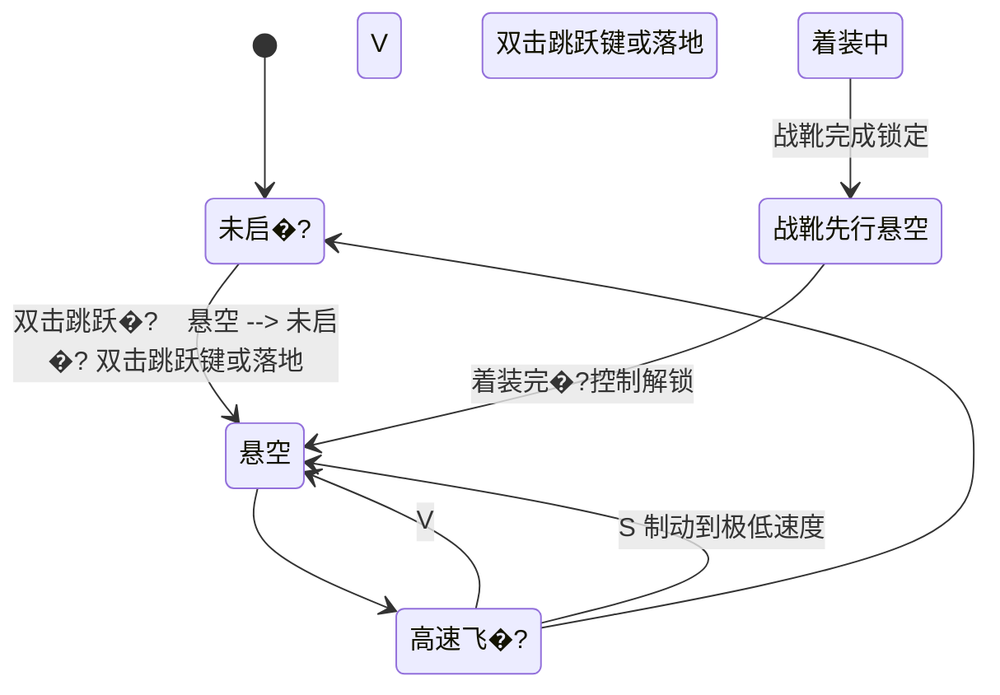
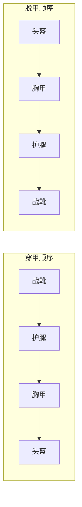

# 凌空战甲操作手册

> 适用于凌空战�?2.44.0（Fabric 1.21.1）。本文按实际代码行为编写，重点区分玩家身上整甲、守望背甲分离的自主僚机、身上整甲部署的“独立巡航”、核心副甲护航以及显式选中的“指令战甲”�?> 设计背景参见 [《装甲核心面板与统一控制逻辑评审》](./装甲核心面板与统一控制逻辑评审.md)；实际操作以本文和游戏内统一状态快照为准�?
**快速导航：** [按键](#按键速查) · [飞行](#飞行状态图) · [B 键](#b-键决策树) ·
[核心面板](#核心面板) · [平台](#平台操作) · [返航](#返航与召�? ·
[客户端设置](#客户端设置与可视�? · [武器](#玩家武器) · [故障排查](#故障排查)


## 先看这四�?
1. <kbd>B</kbd> 首先读取四个装备槽。完整且身份一致时只处理身上这套精确战甲：没有其他独立巡航甲就部署为独立巡航；已有另一套时则部署为护航，旧巡航甲保持原状。四槽全空、场上已有巡航/护航甲且背包另有完整战甲时，会先穿本地战甲而不召回场上载体；否则才执行核心编队或精确召回。
2. 穿戴完整守望型且处于稳定“超驰飞行”时，<kbd>H</kbd> 优先控制本套背甲僚机的分离/召回；其他情况下才控制独立巡航的被动/警戒。H 不控制核心召出的副甲。
3. 飞行推进读取游戏设置中的“疾跑键”，可以重绑；若与跳跃、潜行或后退键重合，上升/下降/制动优先并抑制本次推进。<kbd>组合键</kbd>+<kbd>B</kbd> 和 <kbd>组合键</kbd>+<kbd>↑</kbd>/<kbd>↓</kbd> 读取可重绑的战甲穿脱组合键（默认左 <kbd>Alt</kbd>），组合命令触发时不会同时发送飞行输入；Shift+右键平台也不会夹带下降。
4. 多枚核心各自保留独立网络；换核心只切换活动的平台、主甲和护航配置。战甲快切事务进行中会暂时锁定核心槽，完成或回滚后恢复。右键附近巡航甲可显式选为指令甲，所选指令甲的 R/G/X/J 优先级高于身上战甲。
## 30 秒开始使�?
### 只体验飞�?
1. 穿上凌空战靴后会自动轻抬并进入悬空；完整同型号四件套会获得完整动力、防御和武器能力。手动拖入装备槽、Shift、命令或其他模组直接装备也走同一服务端资格边沿�?2. 双击跳跃键仍可随时手动启�?关闭悬空；没有战靴时模组不会拦截创造模式的原版飞行，也不会弹出装备提示�?3. �?<kbd>W</kbd><kbd>A</kbd><kbd>S</kbd><kbd>D</kbd> 移动，跳跃键上升，潜行键下降�?4. �?<kbd>V</kbd> 进入高速飞行；视角控制方向�?kbd>W</kbd> 加速�?kbd>S</kbd> 制动、疾跑键增强推进。灯光按真实速度从青→蓝→紫→品红→橙→金连续变化，不会因按�?Ctrl 瞬间跳色�?
### 建立第一套核心战�?
```mermaid
flowchart LR
    A["核心放入人物区独立槽，或手持右键空气"] --> B["核心认主并激�?]
    B --> C["穿齐同型号四件战�?]
    C --> D["Shift + 右键空平�?]
    D --> E["整套入库并自动绑�?]
    E --> F["�?K 打开核心面板"]
    F --> G["设为主甲并配置副�?]
    G --> H["关闭面板后按 B 执行"]
```

要绑定更多战甲，使用另一座空平台和另一套完整战甲重复“整套入库”。第一套成功绑定的战甲会自动成为主甲�?也可以把当前核心拿在手中，直接右键属于自己的完整平台完成绑定；该操作优先于平台陈列，不会切成散件模式�?

## 按键速查

| 按键 | 使用条件 | 实际行为 |
|---|---|---|
| 双击跳跃�?| 完整四件套或单穿战靴；界面关�?| 启动/关闭悬空，双击间隔必须为 2�? tick |
| <kbd>W</kbd><kbd>A</kbd><kbd>S</kbd><kbd>D</kbd> | 悬空 | 前后左右水平移动 |
| 跳跃�?/ 潜行�?| 悬空 | 上升 / 下降 |
| 疾跑键（默认 <kbd>Ctrl</kbd>�?| 飞行控制已解�?| 悬空时切�?Boost 动力，高速飞行时增加推进 |
| <kbd>V</kbd> | 已启动飞行，且不处于战靴先行锁定阶段 | 切换悬空/高速飞�?|
| <kbd>B</kbd> | 界面关闭且没有其他战甲事�?| 完整身上甲优先部署；部分穿甲继续分件着装；四槽全空且已有载体时先尝试穿另一套完整背包甲，否则执行核心方案或精确召回 |
| <kbd>组合键</kbd>+<kbd>B</kbd> | 组合键默认左 <kbd>Alt</kbd>，可重绑；界面关闭 | 身上有战甲部件则全部收起；一件未穿时从背包装整套 |
| <kbd>N</kbd> | 穿戴当前激活核心绑定的完整战甲；至少还有一套有效绑�?| 按当前核心的绑定顺序切换下一套：旧甲先解体并在近处无攻击待机，目标甲飞来着装；确认成功后旧甲才返台，失败则恢复旧甲 |
| <kbd>组合键</kbd>+<kbd>↓</kbd> | 组合键默认左 <kbd>Alt</kbd>，可重绑；界面关闭 | 头盔 → 胸甲 → 护腿 → 战靴，逐件解除 |
| <kbd>组合键</kbd>+<kbd>↑</kbd> | 组合键默认左 <kbd>Alt</kbd>，可重绑；界面关闭 | 战靴 → 护腿 → 胸甲 → 头盔，逐件穿上 |
| <kbd>R</kbd> | 未选指令甲时需完整同型号四件套；已选指令甲时需载体在同维度 48 格内 | 控制身上战甲腕炮，或命令所选指令甲攻击准星目标 |
| 长按 <kbd>R</kbd> 12 tick | 四个装甲槽全空、未选择指令甲；同维�?48 格内有唯一最近的己方稳定战甲 | 召回这一台最近战甲；短按 R 不会误召�?|
| <kbd>Z</kbd>（可在按键设置中重绑） | 需完整同型号四件套；界面关闭；未处于遥控指令模式 | 手部增强能量光束的<b>模式切换</b>。开启后由<b>鼠标左键</b>开火：轻点是点射（冷却仅 2 tick，射击节奏由点击速度决定，不破坏地形）；按住约 0.3 秒再松手打出灭世光束，蓄力期间响蓄力循环音、前臂发射器随进度展开。满蓄力射程 150 格、爆坑直径 36 格起。开启期间左键不再挖掘，HUD 常驻显示退出键；地形破坏与撞击爆破共用 `TerrainDestructionGuard` 护栏 |
| 按住 <kbd>G</kbd> 后松开 | 未选指令甲时需完整同型号四件套；已选指令甲时需载体在同维度 48 格内 | 控制身上战甲核心束蓄力；守望超驰且僚机完全入坞时联动胸炮与左右翼炮，僚机在外或过渡中则仅发胸炮；或命令所选指令甲对准星目标开�?|
| <kbd>X</kbd> | 已选中同维�?48 格内的指令甲 | 切换远程悬空/贴地近战；未选指令甲时仍控制身上战甲光刃 |
| <kbd>J</kbd> | 指令甲已进入近战模式，附近有合法目标 | 经过型号专属响应时间后释放近战大�?|
| <kbd>M</kbd> | 穿齐并认主同一 `suitId` 的守望型四件套；无穿�?快切事务；僚机已经完全入�?| 在“超驰飞行”和“重装攻坚”间变形�?0 tick 变形期间锁定攻击 |
| <kbd>H</kbd> | 稳定守望超驰形态，或身上整甲已�?B 部署并进入稳定独立巡�?| 前者分�?召回本套真实僚机；后者切换独立巡航的被动/警戒 |
| <kbd>K</kbd> | 界面关闭 | 打开当前核心面板；无激活核心时显示离线 |
| <kbd>C</kbd> | 至少有一套已加载的护航副甲，且当前核心在位 | 循环全部已加载护航副甲的任务位置：跟随自主 → 贴身跟随 → 原地待命 → 跟随自主；各套档位不一致时先归位到跟随自主 |

## 飞行状态图



### 悬空与高速飞行的输入差异

| 输入 | 悬空 | 高速飞�?|
|---|---|---|
| <kbd>W</kbd> | 向视角水平方向前�?| 逐步提高指令速度 |
| <kbd>S</kbd> | 后退 | 连续制动；速度稳定降至极低值后自动切回悬空，松开 S 后才恢复悬空后退 |
| <kbd>A</kbd>/<kbd>D</kbd> | 左右平移 | 在视角制导上叠加�?18° 左右转向辅助 |
| 跳跃/潜行 | 上升/下降 | 当前不改变真实方�?|
| 鼠标视角 | 决定水平朝向 | 同时决定水平与俯仰方�?|
| 疾跑�?| 使用 Boost 动力�?| 不按 W 也会继续推进；与 W 同按最�?|

水中悬空会直接覆盖浮力，不会被持续推向水面。HUD 按真实位移计算速度并使�?`1 �?= 2 米`：空气中 `75 �?�?= 150 �?秒` 为本模组 Mach 1；水中阈值为 `324 �?秒`。飞行落地时自动关闭；高速状态满足速度和战斗门禁时，会先尝试重力冲击�?
高速飞行使用机动包线：小幅修正保持当前油门；航向夹角变大时会暂时平滑制动，速度下降后逐步恢复转向能力，对准新航向后再按原来的长曲线加速。接�?180° 掉头固定优先水平转弯，不会因三维插值奇点突然抬头或俯冲。客户端和服务端共享�?0.25° 量化的制导方向，避免高速转头时两套速度互相回拉�?
胸口棱形核心、面部、纹路、脚底和疾影尾迹共用同一份平滑速度样本。Ctrl 只提高加速度；持续推进后颜色随速度逐级前进，松开或用 S 制动时按同一曲线反向过渡。悬浮、机械伺服和空气层声音也按真实速度/加速度连续混音�?
守望型按 <kbd>M</kbd> 主动切换双形态：超驰飞行形态会让面甲、头盔、胸腰、双臂、膝腿、战靴和背甲依次重排，再展开每侧四层的大型机械翼；重装攻坚形态把同一批翼片回折为肩背与臂部重甲，速度明显下降但解锁专属重型近战。形态由完整且身份一致的 `suitId` 服务端保存，不能靠速度或客户端画面自行猜测�?
进入稳定超驰后，僚机默认保持在背甲。按 <kbd>H</kbd> 后，每侧真实的外翼、翼尖、模块舱与翼炮会从大型机翼收回共同锁点，再绕各自铰链折叠成紧凑飞行模块；�?10 tick 只切换这批相�?OBJ 面片的渲染所有者，不生成另一套小飞机，也不使用透明淡出或整体缩放。随后左右模块展开为各自的僚机形态，沿弧线离甲并在第 30 tick 到达主人两侧编队。它们拥有各�?UUID、完整度、位置、视线和射击冷却，并服从核心中该套战甲的“停�?敌对/全部”策略与攻击范围；无论策略如何，始终过滤主人、队友、宠物和禁止 PvP 的玩家。再次按 H 后，两台僚机先制动进入外侧捕获走廊，再把同一批翼片逆向折叠并对准背部锁位；�?22 tick 以不透明的单帧所有权交接回到背甲，之后由背甲完成展开和机械锁紧。僚机被摧毁后有 120 tick 重建冷却。高速跟随按主人每帧实际位置位移前馈，因此远端玩家也不会受原版速度包上限影响而周期跳位�?
低空高速飞行会根据真实速度和离�?离水高度产生方向性剪切线、破碎压力环及有界的伺服/空气混音修正；它不读�?Ctrl 是否按下。远程玩家、巡航甲和平台召回的空气声会根据声源与监听者每 tick 的真实径向距离变化产生平滑多普勒，本地第一人称声音保持中性�?
## 客户端设置与可视�?
1. �?<kbd>K</kbd> 打开核心面板，点击顶部“客户端设置”�?2. 可单独开关飞行速度 HUD、疾影高速灯光尾迹和低空/水面环境反馈�?3. “战甲总音量”只影响本机播放，不修改服务端战斗数值�?4. 设置会保存到 `config/flight_armor-client.json`；文件损坏时安全回到默认值�?5. 设置页中的“操作指南”提供平台、召唤、飞行、护航、武器五页游戏内分步说明�?
装备有效导航核心后，左上角显示与核心快照同步的简洁战甲列表：

- `◆` 表示主甲，`◇` 表示副甲，主甲始终排在最前；
- 每行显示战甲名称与实时状态，最多四套，其余�?`+N` 汇总；
- 服务端每 20 tick 刷新一次；打开其他界面时暂时隐藏，避免遮挡面板�?- 若主甲被服务端确认处于“失联”且没有任何可恢复位置证据，核心会自动按“身上完整战�?�?已加载巡�?护航�?�?平台完整战甲”的顺序切换主甲；远端区块未加载、已知散落位置和进行中的转移不会触发切换，恢复的旧主甲也不会自动抢回主位�?
核心面板左上角是静态战术编队预览：

- 底部节点代表主人，战甲节点按型号灯色区分�?- 主甲使用金色框，当前选择使用白色框�?- 连线表达平台、主人、护航、召回和返航关系；失�?冲突使用警示虚线�?- 最多同时绘制六套并�?`+N` 标出其余绑定，预览没有旋转或闪烁�?
充能平台在整�?散件切换时只播放一次约 0.9 秒的缩放与机械锁联动；切换完成后保持完全静止。该动画只改变客户端陈列，不转移或复制物品�?
## B 键决策树

```mermaid
flowchart TD
    A["�?B"] --> B{"死亡、旁观、快切或部件动画中？"}
    B -- "�? --> B1["拒绝第二笔事�?]
    B -- "�? --> C{"四槽是完整且身份一致的一套？"}
    C -- "�? --> C1{"已有另一套独立巡航甲�?}
    C1 -- "�? --> C2["身上这套部署为独立巡�?]
    C1 -- "�? --> C3["身上这套部署为护航；旧甲保持巡航"]
    C -- "部分/冲突" --> D["只继续该 suitId 的分件着装；不猜测召�?]
    C -- "全空" --> L{"已有巡航/护航载体，且背包有另一套完整战甲？"}
    L -- "�? --> L1["穿戴本地战甲；场上载体保持原状�?]
    L -- "�? --> E{"活动核心有有效方案？"}
    E -- "�? --> E1["按统一快照召回主甲、部署副�?]
    E -- "�? --> F{"存在精确独立巡航甲？"}
    F -- "�? --> F1["召回该甲；危险下坠时升级应急召�?]
    F -- "�? --> G{"仍有属于你的平台待机战甲�?}
    G -- "�? --> G1["提示激活核心并绑定"]
    G -- "�? --> H["从背包原子补装完整一致套�?]
```

### 物理 B 与面板“执行核心方案”的边界

- 两种入口共用同一套目标编队规划和统一快照，不会复制物品或重复发起已在进行的移动�?- 面板命令保持幂等；物�?B 在完整穿甲时始终以身上精�?`suitId` 为第一目标，不会先召回或覆盖场上的另一套甲�?- 已穿主甲不会再次解体；已在正确护�?HOLD 状态的副甲不会重复起飞�?- 独立巡航中的目标主甲会精确召回；独立巡航中的副甲可无物品复制地移交护航控制器�?- 转换、返航、快切和分件动画会锁�?B/N/衣柜/平台存甲/核心移动命令，不能并发启动第二笔事务�?- 当场上已有巡�?护航载体时，B 会优先穿戴背包内另一套身份安全的完整战甲；若背包套装与场上载体共用同一 `suitId` 或所有权账本异常，则拒绝操作以防复制。普通无载体场景仍在没有有效核心方案和平台待机甲时才从背包补装�?
## 独立巡航与核心副�?
| 项目 | 身上整甲独立巡航 | 核心副甲护航 |
|---|---|---|
| 创建方式 | 穿齐四件后按 <kbd>B</kbd> | 核心面板“召唤为护卫”或核心方案 |
| 数量 | 每名玩家一套流�?| 所有非主甲绑定均可成为副甲，没有固定两套上�?|
| 战斗开�?| 未穿稳定守望超驰甲时�?kbd>H</kbd> 切换被动/警戒 | 核心面板的攻击模�?|
| 攻击范围 | 独立巡航自己的固定警戒范�?| 核心配置�?16/32/48/64 �?|
| 再次�?B | 召回玩家并着�?| 若它被设为主甲，核心方案可让它脱离护航并着�?|
| 直接回平�?| 单甲面板/核心面板“返航平台�?| 核心面板“返航平台�?|
| 返台轨迹 | 高速接�?�?平台上方制动 �?垂直入坞 | 高速接�?�?平台上方制动 �?垂直入坞 |

<kbd>H</kbd> 先检查玩家身上是否为稳定守望超驰套装：是则只控制该套背甲僚机；否则才查找独立巡航状态。对核心副甲�?H 不会修改副甲策略�?
### 指令战甲：右键面板与 R/G/X/J

1. 在同维度 48 格内右键自己的稳定巡�?护航载体，点击“设为指令战甲”�?2. 服务器保存精�?`owner + suitId + carrier`，即使玩家身上穿着另一套甲，R/G/X/J 也只发往所选载体，不会同时触发身上武器�?3. R/G 读取玩家准星方向并由服务端选择合法目标；载体按距离等待�?6�?2 tick 后响应。目标和机动点必须留在主�?48 格控制球内�?4. 每套指令甲同一时刻只执行一条远程指令。上一条攻击完成、目标失效、超距或超时前，新的 R/G/X/J 会被明确拒绝，不会覆盖已经显示“接收”的攻击；失败回执会关联原指令序号�?5. 选择状态同时绑定载�?UUID、载体版本和服务端选择会话。战甲重建、切换或旧网络包到达时会安全取消/拒绝，不会把旧命令静默转给同 `suitId` 的新实体�?6. X 在远程悬空与贴地/低空近战之间切换；近战会主动调整高度、接近并攻击。J 仅在近战模式释放型号专属大招�?7. 再次点击当前已选载体会取消指令模式，R/G/X 恢复控制身上战甲；J 不会误发到身上战甲�?8. 跟随采用近距编队、战斗脱离、远距追赶和失联保护四层策略，并预测主人速度、视线与安全高度。战斗结束后平滑归队，不会每 tick 硬拉回主人背后�?9. 在单甲面板选择“原地待命”会保存服务�?HOLD 锚点；核心的 FOLLOW 配置不会在下一 tick 抢回该战甲。再次选择“跟随主人”才解除 HOLD�?10. 身上战甲和每套载体分别拥有独立战斗资源通道；一套甲的蓄力、过热、冷却和在途导弹不会阻塞或清除其他甲�?
没有穿甲且没有选择指令甲时，长�?<kbd>R</kbd> 12 tick 会召�?48 格内唯一最近的己方稳定战甲。服务器会再次校验主人、完整身份、距离和四个空装甲槽；短�?R 保持武器语义，不会误把附近战甲拉过来�?
## 分件穿脱



- <kbd>组合键</kbd>+<kbd>B</kbd> 发现身上有任意本模组部件时，只执行收起，不会先补齐。
- 一件本模组部件都没穿时，<kbd>组合键</kbd>+<kbd>B</kbd> 才尝试从背包穿完整套。
- 每件动画完成后才能发下一条指令。
- 脱甲需要空背包格；穿甲目标槽若被其他装备占用，会在该槽停止，不会跳过。
- 独立巡航或召回流程中，全部衣柜组合键都会被拒绝，应先用普通 <kbd>B</kbd> 完成召回。
- 同时按下 <kbd>组合键</kbd>+<kbd>↑</kbd> 和 <kbd>组合键</kbd>+<kbd>↓</kbd> 不执行操作。
## 核心面板

### 面板布局示意

```text
┌──────────────────── 装甲核心 · 召唤指挥 ────────────────────�?�? 核心状�?/ 绑定数量 / 可召数量          [绑定准星平台] [刷新] �?├──────────────────┬───────────────────────────────────────────�?�?当前选择的策�?    �?战甲列表（◆ 主甲 / �?副甲�?              �?�?[攻击：仅敌对]     �?�?先锋�?XXXX       平台就绪               �?�?[作战半径�?2 格]  �?  先锋�?· 仅敌�?32�?· 跟随主人          �?�?[护航：跟随主人]   �?�?疾影�?XXXX       护卫作战               �?�?                  �?  疾影�?· 所有生�?48�?· 原地待命        �?├──────────────────┴───────────────────────────────────────────�?�?所选战甲详情：型号 / 维度 / 距离 / 平台坐标                   �?�?[设为主战甲] [召回并着�?/ 释放当前战甲]                     �?�?[召唤为护�?/ 返航平台]        [执行核心方案（B）]            �?├──────────────────────────────────────────────────────────────�?�?指令结果与失败原�?                                            �?└──────────────────────────────────────────────────────────────�?```

### 激活、切换与绑定

- 人物装备区新增一个可见核心槽，只接受导航核心；服务端保存，重登后仍在�?- 手持未认主核心右键空气也可认主、转入核心槽并打开面板；以后按 <kbd>K</kbd> 打开�?- 核心已经绑定平台时，可以直接换入另一枚属于自己的核心；原核心的绑定、主甲和护航配置保留在独立网络桶中�?- 同一平台或同一套战甲只能属于一个核心网络；用新核心重新绑定会迁移归属，不会复制战甲�?- 自动绑定：核心在线时，把完整战甲 Shift+右键存入空平台�?- 手动绑定：手持当前核心右键完整平台；或对�?6 格内的平台点击面板“绑定准星平台”�?- 第一套绑定自动成为主甲；之后可选中其他战甲并点击“设为主战甲”，旧主甲自动变为副甲�?
- 核心在位才解锁网络能力：形态切换 <kbd>M</kbd> 与遥控指令；核心离线时战甲仍可裸装飞行与战斗，只是上述能力锁定。核心在位且穿着胸甲时，玩家胸口会渲染核心挂件。
```mermaid
flowchart TD
    A["放入或激活核�?] --> B{"该核心已有网络？"}
    B -- "�? --> C["恢复该核心的绑定、主甲和护航配置"]
    B -- "�? --> D["创建空的独立网络"]
    C --> E["绑定或控制一个或多个平台"]
    D --> E
    E --> F["换入其他核心时保留当前网�?]
```

### 状态与按钮矩阵

| 战甲状�?| 召回并着�?| 召唤为护�?| 返航平台 | 设为主甲/修改策略 | 作为主甲执行方案 |
|---|---:|---:|---:|---:|---:|
| 平台就绪 `READY` | 可用 | 可用 | �?| 可用 | 可用 |
| 远端 `OFFLINE` | 可用，点击后临时加载区块校验 | 可用 | �?| 可用 | 可用 |
| 已穿�?`WORN` | �?| “释放当前战甲”可�?| �?| 可用 | 默认保持穿戴；显式释放后进入巡航/护航 |
| 独立巡航 `CRUISING` | 可用 | 可移交为护航 | 可用 | 可用 | 主甲精确召回，副甲移交护�?|
| 护卫 `ESCORTING` | �?| �?| 可用 | 可用 | 可脱离护航并贴近着�?|
| 返航 `RETURNING` | �?| �?| 显示“返航中�?| �?| �?|
| 过渡 `TRANSITION` | �?| �?| �?| �?| 等待当前事务完成/回滚 |
| 平台缺件 `INCOMPLETE` | �?| �?| �?| 可设置，但不能执�?| �?|
| 冲突/失效 `CONFLICT/INVALID` | �?| �?| �?| �?| 先排除重复载体或身份问题 |

### 单甲状态面�?
- 右键完整平台上的待机战甲、独立巡航战甲或核心护航战甲即可打开�?- 面板分区显示型号、唯一短名、主人、角色、生命周期、维�?坐标/距离、完整性、事务冲突和指令链路�?- 战甲属于自己且四个装甲槽为空时，显示“召回并穿戴”�?- 自己正穿着核心同时绑定的另一套完整战甲时，显示“切换至此战甲”，并复�?N 快切事务�?- 非主人只能查看，不显示可执行的穿戴、切换或陈列按钮�?- 平台整甲/分件陈列改在该面板内切换，普通右键不再直接改变陈列�?- 稳定巡航/护航载体可设为指令甲并切换跟�?待命；已选择时按钮改为“取消指令战甲”。平台、OWNER_DOWN、返航和着装过渡不会开放战斗控制�?- 面板使用轻透明遮罩而不是世界后处理模糊，打开时仍能看清被检查的战甲和周围环境�?
右键打开载体面板要求 14 格内；载体会话建立后，指�?跟随操作使用统一 48 格控制范围。按钮按下时服务端会再次检查会话时限、距离、维度、实�?平台 UUID、四件身份和主人；面板过期、身份变化或战甲飞出范围时需要重新右键�?
### 护航策略

| 配置 | 循环顺序 | 含义 |
|---|---|---|
| 攻击模式 | 关闭 �?仅敌�?�?所有生�?�?关闭 | 决定是否主动搜索目标 |
| 作战半径 | 16 �?32 �?48 �?64 �?16 | 以主人或 HOLD 锚点为中心的最大搜索半�?|
| 护航位置 | 跟随主人 �?原地待命 | 跟随主人或保存当前护卫位�?|

第一次从“跟随主人”切到“原地待命”时，该战甲必须已经在护航，系统才能记录它当前的维度和方块位置。HOLD 战甲可以留在其他维度，但与主人不在同一维度时不会主动攻击�?
### 攻击目标过滤

- “仅敌对”攻击原生敌对生物，以及正在攻击主人或战甲的 Mob�?- “所有生物”仍不会攻击主人、队友、主人的驯服宠物、装饰盔甲架、其他战甲载体和 PvP 规则禁止的玩家�?- 战甲不会沿着连续目标无限离开主人；接敌位置始终被限制在配置锚点半径内�?
| 型号 | 护航移动和武器偏�?|
|---|---|
| 先锋�?| 高速近身冲撞；不满足冲撞窗口时用腕炮补�?|
| 疾影�?| 高速环绕，发射最多六目标追踪导弹�?|
| 守望型·超驰飞�?| 全身流线重排并展开四层机械翼；H 控制两台真实僚机从背甲分离或回收；部署后自主远程攻击，完全回收后 G 联动胸炮和左右翼�?|
| 守望型·重装攻�?| 翼片回折为厚重肩�?臂甲，贴地接敌并使用专属重型破阵刃与近战大招 |

## 平台操作

| 操作 | 前置条件 | 结果 |
|---|---|---|
| <kbd>Shift</kbd>+右键平台 | 身上穿齐四件；平台完全空�?| 整套原子入库；核心在线时自动绑定 |
| 普通右键完整平�?| 任意玩家 | 打开单甲状态面板；非主人只读；主人可在面板切换陈列 |
| 手持导航核心右键 | 完整平台属于当前玩家 | 激�?恢复该核心并直接绑定平台，不切换陈列 |
| 手持钻石右键 | 平台完整且属于当前玩�?| 四件同步重构为先锋型 |
| 手持回响碎片右键 | 同上 | 四件同步重构为疾影型 |
| 手持海洋之心右键 | 同上 | 四件同步重构为守望型 |

注意�?
- 导航核心直绑优先级最高；其他物品�?Shift 存甲优先于催化重构。蹲下拿着钻石右键仍会尝试存甲�?- 当前正式交互不打开容器，也没有逐件手动存放入口�?- 整套入库要求四件同型号，且必须全未认主或属于同一认主套装；平台被占用、混装、身份不一致或存在重复部件时会整体拒绝，不移动任何物品�?- 两种平台陈列均为静态，不旋转�?
## 返航与召�?
### 核心副甲返回平台

1. �?<kbd>K</kbd> 打开面板�?2. 选择状态为“护卫”的战甲�?3. 点击“返航平台”�?4. 战甲立即停止战斗，返回它最初离开的绑定平台�?
返航要求原平台仍存在、方块实例没有被替换且完全空置。平台在途中被占用时，入库失败，战甲会恢复护航和战斗。玩家死亡、离线或旁观时，已经抵达平台的战甲会悬停等待玩家恢复可用状态�?
### 把护航甲改为主甲并穿�?
```mermaid
flowchart LR
    A["K 打开面板"] --> B["选中护航�?]
    B --> C["设为主战�?]
    C --> D["清空四个装甲�?]
    D --> E["执行核心方案或关闭面板按 B"]
    E --> F["主甲脱离护航并贴近着�?]
```

### 身上整甲独立巡航返回平台

右键该独立巡航战甲打开单甲面板，或在核心面板选择它并点击“返航平台”。系统沿用同一 ArmorStand 和四件物品，先高速接近，再在平台上方制动并垂直入坞；途中平台被替换或占用时恢复原巡航/护航状态，不复制物品�?
## 被动能力

穿齐同型号整套后自动生效，不需要按键。破坏地形的部分只在服务端执行，并与核心束共用同一套保护规则：`mobGriefing` 关闭、方块实体、`flight_armor:laser_protected` 标签、领地回调、无建造权限或旁观身份都会阻止破坏。

| 能力 | 触发 | 表现 |
|---|---|---|
| 撞击爆炸 | 高速飞行撞到方块 | 在撞击点炸开球形爆坑而不是被弹开；爆坑半径随撞击前的速度增长（上限 9 格），巡航撞出几格的坑、俯冲撞出直径十几格并掀掉上千块。疾影型能啃黑曜石，先锋型居中，守望型只能啃软岩；门槛 0.05 格/刻，同玩家两次爆破间隔 5 刻 |
| 高速掠过破土 | 穿越马赫 1 | 冲击波掀开半径内的方块，半径与预算随马赫数增长（半径上限 12 格、单次上限 320 块） |
| 坠落免疫 | 整套着甲 | 坠落伤害归零 |
| 水面滑行 | 下半身贴水 | 保持高度掠过水面，不下沉也不减速；按潜行主动下潜仍会入水 |

## 玩家武器

| 能力 | 操作 | 关键门禁 |
|---|---|---|
| 腕部脉冲 | �?<kbd>R</kbd> | 完整同型号四件、身份有效、未高速飞行、未独立巡航、未过热且冷却结�?|
| 核心�?/ 守望联合�?| 按住 <kbd>G</kbd> 后松开 | 同上；额外禁止疾跑推进；稳定守望超驰且僚机完全回收到背甲时改为胸�?+ 左右翼炮三路结算，僚机部署或过渡中只发胸炮，并可�?V 高速飞行中继续蓄力 |
| 重力冲击 | 高速飞行接触地面、墙体、实体或水体时自动尝�?| 速度、能�?热量、冷却和单次俯冲序列允许 |
| 指令甲腕�?胸炮 | 先在单甲面板选择载体，再�?<kbd>R</kbd>/<kbd>G</kbd> | 载体同维度且�?48 格内；服务端重新选择准星目标并等待距离响应时�?|
| 指令甲近�?大招 | <kbd>X</kbd> 切换近战�?kbd>J</kbd> 大招 | X 后进入贴�?低空接敌；J 需要合法近战目标和型号专属冷却 |
| 守望双形�?| <kbd>M</kbd> 切换超驰飞行/重装攻坚 | 仅完整认主守望套装；30 tick 机械变形期间全部攻击锁定 |

核心束时间：

- 少于 6 tick 松开：取消�?- 6�?0 tick：伤害、射程和效果随蓄力提高�?- 30 tick：满蓄力，继续按住不再增强�?- 达到 100 tick：自动取消并回到待机，不会自动开火�?- 核心束充能低�?70% 时只伤实体；高充能后才按能量/硬度/方块数预算破坏路径方块�?- 稳定守望超驰且两台僚机完全回收到背甲时，从最低有效蓄力起发射胸炮和左右翼炮；满蓄力进入毁灭档，三路分别进行服务端射线、友军过滤和命中结算。僚机在外或处于分离/回收过渡时，G 安全降级为胸炮单束，不会让同一门翼炮同时出现在背甲和僚机上。胸炮与翼炮会在合法命中点产生原版实体爆炸，地形只由有硬度、方块数、权限和保护回调预算的光束走廊改动，不用球形爆炸绕过领地保护�?- `mobGriefing` 关闭、方块实体、不可破坏方块、保护标签、领地回调拒绝或玩家无权交互时不会破坏；射线遇保护点停止，不破坏后方方块�?- 普通型号蓄力时开始疾跑推进、进入高速飞行、打开界面、穿脱甲或进入巡航，都会取消。稳定守望超驰的 G 可在 V 高速飞行中保持，但开�?Ctrl 推进仍会取消�?
腕部脉冲在普通悬空的疾跑推进状态仍可使用；高速飞行模式下不能使用�?
疾影型自主战斗发射的导弹是真实实体：会受方块阻挡，可被攻击摧毁，具有最大转向、速度、寿命和距离。先锋冲撞使用升�?锁定/俯冲/拉起状态机；守望保持远距并优先使用核心束。自主战甲有 1000 完整度，低于 25% 会降级，归零后失能受控下落但仍可召回；完整平台会自动维修身份匹配的战甲�?
## 故障排查

| 现象 | 最常见原因 | 处理方法 |
|---|---|---|
| 另一枚核心放不进核心�?| 核心属于其他玩家，或战甲快切事务尚未完成 | 使用自己认主的核心；等待快切完成或回滚后再换�?|
| 手持核心右键普通方块没打开面板 | 普通方块被安全消费，不再隐式切换核�?| �?K 打开面板；绑定时直接右键完整平台 |
| 右键战甲没有穿戴/切换按钮 | 战甲不属于你、装甲槽不满足条件，或正处于过渡事务 | 查看主人和状态；清空四槽或穿齐当前绑定战甲后重试 |
| �?B 显示“核心编队已对齐�?| 四槽全空且当前核心目标已经满足；或装备槽中的四件不是同一 `suitId` | 完整一致穿甲时 B 应直接部署该套；若没有部署，检查四件主人、`suitId`、型号和完整�?|
| 穿着 B �?R/G 仍控制身上甲 | 尚未�?A 的单甲面板中设为指令甲，�?A 已离开 48 格范�?| 右键 A �?“设为指令战甲”；收到服务端锁定回执后再操作。再次选择 A 会取消并恢复 B |
| 一套巡航甲开火后其他甲全部失�?| 旧版本共�?owner 级能�?冷却状�?| 更新�?2.31.1；当前版本按精确载体隔离战斗 lane |
| 场上已有巡航甲时，按 B 没穿背包里的另一套甲 | 背包没有完整一致套装；或该套与场上载体共用 `suitId`、所有权位置异常 | 确认四件齐全且属于另一套战甲；身份冲突会主动拒绝以防复�?|
| 没有场上载体时，按 B 没从背包装甲 | 有有效核心绑定，或世界中仍有属于你的平台战甲 | 按核心提示处理；纯背包装甲可用 组合键+B |
| B 提示转换�?冲突 | 快切、返航或装配事务仍在进行，或同一 suitId 出现多个载体 | 等待完成；若持续冲突，在单甲/核心面板查看位置与身�?|
| 召回提示需要清空槽�?| 平台召回和护航主甲着装都不会覆盖其他装备 | 清空头、胸、腿、脚四个槽位 |
| 双击跳跃没有进入悬空 | 没穿战靴、双击间隔不�?2�? tick、界面打开、正在着装或身份无效 | 穿上本模组战靴，关闭界面并按正常跳跃节奏重试 |
| 创造模式双击仍是原版飞�?| 没穿本模组飞行装备时，模组故意不拦截原版双击 | 穿上战靴后再使用模组悬空 |
| V 没有效果 | 尚未启动悬空，或处于战靴先行的临时锁定阶�?| 先双击启动；等待完整着装完�?|
| Ctrl 飞行加速没效果 | 疾跑键已被重绑，或速度仍在长加速曲线起�?| 使用实际疾跑键并持续推进；观�?HUD 速度而不是按键瞬�?|
| Ctrl 加速但灯光不变 | 灯光读取真实平滑位移速度，不读取按键 | 持续加速直�?HUD 速度明显上升；若速度已变但颜色仍不变再报�?|
| 组合键+B / 组合键+方向键没效果 | 组合键未按住、界面未关闭、动画未结束或独立巡航仍活动 | 使用实际组合键（默认左 Alt）、关闭界面、等待动画；巡航先按普通 B 召回 |
| H 提示需要巡�?| 身上不是稳定守望超驰套装，且当前看到的是核心副甲或独立巡航尚未稳�?| 守望僚机先穿齐同一 `suitId` 并切到超驰；核心副甲�?K 面板改攻击；独立巡航等待进入 CRUISING |
| “原地待命”设置失�?| 战甲尚未作为护卫活动，没有可记录的位�?| 先“召唤为护卫”，再点击“护航：跟随主人�?|
| 返航按钮不可�?| 战甲不在 `ESCORTING/CRUISING`，或已经 `RETURNING/TRANSITION` | 选择稳定护卫/独立巡航战甲；返航或事务中的战甲等待完成 |
| 返航失败并恢复护�?| 原平台不存在、实例被替换或平台被占用 | 清空原平台；若平台已重放，重新入库并绑定 |
| Shift+右键平台不能存甲 | 没穿齐、平台不空、四件混�?异主或身份重�?| 使用完全空平台和同型号同身份完整四件 |
| R/G 被拒�?| 不是完整同型号套装、正在独立巡�?穿脱、冷却或过热；普通装甲正在高速飞�?| 恢复稳定整甲状态并等待冷却；G 还要松开 Ctrl 推进。稳定守望超驰的 G 可在高速飞行中使用 |
| 核心面板显示远端 | 平台区块未加�?| 可以直接召回；服务端会临时加载并重新校验 |
| 核心面板显示失效 | 平台被拆除、重放后实例变化，或战甲身份不一�?| 使用原战甲重新入库，并重新绑定平�?|

## 推荐验证顺序

第一次配置多套战甲时，按下面顺序操作最容易定位问题�?
1. 激活一枚核心，确认 K 面板显示“在线”�?2. 将第一套完整同型号战甲存入空平台，确认列表出现且为主甲�?3. 对第二、第三套重复入库，确认它们显示为副甲�?4. 为每套副甲分别设置攻击、范围和跟随策略�?5. 清空四个装甲槽，关闭面板，按 B�?6. 确认主甲着装、副甲进入护航�?7. 使用核心面板分别测试 HOLD、攻击关闭和返航�?8. 最后再测试身穿整甲�?B 的独立巡航与 H，避免把两套系统混在一起判断�?