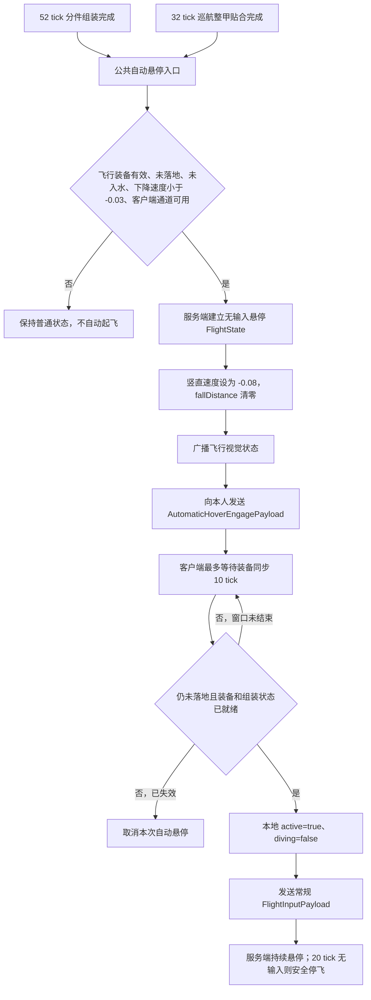

# 下落着装后自动悬停实现评审

> 历史说明：本文记录的是 `2.8.5` 的“全部着装完成后再悬停”方案。`2.8.6` 已改为“战靴先锁定、立即悬空、其余部件继续着装”，当前实现请以《战靴优先悬空着甲实现文档》为准。

## 1. 文档范围

本文评审 `2.8.5` 中“玩家下落时，战甲着装完成后自动进入悬停”的实际实现。

当前功能边界是：

- 只响应两种已有动画的**完成事件**：52 tick 分件组装完成、32 tick 巡航整甲贴合完成；
- 完成瞬间玩家必须仍在空中下落；
- 不自动寻找战甲、不自动发起召回；
- 地面完成、仍在上升、水中完成、手动拖入装备槽或只手动穿上飞行战靴，当前都不会触发自动悬停；
- 自动悬停是一次性事件，玩家之后手动关闭飞行不会被持续检测重新打开。

如果产品目标就是上述范围，当前方案总体合理，可以继续使用，无需推倒重写。如果“穿戴后自动悬空”实际指任何穿戴方式、地面也自动升空，那么当前实现只完成了其中一个子集，需要另开“自动起飞”状态，而不是简单删除几个条件。

## 2. 总体结论

| 评审维度 | 结论 | 说明 |
| --- | --- | --- |
| 权威性 | 合理 | 是否触发、刹停速度、清除跌落累计和创建飞行状态都由服务端决定 |
| 触发范围 | 对“着装完成瞬间仍在下落”这一目标合理 | 只挂在两条着装完成边沿，不做持续扫描，因此不会误伤普通跳跃或后续下落 |
| 客户端体验 | 合理 | 客户端收到专用事件后接入现有悬停输入，不需要模拟双击空格 |
| 网络容错 | 基本合理 | 客户端等待装备同步 10 tick，服务端允许 20 tick 输入接管窗口 |
| 物理衔接 | 合理 | 完成帧清除高速下坠和 `fallDistance`，同 tick 进入原有悬停物理 |
| 可维护性 | 中等 | 核心路径清晰，但存在对服务端 tick 调用顺序的隐式依赖，事件包也没有序列号或确认包 |
| 需求扩展性 | 中等 | 适合“下落着装完成后救援”，不直接适合“任何穿戴后自动起飞” |

综合判断：**若目标是“着装动画完成瞬间仍在下落时进行救援”，当前实现适合作为正式基础版本，建议保留；后续优先补网络确认和测试，不建议现在扩大到持续装备扫描。** “已经穿着战甲后，未来每次下落都自动悬停”是另一种需求，当前并不支持，需要用户最终确认语义。

## 3. 当前实现链路

### 3.1 两个权威触发点

第一条路径是背包中的分件组装：

1. `ArmorAssemblyController` 运行 52 tick 组装时间线；
2. 服务端将状态从 `assembling=true` 原子替换为 `assembling=false`；
3. 先广播组装完成快照；
4. 调用 `FlightController.tryEngageHoverAfterArmorReady(player)`。

对应代码：[`ArmorAssemblyController.java`](../src/main/java/dev/codex/flightarmor/assembly/ArmorAssemblyController.java#L101)。

第二条路径是独立巡航整甲召回：

1. 载体完成 32 tick 捕获、贴合和闭合；
2. 四件真实物品从载体一次性转移到玩家装备槽；
3. 显式发送玩家装备更新包；
4. 移除载体、持久索引和巡航活动状态；
5. 广播 `IDLE` 墓碑后调用同一个自动悬停入口。

对应代码：[`ArmorCruiseController.java`](../src/main/java/dev/codex/flightarmor/cruise/ArmorCruiseController.java#L1053)。装备同步在自动悬停通知之前发送，因此客户端有确定的包顺序。

这两个调用点都是状态提交的完成边沿，不会在每个玩家 tick 中重复判断。这是当前设计最重要的合理点。

### 3.2 服务端触发条件

公共入口 `FlightController.tryEngageHoverAfterArmorReady` 要求：

```text
canFly(player)
&& !player.onGround()
&& !player.isInWaterOrBubble()
&& player.getDeltaMovement().y < -0.03
&& 客户端支持 automatic_hover_engage 通道
```

`canFly(player)` 还会排除死亡、旁观、乘骑、睡眠、岩浆、仍在组装以及没有有效飞行装备的情况。

对应代码：[`FlightController.java`](../src/main/java/dev/codex/flightarmor/flight/FlightController.java#L59) 和 [`FlightController.java`](../src/main/java/dev/codex/flightarmor/flight/FlightController.java#L175)。

`-0.03` 是一个小型下降死区。它能过滤站在方块边缘产生的微小速度、地面状态抖动和仍在上升的完成帧，同时不会要求玩家先积累很大的坠落距离。

### 3.3 服务端先接管物理

条件通过后，服务端不会只发一个视觉通知，而是先完成以下操作：

1. 保存进入战甲飞行前的 `mayfly`、`flying`，保证停飞后可恢复创造模式或其他来源的能力；
2. 创建一个 `active=true`、`diving=false`、无方向输入的 `FlightState`；
3. 停止原版鞘翅姿态；
4. 将空气中的竖直速度设置为 `-0.08`，清除 `fallDistance`；
5. 标记玩家运动需要同步；
6. 广播现有 `FlightVisualStatePayload`，让旁观者看到飞行展开；
7. 向所属客户端发送专用的 `AutomaticHoverEngagePayload`。

对应代码：[`FlightController.java`](../src/main/java/dev/codex/flightarmor/flight/FlightController.java#L66) 和 [`FlightPhysics.java`](../src/main/java/dev/codex/flightarmor/flight/FlightPhysics.java#L15)。

空气中的 `-0.08` 不是继续下坠。当前 `FlightPhysics.apply` 会在同 tick 显式补回 `+0.08`，两个模组内常量相互抵消，因此目标竖直速度收敛到 `0`。比直接设为 `0` 更能避免下一步物理产生一个轻微向上的弹跳。

### 3.4 同 tick 悬停接管

服务端统一在一个 `END_SERVER_TICK` 回调中按以下顺序运行：

```text
ArmorCruiseController.tickServer
ArmorAssemblyController.tickServer
FlightController.tickServer
```

对应代码：[`FlightArmorMod.java`](../src/main/java/dev/codex/flightarmor/FlightArmorMod.java#L64)。

因此，无论是哪条着装路径完成，都会先建立自动悬停状态，随后在同一个服务端 tick 内由 `FlightController.tickServer` 应用一次正常悬停物理。这能避免着装完成到飞行接管之间再多掉一帧。

### 3.5 客户端接续输入

客户端收到 `AutomaticHoverEngagePayload` 后，不会马上假设装备已经同步，而是创建一个 10 tick 等待窗口：

- 落地、乘骑、进入岩浆或旁观时立即取消；
- 装备包尚未抵达或组装状态尚未结束时继续等待；
- 条件就绪后清除旧的双击空格时间戳、退出俯冲姿态、执行本地刹停并设置 `active=true`；
- 同一个客户端 tick 继续运行原有 `FlightPhysics.apply`；
- 通过已有 `FlightInputPayload` 把 `active`、WASD、升降、加速和俯冲状态发给服务端。

对应代码：[`FlightArmorClient.java`](../src/client/java/dev/codex/flightarmor/client/FlightArmorClient.java#L38)、[`FlightArmorClient.java`](../src/client/java/dev/codex/flightarmor/client/FlightArmorClient.java#L62) 和 [`FlightArmorClient.java`](../src/client/java/dev/codex/flightarmor/client/FlightArmorClient.java#L127)。

清除双击空格时间戳是必要的：否则着装完成附近的一次空格输入可能和旧点击组成“双击”，反而把刚自动开启的飞行关闭。

### 3.6 完整流程图



## 4. 为什么当前设计合理

### 4.1 没有把客户端当成权威物理来源

如果只在客户端把 `active` 改为 `true`，高延迟时服务端仍会继续累计下落和跌落伤害，甚至把客户端拉回。当前实现由服务端先创建状态、刹停和清除 `fallDistance`，客户端只负责输入预测与操作接续，这是正确的职责划分。

### 4.2 没有复用普通视觉包强行开飞

`FlightVisualStatePayload` 面向本人和旁观者，只表达外观状态。本地是否真的处于输入飞行仍由 `FlightArmorClient.active` 控制。新增专用的 `AutomaticHoverEngagePayload` 避免把“远端正在飞的视觉快照”误当作“要求本地自动起飞”的命令，语义清楚。

### 4.3 触发是边沿事件，不是持续条件

持续写成“只要玩家有战甲并且在下落就自动飞”会产生两个问题：

- 玩家手动关闭悬停后仍在下降，下一 tick 又被强制打开；
- 普通跳跃、走下台阶或玩家主动俯冲都可能误触发。

当前方案只在着装事务成功提交的瞬间调用一次，因此天然避免循环重启。

### 4.4 装备事务先完成，飞行再开始

服务端只有在完整装备已经落到玩家槽位、组装状态已经结束后才调用自动悬停。`canFly` 会再次检查有效装备，避免出现“视觉说穿好了，但权威装备尚未提交”的空飞状态。

### 4.5 有双重超时兜底

- 客户端 10 tick 等待窗口用于吸收装备包与自定义事件包到达主线程的细小时差；
- 服务端 20 tick 输入超时用于防止客户端断开、卡死或没有完成接管时永久保留飞行状态。

客户端输入变化时会立即发送；输入保持不变时每 2 tick 发送一次心跳。有效输入的最大正常间隔远小于服务端“超过 20 tick”才停飞的超时，所以正常链路有足够余量。

## 5. 当前风险与限制

| 编号 | 等级 | 风险或限制 | 当前影响 | 建议 |
| --- | --- | --- | --- | --- |
| R1 | 中 | 需求语义容易被理解为“任何穿戴后都自动悬空” | 当前只覆盖两条动画完成路径和下降状态 | 在功能说明中持续写明边界；扩大需求时单独设计自动起飞状态 |
| R2 | 中 | 52 tick 分件组装约需 2.6 秒，32 tick 整甲贴合约需 1.6 秒 | 低空下落可能在穿戴完成前已经落地或死亡，本功能不会提前救援 | 若要做真正坠落救援，另加下落中的临时保护场或加速着装，不要混入当前完成事件 |
| R3 | 低到中 | 服务端等待客户端输入只有 20 tick | 极端卡顿超过约 1 秒时，服务端会安全停飞并恢复下落 | 可加入自动悬停确认包，确认前给予更明确但有上限的宽限期 |
| R4 | 低 | `AutomaticHoverEngagePayload` 没有序列号、来源或维度 | 当前可靠有序连接和 10 tick 窗口足以工作；极端滞后事件跨维度执行时，普通 `active=true` 输入理论上可能在新维度重新建状态 | 增加 `engagementId`、触发来源和维度键，并让客户端回传确认 |
| R5 | 低 | 着装完成前客户端可能已有一个旧的 `active=false` 输入包在路上 | 服务端状态可能短暂经历一次关停再被客户端重新开启 | 在服务端为自动悬停增加“等待首次 active 确认”的短宽限，忽略早于事件的关闭输入 |
| R6 | 观感 | 捕获帧只刹停竖直速度，保留水平速度 | 高速横移时会按原有加速度逐渐停下，不是立即定点冻结 | 当前更自然；若要求绝对定点悬停，可只在自动捕获帧把 X/Z 同时清零 |
| R7 | 维护 | `-0.08` 精确抵消依赖完成控制器先于 `FlightController.tickServer` 执行 | 当前统一回调顺序正确；以后调整 tick 注册可能破坏假设 | 把顺序写成测试，或让自动悬停入口显式执行首帧物理，不依赖外部调用顺序 |
| R8 | 产品边界 | 水中入口被明确排除，虽然普通飞行物理支持水中悬停 | 玩家在入水后才完成着装不会自动接管 | 若需要“坠海后继续自动悬停”，单独放开水中条件并明确目标是水中定深而非空中悬停 |
| R9 | 低 | 客户端等待阶段没有再次检查 `isAlive`、`isSleeping` | 服务端不会合法创建这种请求，但极端延迟事件可能造成一帧本地错误激活，随后会被服务端拒绝 | 客户端接管条件补充存活、睡眠和事件维度检查 |

这些风险中没有发现会导致物品复制、装备丢失、无限飞行状态或普通下落反复触发的高危缺陷。

## 6. “穿戴后自动悬空”的三种可能语义

| 目标语义 | 当前是否支持 | 正确实现方式 |
| --- | --- | --- |
| 下落时，分件/整甲动画完成后自动悬停 | 支持 | 保持当前完成事件方案 |
| 下落时，手动穿上完整套装或单穿飞行战靴后自动悬停 | 不支持 | 记录每个玩家上一 tick 的飞行装备状态，只对 `false -> true` 边沿触发一次 |
| 无论地面还是空中，任何穿戴完成后都自动升空悬停 | 不支持 | 新增短暂 `TAKEOFF` 阶段、向上抬升、落地关闭宽限；不能只删除 `onGround` 判断 |

如果要扩展第二种语义，装备变化检测也必须是边沿事件，不能写成“有装备且正在下降就触发”。

如果要扩展第三种语义，当前客户端在 `active && player.onGround()` 时会立即停飞，服务端也会在地面停止状态。因此必须设计起飞抬升和 3～5 tick 的落地判定宽限，否则地面自动激活会在同一 tick 被关闭。

## 7. 建议的改进顺序

### P0：当前实机验收前不必重构

先验证两条实际流程：

- 高空下落时从背包触发 52 tick 分件着装；
- 高空下落时召回独立巡航战甲并完成 32 tick 整甲贴合。

确认完成帧是否停止下坠、是否立即进入悬停姿势、声音和灯光是否只播放一次、随后控制是否顺滑。当前架构足以支持这一轮验收。

### P1：增加自动悬停握手

建议将空事件扩展为：

```text
AutomaticHoverEngagePayload(engagementId, source, dimension)
AutomaticHoverAckPayload(engagementId)
```

服务端在收到对应 `ack` 或第一份 `active=true` 输入后结束接管等待。在等待期间，只忽略事件创建前已经发出的旧关闭输入；超过上限仍按现有安全策略停飞。

### P1：补自动化边界测试

至少把触发条件和状态恢复抽成可测试逻辑，锁定以下约束：

- 下降速度恰好在阈值两侧；
- 完成前后 `assembling` 状态；
- 原始创造飞行能力保存与恢复；
- 维度变化、落地、装备丢失和输入超时；
- 两条完成路径各自只调用一次。

### P2：把关键参数集中配置

当前 `-0.03`、客户端 10 tick、服务端 20 tick 分散在不同类中。可以集中为自动悬停配置或公共常量，并在日志中带上拒绝原因，便于实机调参和定位“为什么这次没有触发”。

### P2：按最终观感决定是否清除水平惯性

建议先保留水平速度，它会让高速下落后的捕获有刹车感。如果实机表现像“穿好后仍向前滑太远”，再只对自动着装捕获帧清零水平速度，不要改变全部悬停模式的惯性。

## 8. 验收测试矩阵

| 场景 | 预期结果 |
| --- | --- |
| 地面完成 52 tick 分件组装 | 不自动起飞 |
| 地面完成 32 tick 整甲贴合 | 不自动起飞 |
| 空中上升阶段完成着装 | 不自动悬停 |
| 空中下降且 `Y < -0.03` 时完成分件组装 | 清除下坠与跌落累计，自动悬停 |
| 空中下降且 `Y < -0.03` 时完成整甲贴合 | 装备先同步，再自动悬停 |
| 下降速度处于 `[-0.03, 0)` | 不触发，验证死区符合预期 |
| 完成前已经落地 | 不触发 |
| 完成帧处于水中 | 当前不触发 |
| 下落中手动穿齐全套或只穿飞行战靴 | 当前不触发，确认它不属于本版本触发范围 |
| 乘骑、睡眠、旁观、岩浆 | 不触发 |
| 自动悬停后无按键 | 保持悬空姿势，竖直速度稳定在 0 附近 |
| 自动悬停后 WASD / 空格 / Shift / Ctrl | 无需再次双击空格，直接接入原有控制 |
| 自动悬停后按 V | 正常切入俯冲模式 |
| 自动悬停后手动双击空格关闭 | 停止飞行，后续下降不自动重开 |
| 着装完成附近按一次空格 | 不应与旧点击组成双击关闭飞行 |
| 自动悬停后脱下飞行装备 | 服务端与客户端都停止飞行 |
| 自动悬停后切换维度 | 清除旧维度状态与客户端等待 |
| 死亡或换维度后才执行滞后的自动事件 | 不应在新状态中短暂激活；当前需重点观察并作为后续握手改进依据 |
| 创造模式进入并退出自动悬停 | 原有 `mayfly/flying` 状态正确恢复 |
| 客户端在 10 tick 内收到装备同步 | 正常接管 |
| 客户端超过 20 tick 没有发送有效输入 | 服务端安全停飞，不永久保留状态 |
| 多人旁观自动接管 | 其他客户端只收到视觉状态，不会被错误要求本地起飞 |

## 9. 最终建议

若目标是“着装动画完成瞬间仍在下落时自动悬停”，当前实现逻辑是合理的，尤其是以下三点应当保留：

1. 着装完成事件而非玩家持续 tick 扫描；
2. 服务端先建立飞行状态和刹停，客户端再接续输入；
3. 使用独立自动悬停事件，而不是让视觉状态包承担控制语义。

现阶段不建议为了覆盖所有“穿戴”方式而扩大触发器。先完成两条动画路径的实机验收，再根据实际需求选择：继续保持“下落着装救援”，增加“手动装备边沿触发”，或另做带起飞阶段的“地面着装自动升空”。三者的交互语义不同，不应混成一个持续条件。
