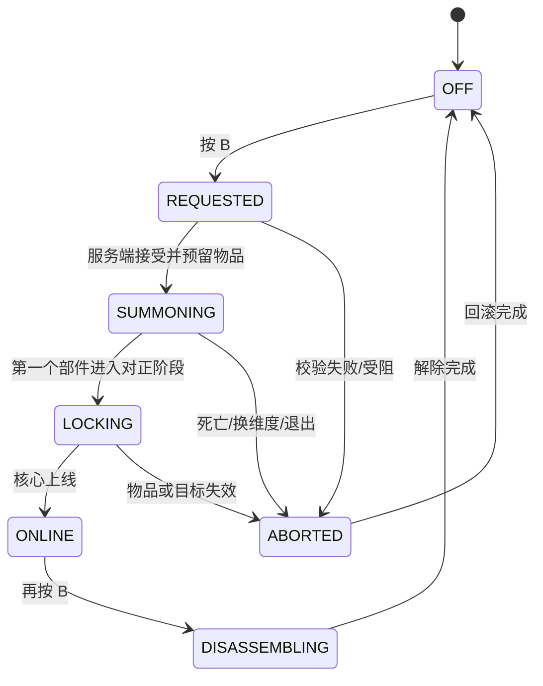

# 分件召回着甲实现可行性分析

> 项目：Flight Armor  
> 目标版本：Minecraft 1.21.1 / Fabric 0.19.3  
> 当前基线：Flight Armor 2.5.1、原生 OBJ 渲染、playerAnimator + bendy-lib  
> 文档日期：2026-07-13

## 1. 分析结论

分件召回着甲可以实现，现有模型和渲染器无需推倒重写。

建议先实现“视觉组装”版本：服务端确认召回后立即将四件装甲写入装备槽，客户端先隐藏模型，再让约 13 个逻辑部件沿不同轨迹飞向角色并逐个锁定。它能达到完整的分件飞来观感，同时规避物品复制、途中掉落、背包占用和断线回滚等高风险问题。

确认视觉方向后，再决定是否升级为“真实分件实体”：每个部件在世界中成为短命实体，真正到达身体后才装备对应物品。这条路线也可行，但开发与测试成本约为视觉组装的 2～3 倍。

推荐结论：

| 项目 | 判断 |
|---|---|
| 技术可行性 | 高 |
| 现有 OBJ 复用率 | 高，103 个分组可以直接归类 |
| 是否必须切换 GeckoLib | 否 |
| 是否需要服务端状态机 | 是 |
| 是否需要新增世界实体 | MVP 不需要；完整版需要 |
| 多人同步难度 | 中等 |
| 真实物品迁移风险 | 高 |
| 推荐先做 | 视觉组装 MVP |

## 2. 目标效果边界

本文讨论的是原创的“分件召回、飞入、对正、吸附、锁定、核心上线”机制，不复刻电影中的具体装甲造型、镜头、声音或商标元素。

目标效果：

- 按 `B` 发起着甲或解除。
- 装甲不是整套瞬间出现，而是战靴、腿甲、胸背甲、手臂、头盔、面甲和核心分阶段到达。
- 左右部件错峰，不完全镜像同步。
- 每个逻辑部件具有独立轨迹、旋转、减速对正和锁定反馈。
- 锁定时触发一次局部发光、粒子和机械吸附声。
- 装甲未完成前不能攻击；完整飞行能力在核心上线后启用。
- 其他玩家看到相同顺序和大致时间点。

暂不纳入第一版：

- 装甲跨区块从基地真实飞到玩家身边。
- 部件可被其他玩家击落或拾取。
- 中途损毁、维修和独立耐久。
- 超远距离导航、绕障和寻路。
- 103 个 OBJ 分组全部成为独立物理实体。

## 3. 当前项目基础

### 3.1 可直接复用

当前已经具备：

- `FlightObjArmorRenderer`：逐 OBJ group 渲染并应用独立变换。
- `ArmorObjMesh.Group`：保存每组中心坐标，可用于绕组中心旋转和缩放。
- `GroupBinding`：可判断装备槽、身体锚点和肢体段。
- `FlightPoseController`：产生统一人物飞行姿态。
- `FlightJointAnimation`：处理人物连续肘膝弯曲。
- `FlightVisualStatePayload`：已经展示了服务端广播与追踪者补发状态的模式。
- 103 个 OBJ 分组：足够拆成头盔、胸背、核心、手臂、腿甲和战靴等逻辑部件。
- 发光组命名规则 `_led`：适合做逐段点亮。

### 3.2 当前限制

Fabric `ArmorRenderer` 的入口依赖角色对应装备槽中的物品。如果装备槽为空，当前 `FlightObjArmorRenderer` 不会获得一次“渲染尚未穿上的装甲”的机会。

这意味着：

- 视觉组装可以继续使用当前 `ArmorRenderer`。
- 真实分件必须增加独立世界渲染器或短命装甲部件实体。
- 仅靠修改现有 `ArmorRenderer` 无法在完全未装备时显示远处飞来的部件。

另一个限制是 `GroupBinding` 目前属于渲染器私有实现，并且多处逻辑依赖组名字符串。着甲系统加入后，应先将分类逻辑抽成共享类，避免飞行变形、攻击、着甲和关节分别维护不同字符串规则。

## 4. 三种实现路线

### 4.1 路线 A：视觉组装

服务端接受召回请求后立即装备装甲；客户端根据组装状态先隐藏全部模型，再让部件飞入。

```text
服务端确认请求
    ↓
立即写入四个 EquipmentSlot
    ↓
同步 assemblyStartTick / sequenceId
    ↓
客户端隐藏全部逻辑部件
    ↓
按时间表逐件飞入、锁定、点亮
    ↓
核心上线后启用完整能力
```

优点：

- 完全复用当前 OBJ 渲染器。
- 不创建额外实体，性能稳定。
- 没有真实物品在途中丢失的问题。
- 多人只需同步一个状态快照。
- 适合快速验证美术和动作。

缺点：

- 数据上装甲已经穿上，只是视觉上尚未完成。
- 需要额外能力门禁，避免着甲途中提前获得护甲、攻击或飞行能力。
- 部件不能真实被击落或阻挡。

可行性：最高，推荐第一阶段采用。

### 4.2 路线 B：独立渲染代理

服务端预留整套物品但暂不写入装备槽；客户端使用独立 `ArmorAssemblyRenderer` 绘制飞行部件。到达时才装备。

优点：

- 数据状态与视觉状态基本一致。
- 不一定需要为每件部件创建真正网络实体。
- 可保持轨迹完全确定并减少实体数量。

缺点：

- 需要在玩家装备层之外增加世界渲染入口。
- 必须为第一人称、第三人称、其他玩家和追踪范围分别处理。
- 服务端仍要维护物品预留和回滚。
- 中途加入追踪范围的客户端必须重建飞行部件位置。

可行性：高，适合视觉组装验证后升级。

### 4.3 路线 C：真实装甲部件实体

服务端创建 `ArmorPieceEntity`。每个实体保存目标玩家、逻辑部件、装配序号和预留物品，到达身体锚点后装备并消失。

优点：

- 部件在世界中真实存在。
- 可做绕行、击落、拦截、损坏和声音衰减。
- 进入追踪范围时可以利用原版实体同步。
- 数据与视觉最一致。

缺点：

- 实体数量、碰撞、区块卸载和网络成本最高。
- 必须处理部件被杀死、目标死亡、目标传送、换维度和目标退出。
- 物品预留与恢复逻辑复杂。
- 真实追踪玩家骨骼锚点仍需客户端渲染插值。

可行性：中高，但不适合直接作为第一版。

## 5. 推荐架构

### 5.1 共享分组分类

新增：

```text
client/render/obj/ArmorGroupClassifier.java
client/render/obj/ArmorGroupBinding.java
assembly/AssemblyPart.java
```

分类结果建议包含：

```java
record ArmorGroupBinding(
    Anchor anchor,
    EquipmentSlot slot,
    LimbSegment limbSegment,
    AssemblyPart assemblyPart,
    MaterialChannel material,
    DynamicChannel dynamicChannel
) {}
```

`FlightObjArmorRenderer.GroupBinding` 应迁移到这里，避免重复解析。

### 5.2 逻辑部件划分

不要让 103 个 OBJ group 各自随机飞行。建议归为 13 个逻辑部件：

| 逻辑部件 | 主要组名前缀/关键词 | 身体锚点 |
|---|---|---|
| LEFT_BOOT | `boot_left_*` | 左脚 |
| RIGHT_BOOT | `boot_right_*` | 右脚 |
| LEFT_LEG | `leg_left_*` | 左腿 |
| RIGHT_LEG | `leg_right_*` | 右腿 |
| TORSO | `body_underlayer/chest/abdomen/collar/waist` | 身体 |
| BACK | `body_backplate/spine`、`vane_*` | 身体 |
| CORE | `core_*` | 身体 |
| LEFT_FOREARM | `arm_left_forearm_*` | 左臂 |
| RIGHT_FOREARM | `arm_right_forearm_*` | 右臂 |
| LEFT_UPPER_ARM | `arm_left_upper_*` | 左臂 |
| RIGHT_UPPER_ARM | `arm_right_upper_*` | 右臂 |
| HELMET_SHELL | `head_shell/crown/brow/temple/rear/neck` | 头部 |
| HELMET_FACE | `visor_*`、`head_faceplate_*`、`head_cheek_*` | 头部 |

同一逻辑部件内部的多个 group 使用相同主轨迹，但允许：

- 发光层延迟 1～2 tick 点亮。
- 外装甲比内衬早锁定或晚锁定 1 tick。
- 面甲最后做一次很短的闭合位移。
- 核心底座、外框和发光棱形分三层上线。

### 5.3 服务端类

```text
assembly/ArmorAssemblyController.java
assembly/ArmorAssemblyState.java
assembly/AssemblyPhase.java
assembly/AssemblyPart.java
assembly/ReservedArmorSet.java

network/ArmorAssemblyRequestPayload.java
network/ArmorAssemblyStatePayload.java
network/ArmorAssemblyEventPayload.java
```

职责：

- 验证玩家是否拥有完整装甲。
- 预留或装备物品。
- 维护开始时间、方向、阶段和锁定 bitmask。
- 拒绝重复请求。
- 处理死亡、退出、传送、换维度和取消。
- 向自身和追踪者同步快照。

### 5.4 客户端类

```text
client/assembly/ArmorAssemblyClient.java
client/assembly/ArmorAssemblyVisualState.java
client/assembly/AssemblyPoseController.java
client/assembly/AssemblySoundController.java
```

职责：

- 根据服务端起始 tick 计算当前进度。
- 计算各逻辑部件局部进度。
- 防止锁定事件重复播放。
- 提供 `assemblyProgress`、`partProgress` 和 `lockedMask` 给渲染器。
- 将接受装甲姿势混入统一 `FlightPoseFrame`。

## 6. 状态机

### 6.1 总状态



### 6.2 单部件状态

```text
HIDDEN
  ↓
IN_FLIGHT
  ↓
ALIGNING
  ↓
LOCKED
```

只有状态从 `ALIGNING` 首次进入 `LOCKED` 时，才播放吸附声、火花和局部点亮。

### 6.3 服务端状态字段

```text
playerId
sequenceId
phase
serverStartTick
duration
lockedPartBitmask
assembling
reservedArmorSet
lastRequestTick
abortReason
```

`sequenceId` 防止旧包和新着甲流程混在一起；`lockedPartBitmask` 使后来加入追踪范围的客户端可以恢复正确状态。

## 7. 时间表与动作设计

建议总时长为 52 tick，约 2.6 秒：

| Tick | 部件 | 动作 |
|---:|---|---|
| 0～8 | 鞋底重力场 | 脚下出现定位光环 |
| 6～13 | LEFT_BOOT | 弧线接近、脚踝对正、锁定 |
| 8～15 | RIGHT_BOOT | 比左侧晚 2 tick |
| 11～19 | LEFT_LEG | 小腿外侧切入 |
| 14～22 | RIGHT_LEG | 右腿错峰 |
| 17～26 | BACK | 从后上方接近并贴合 |
| 20～29 | TORSO | 从前侧减速压入 |
| 22～31 | LEFT_FOREARM | 角色短暂抬起左臂 |
| 25～34 | RIGHT_FOREARM | 右臂稍晚 |
| 27～36 | LEFT_UPPER_ARM | 与肩甲共同对正 |
| 29～38 | RIGHT_UPPER_ARM | 右侧错峰 |
| 30～42 | HELMET_SHELL | 后脑、顶部和耳舱闭合 |
| 37～47 | HELMET_FACE | V 型面甲与目镜闭合 |
| 44～52 | CORE | 底座、外框、发光棱形依次上线 |

人物接受姿势：

- 双脚分开约正常站姿的 1.1～1.2 倍。
- 双臂离身体 15～25°，但左右不完全对称。
- 哪一侧前臂正在锁定，哪一侧手臂短暂抬起。
- 胸背甲锁定时肩部向后打开，腰部保持刚性连接。
- 头盔闭合前抬头约 4°。
- 核心上线后回到普通站立或悬空姿态。

着甲姿态必须最终混入 `FlightPoseFrame`，不能另写一个 TAIL mixin，否则会与当前 `DiveLegPoseMixin` 竞争并再次导致人物与装甲不一致。

## 8. 轨迹与变换

### 8.1 变换顺序

```text
ModelPart.translateAndRotate
模型 1/16 缩放
肘膝关节变换
分件飞入变换
飞行展开变换
攻击后坐/蓄力变换
```

组装优先于飞行展开。处于 `SUMMONING/LOCKING` 时应暂时关闭或压低飞行变形，避免部件一边飞入一边展开。

### 8.2 贝塞尔轨迹

对每个逻辑部件定义局部空间起点与控制点：

```text
P0：角色外侧 12～28 模型像素
P1：略高、略后或略前的弧线控制点
P2：最终装甲位置
```

二次贝塞尔：

```text
B(t) = (1-t)^2 P0 + 2(1-t)t P1 + t^2 P2
```

视觉时间曲线：

```text
0%～72%    快速接近
72%～92%   减速并对正旋转
92%～100%  短促压入，回弹 0.5～1.0 像素
```

旋转可使用球面插值或分别对 XYZ 使用平滑插值。第一版使用欧拉角即可，但所有角度应以确定性 `sequenceId` 生成，不能每帧随机。

### 8.3 起点设计

路线 A 的部件不是真实世界实体，所以起点应是角色局部坐标：

- 战靴：下方外侧。
- 腿甲：侧后方。
- 背甲：头顶后方。
- 胸甲：正前上方。
- 手臂：各自外侧前方。
- 头盔：后上方分片包覆。
- 面甲：正前方最后闭合。
- 核心：胸前短距离压入，不从远处飞来。

这样角色转向时轨迹会跟随角色，MVP 不会出现部件飞向旧坐标的问题。

## 9. 渲染器改造

在 `FlightObjArmorRenderer.renderGroup()` 中增加组装状态：

```java
float partProgress = assembly.partProgress(binding.assemblyPart(), partialTick);

if (partProgress <= 0.0F) {
    return; // 尚未出现
}

applyJointTransform(...);
applyAssemblyTransform(...);
applyDynamicTransform(...);
```

建议接口：

```java
private static void applyAssemblyTransform(
    PoseStack poseStack,
    ArmorObjMesh.Group group,
    ArmorGroupBinding binding,
    ArmorAssemblyVisualState state,
    float partialTick
)
```

发光规则：

- 未锁定：LED 不渲染或只保留非常弱的定位线。
- 对正阶段：对应局部 LED 快速点亮。
- 已锁定：恢复当前速度颜色系统。
- CORE 上线：全套 LED 做一次颜色扫描，但亮度保持高亮。

## 10. 网络同步

Fabric 官方网络文档强调 payload 需要按方向注册，并且服务端必须验证客户端请求。[Fabric Networking](https://docs.fabricmc.net/develop/networking)

1.21.1 项目继续使用：

```java
PayloadTypeRegistry.playC2S().register(...);
PayloadTypeRegistry.playS2C().register(...);
ServerPlayNetworking.registerGlobalReceiver(...);
```

不要每 tick 发送所有部件浮点进度。S2C 快照只需要：

```text
playerId
sequenceId
phase
serverStartTick
duration
lockedPartBitmask
direction
```

客户端用 `serverStartTick` 和固定时间表计算全部轨迹。仅发生以下事件时发包：

- 召回开始。
- 解除开始。
- 流程中止。
- 锁定 bitmask 发生权威变化。
- 新玩家开始追踪该角色。

广播对象使用玩家自身和 `PlayerLookup.tracking(player)`，不向全服无条件发送。

## 11. 物品安全与回滚

### 11.1 视觉组装

物品立即进入装备槽，但能力门禁检查 `AssemblyPhase.ONLINE`：

```text
护甲值              可选择立即生效或 ONLINE 后生效
飞行                CORE 上线后生效
攻击                ONLINE 后生效
速度灯光            对应部件锁定后生效
```

如果要让护甲值也延迟生效，需要额外取消原版装备属性或使用临时无属性展示物品，成本会上升。MVP 建议接受着甲动画期间护甲值提前生效，但严格限制攻击和飞行。

### 11.2 真实迁移

必须有 `ReservedArmorSet`，从开始到结束保持唯一所有权：

- 请求开始时从背包原子性取出整套装甲。
- 任意一件缺失则拒绝开始，不做部分扣除。
- 部件实体不直接持有可拾取的真实 `ItemStack`，避免复制。
- 服务端状态持有预留物品，部件实体只持有逻辑 ID。
- 成功到达时从预留状态转移到装备槽。
- 失败时按固定顺序恢复背包；背包满则生成归属玩家的掉落实体或进入专用恢复槽。
- 断线前保存预留状态，重连后先回滚再允许新请求。

### 11.3 必须处理的中断

| 中断 | 推荐处理 |
|---|---|
| 玩家死亡 | 立即 ABORTED，按死亡掉落规则处理整套预留物品 |
| 换维度 | MVP 取消并完成装备；完整版取消并回滚 |
| 玩家退出 | 保存状态并回滚，禁止旧序列继续 |
| 传送 | 视觉组装跟随；真实实体应取消或重新定位 |
| 目标进入载具 | 拒绝开始或中止 |
| 背包变化 | 预留后不再依赖原背包槽位 |
| 重复按 B | 使用 sequenceId 和最短请求间隔拒绝重放 |

## 12. 多人一致性

服务端只决定：

- 是否允许开始。
- 开始 tick。
- 当前 phase。
- 哪些部件已锁定。
- 是否中止或完成。

客户端决定：

- 连续轨迹插值。
- 粒子数量。
- 声音衰减。
- 轻微回弹和镜头表现。

新客户端中途开始追踪时：

1. 服务端补发完整 `ArmorAssemblyStatePayload`。
2. 客户端根据 `serverStartTick` 直接计算当前进度。
3. 已锁定部件直接显示在最终位置。
4. 正在飞行的部件从当前贝塞尔位置继续，不重播已经完成的声音。

不要依赖客户端从第 0 tick 开始完整播放，否则远端加入、卡顿和短暂离开视距都会导致不同步。

## 13. 性能评估

### 视觉组装

- 仍渲染原有 103 个 group，只增加矩阵变换。
- 不增加实体 tick。
- 网络只在状态变化时发包。
- 预计性能影响较低。

### 独立渲染代理

- 组装期间需要额外渲染若干部件。
- 每位正在组装的玩家约 13 个逻辑变换。
- 可接受，但需要距离裁剪。

### 真实实体

- 每次组装最多 13 个短命实体。
- 多人同时着甲时实体数快速增加。
- 必须限制召回频率、生命周期和追踪距离。
- 不应将 103 个 OBJ group 各自变成实体。

## 14. 是否需要 GeckoLib

[GeckoLib 1.21.1](https://github.com/bernie-g/geckolib/tree/1.21.1)是 MIT 许可证，支持 Fabric、装甲模型、关键帧、并行动画控制器、声音与粒子关键帧。官方提供[装甲渲染说明](https://github.com/bernie-g/geckolib/wiki/Geckolib-Armor-%28Geckolib4%29)和[动画控制器说明](https://github.com/bernie-g/geckolib/wiki/The-Animation-Controller-%28Geckolib4%29)。

适合使用 GeckoLib 的情况：

- 后续由美术人员在 Blockbench 中大量制作装甲骨骼动画。
- 需要面甲、手腕发射器、肩甲等复杂关键帧序列。
- 需要声音和粒子严格跟随动画关键帧。
- 愿意重做当前 OBJ 模型为骨骼模型。

当前不建议立即迁移的原因：

- 现有 103 个 OBJ group 已经能独立变换。
- 现有肘膝、发光和飞行展开全部依赖当前 renderer。
- 迁移会同时影响模型、材质、动作、装备渲染和热重载。
- 分件着甲 MVP 的核心是状态机和轨迹，不是动画库。

结论：先用现有 OBJ 完成 MVP；只有在动作制作效率成为主要瓶颈时，再评估 GeckoLib。

## 15. 可参考的公开实现

### Palladium

[Palladium 原仓库](https://git.threetag.net/ThreeTAG/Palladium)的 1.20 分支包含飞行、悬停、瞄准、连续能量束、能量槽、自定义投射物、GeckoLib 装甲和装甲动画 controller。

可参考的相邻能力：

- 飞行中瞄准姿态。
- 掌心/胸口光束锚点。
- 装甲 animation controller 触发。
- 自定义投射物 renderer。
- 装甲槽遍历和能力状态。

其[仓库许可证](https://git.threetag.net/ThreeTAG/Palladium/src/branch/1.20/main/LICENSE)为 GPL-3.0，目标版本是 1.20.1；公开分发页另显示 All Rights Reserved，许可元数据存在不一致。建议只研究架构并独立实现，除非获得作者明确许可。

### GeckoLib

GeckoLib 1.21.1 可直接作为动画技术备选，但没有现成的“分件召回着甲”完整流程，需要自行实现状态机、部件实体和装备迁移。

### 旧 Iron Man 项目

- [Iron-Man-Reborn](https://github.com/Redstoneguy129/Iron-Man-Reborn)：Forge 1.15.2，MPL-2.0，规模很小。
- [IronManMod/IronMan](https://github.com/IronManMod/IronMan)：Forge 1.7.2，架构过旧。

两者迁移到 Fabric 1.21.1 的成本高于基于当前工程重写，不能作为主实现。

## 16. 分阶段实施计划

### 阶段 0：分类重构

- 抽出 `ArmorGroupClassifier`。
- 为 103 个 group 建立 13 个逻辑部件映射。
- 保证现有飞行、发光和肘膝效果无回归。

验收：同一 JAR 外观与 2.5.1 一致，只改变内部分类结构。

### 阶段 1：五部件视觉验证

只实现：

```text
LEFT_BOOT → TORSO → RIGHT_FOREARM → HELMET_FACE → CORE
```

- 按 `B` 开始。
- 部件从预设方向飞入。
- 每件有一次锁定声和 LED。
- 人物进入接受装甲姿态。

验收：确认轨迹、速度、镜头和整体风格。

### 阶段 2：完整视觉组装

- 扩展到 13 个逻辑部件。
- 加入左右错峰。
- 加入服务端状态与多人补发。
- 核心上线后解锁飞行与攻击。

### 阶段 3：解除与中断

- 反向解除动画。
- 死亡、退出、换维度和重复请求处理。
- 新追踪者状态恢复。

### 阶段 4：评估真实迁移

- 选择独立渲染代理或 `ArmorPieceEntity`。
- 实现 `ReservedArmorSet`。
- 加入背包回滚和断线恢复。
- 再决定是否允许部件被击落。

## 17. 工作量评估

以下估算假设由熟悉当前代码的人开发，不包含重新设计整套装甲美术：

| 阶段 | 预计工作量 | 风险 |
|---|---:|---|
| 分类重构 | 0.5～1 天 | 低 |
| 五部件视觉验证 | 1～2 天 | 中 |
| 完整 13 部件视觉组装 | 2～4 天 | 中 |
| 多人同步与中断 | 1～3 天 | 中高 |
| 独立渲染代理 | 3～6 天 | 高 |
| 真实部件实体与物品回滚 | 5～10 天 | 高 |
| 美术、声音与动作反复打磨 | 不固定 | 高 |

真正影响周期的通常不是贝塞尔轨迹代码，而是部件顺序、人物接受姿势、声音节奏、第一/第三人称差异和中断场景测试。

## 18. MVP 验收标准

- 按 `B` 后不会整套瞬间出现。
- 五个验证部件按顺序飞入并准确贴合身体。
- 部件飞行过程中不跟身体脱节或飞向旧位置。
- 左右动作不完全同步。
- 人物皮肤、弯肘和装甲关节一致。
- 每个锁定音效和粒子只触发一次。
- 组装未完成时不能攻击或启动完整飞行。
- 其他玩家看到相同顺序。
- 中途死亡、换维度或退出不会复制装甲。
- 重新进入追踪范围时不会从头播放。

## 19. 最终建议

立项可行，推荐立即采用路线 A 做最小验证：先完成分组分类，再实现五个逻辑部件的视觉召回。这个阶段不需要 GeckoLib、不需要真实装甲实体，也不需要改造物品系统。

只有在五部件版本的观感确认后，才扩展到完整 13 部件和多人同步；只有明确需要“部件能被阻挡、击落或途中损坏”时，才值得投入路线 C 的真实实体和物品回滚系统。
