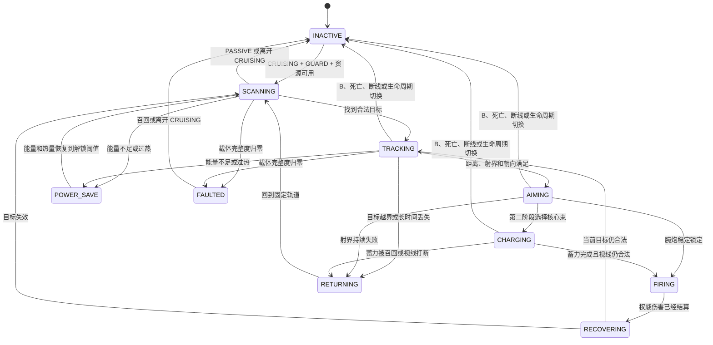

# 巡航战甲自主战斗实现设计

> 项目：Flight Armor / Minecraft 1.21.1 / Fabric 0.19.3  
> 文档日期：2026-07-16  
> 当前代码基线：2.12.0，巡航腕炮最小闭环已接入  
> 文档状态：MVP 开发验证版，代码与构建已完成，仍待游戏内验收和正式战斗载体  
> 关联文档：[战甲独立巡航与整甲召回实现文档](战甲独立巡航与召回着甲实现文档.md)、[凌空战甲武器系统现状与实现设计 v2](战甲武器系统现状与实现设计-v2.md)

## 0. 2.12.0 实现落地状态

本轮已经完成可运行的腕炮最小闭环：

- 新部署默认保持 `PASSIVE`，玩家按 `H` 才会切换为 `GUARD`；
- 模式命令同时校验 owner、巡航 `sequenceId` 和载体 UUID，旧实例延迟包不会关闭新巡航；
- 服务端每 5 tick 扫描锚点区域，只选择敌对生物或正在攻击 owner 的生物；
- 载体完成转向、6 tick 稳定瞄准后，左右腕部交替发射权威反重力脉冲；
- 方块、友军和 owner 宠物会遮挡射线但不会受伤，也不会扣除本次攻击资源；
- 玩家与独立战甲共用能量、热量、过热、腕炮冷却和左右腕切换，开火后保留 20 tick 恢复延迟；
- 水下判定跟随载体，锁敌范围与水下腕炮 20 格射程一致；
- 搜索、瞄准、开火和冷却分别使用高亮蓝、紫、白红和青绿色灯光，并复用载体位置的腕炮声音与原创几何 FX；
- `B` 召回、相位化、死亡、掉线、载体卸载、异常归还和着装提交都会停火并清理运行态；
- 网络、服务端、客户端和模型边界校验已通过完整 Gradle 构建。

当前仍属于开发验证版：尚未加入可受击的正式巡航实体、完整度/失能系统、威胁账本、侧移拦截、巡航核心束、配置化 PVP，以及多人延迟和故障注入的实机验收。下文保留完整正式方案，未勾选的验收项不能视为已经通过。

## 1. 设计结论

巡航战甲自主战斗可以实现，但不能把当前玩家的 `R/G` 按键攻击函数直接调用一次。当前武器系统把“攻击者、瞄准视线、装备资格、姿势、网络追踪和伤害归属”全部绑定在 `ServerPlayer` 上；独立巡航载体则是一个持有四件真实物品、围绕固定锚点移动的 `ArmorStand`。两者需要通过一个新的“战斗发射源”抽象衔接。

本设计采用以下原则：

1. `ArmorCruisePhase` 继续只管理物品与生命周期，不加入 `ATTACKING` 之类的新阶段。
2. 自主战斗使用正交的 `CruiseCombatMode + CruiseCombatBehavior` 子状态机，且只允许在 `CRUISING` 中运行。
3. 默认模式为 `PASSIVE`。玩家明确切换到 `GUARD` 后，战甲才会自主寻找目标。
4. 第一阶段只开放腕部反重力脉冲，对敌对生物进行有限范围点射；核心束在第二阶段加入，俯冲重力冲击不提供给巡航载体。
5. 玩家穿戴武器与巡航武器共用 owner 唯一的能量、热量、过热和冷却账本，部署与召回都不能复制或刷新资源。
6. 目标、命中、伤害、能耗、移动与攻击时序全部由服务端决定，客户端只发送模式切换意图并播放权威表现。
7. `B` 召回、死亡自返、折跃、贴合、断线和停服永远高于战斗；进入这些路径时先取消攻击，再执行原有物品事务。
8. 自主 PVP 默认关闭。不开启服务器配置时，巡航战甲绝不主动搜索或攻击玩家。
9. 战斗逻辑不得移动、复制、丢弃或修改载体内的四件 `ItemStack`。

第一轮可交付闭环为：

```text
完整穿戴 -> B 部署 -> PASSIVE 固定区域巡航
                         |
                         H 明确切换 GUARD
                         v
          搜索敌对生物 -> 拦截/侧移 -> 稳定瞄准 -> 腕炮点射
                 ^                                      |
                 +-------- 冷却/散热/返航 --------------+

任意时刻 B / 死亡 / 断线 / 非 CRUISING
  -> 原子取消目标与攻击表现
  -> 进入现有召回、OWNER_DOWN、PHASING 或 DOCKING 流程
```

## 2. 当前实现基线与缺口

### 2.1 已有基础

| 能力 | 当前状态 | 可复用方式 |
|---|---|---|
| 固定区域巡航 | 已实现 | 继续以 `patrolAnchor` 为唯一警戒中心，不改成跟随主人 |
| owner 到唯一载体 | 已实现 | `CruiseState`、`sequenceId` 和载体 UUID 作为所有战斗请求的身份门禁 |
| 四件物品唯一持有 | 已实现 | 继续由载体装备槽持有，战斗状态不接触物品槽 |
| 区块票据 | 已实现 | 主人在线时维持载体附近 tick，自主搜索不得额外创建每目标票据 |
| 召回、折跃、死亡自返、贴合 | 已实现 | 所有这些阶段进入前统一取消巡航战斗 |
| 腕炮、核心束、俯冲冲击 | 玩家版本已实现 | 复用伤害参数、资源概念、特效几何和声音，不复用玩家视线入口 |
| 服务端权威命中 | 已实现 | 抽出与发射者无关的射线解析器后复用 |
| 能量、热量、冷却持久化 | 已实现 | 从玩家攻击控制器中抽成 owner 唯一资源端口 |
| 目标友敌过滤 | 已有基础 | 抽出 owner 与物理发射源两个概念后扩展 |
| 自定义世界几何特效 | 已实现 | 使用载体真实腕口/核心起点和服务端端点 |

### 2.2 不能直接复用的部分

当前代码存在以下硬绑定：

- `ArmorCombatGate` 要求玩家存活、完整穿戴，并在存在活动巡航时返回 `CRUISE_ACTIVE`。
- `CombatRaycast` 从玩家眼睛、姿势和近似腕口/胸口计算射线。
- `CombatTargetPolicy` 的攻击者参数是 `ServerPlayer`。
- `ModDamageTypes` 把 direct entity 与 causing entity 都设置为玩家。
- `ArmorCombatVisualStatePayload` 与 `AttackPoseController` 面向玩家模型，而不是巡航载体。
- 武器 FX 当前按攻击玩家的追踪者广播，本地第一人称还会修正玩家炮口。
- 当前巡航 payload 只包含 owner、sequence、生命周期阶段和载体身份，没有目标与攻击阶段。
- 当前原版 `ArmorStand` 适合做安全物品载体，但没有可信的战甲耐久、受击和敌对仇恨模型。

因此不能采用下面这种实现：

```text
错误方案：构造一个假玩家 -> 调用 handleIntent() -> 让 ArmorStand 播动画
```

这会造成瞄准起点错误、装备门禁错误、伤害归属错误、网络追踪缺失，并可能复制 owner 的战斗运行态。

## 3. 功能范围与玩家操作

### 3.1 战斗模式

```java
public enum CruiseCombatMode {
    PASSIVE,
    GUARD
}
```

| 模式 | 行为 | 是否主动攻击 |
|---|---|---:|
| `PASSIVE` | 保持当前固定区域悬浮巡航，只播放常态声光 | 否 |
| `GUARD` | 在固定锚点周围警戒、拦截并攻击合法敌对目标 | 是 |

`AGGRESSIVE`、跟随主人作战、指定位置进攻和自动 PVP 暂不进入第一版。它们不是简单增加一个枚举值，而是会改变目标权限、追击半径和服务器滥用边界。

### 3.2 默认按键

- `B`：维持现有语义，部署或召回整甲。
- `Ctrl+B`：维持现有整套收起语义。
- 新增可重绑定的 `H`：仅在存在活动巡航时切换 `PASSIVE / GUARD`。

客户端发送的只是一条模式切换意图。服务端必须验证：

1. 请求者就是 owner；
2. owner 仍在线且不是旁观者；
3. payload 中的 `sequenceId` 与当前活动巡航一致；
4. 当前载体 UUID 与服务端状态一致；
5. 当前生命周期是 `CRUISING`；
6. 请求通过限频；
7. 服务器配置允许自主战斗。

模式切换成功后显示一次动作栏消息：

```text
巡航战甲：被动巡航
巡航战甲：锚点守卫已启用
```

为了避免部署后意外伤害生物，每次新部署、重启恢复和故障恢复都进入 `PASSIVE`。第一版不自动恢复上次的 `GUARD` 活动状态。

## 4. 双层状态机

### 4.1 生命周期状态保持不变

`ArmorCruisePhase` 继续只有：

```text
IDLE / CRUISING / RECALLING / PHASING / OWNER_DOWN / DOCKING
```

这些状态决定四件物品在哪里、载体是否存在以及是否正在交接。自主战斗不能改变这组含义。

### 4.2 自主战斗行为状态

```java
public enum CruiseCombatBehavior {
    INACTIVE,
    SCANNING,
    TRACKING,
    AIMING,
    CHARGING,
    FIRING,
    RECOVERING,
    RETURNING,
    POWER_SAVE,
    FAULTED
}
```

电源与故障原因单独同步，避免把低能量、过热和结构失能都塞进同一个 `POWER_SAVE` 外观：

```java
public enum CruisePowerCondition {
    NORMAL,
    LOW_ENERGY,
    OVERHEATED,
    FAULTED
}
```

`POWER_SAVE + LOW_ENERGY` 使用琥珀灯，`POWER_SAVE + OVERHEATED` 使用红橙散热灯；完整度归零则使用 `FAULTED + FAULTED`，且不会通过自动回能自行解除。

| 行为 | 目的 | 允许开火 |
|---|---|---:|
| `INACTIVE` | 非守卫模式或非 `CRUISING` | 否 |
| `SCANNING` | 沿固定巡航轨迹低频搜索目标 | 否 |
| `TRACKING` | 保持锚点约束，移动到有射界的位置 | 否 |
| `AIMING` | 稳定朝向与腕口，连续验证视线和友军遮挡 | 否 |
| `CHARGING` | 第二阶段核心束蓄力 | 否 |
| `FIRING` | 已完成一次服务端权威攻击，短暂播放后坐 | 已结算一次 |
| `RECOVERING` | 武器回位、独立冷却和重新扫描 | 否 |
| `RETURNING` | 目标失效或越界，返回锚点巡航轨道 | 否 |
| `POWER_SAVE` | 能量不足或过热，只返航、回能与散热 | 否 |
| `FAULTED` | 正式载体完整度归零，武器离线但仍可召回 | 否 |

### 4.3 状态关系



### 4.4 生命周期与战斗状态矩阵

| 巡航阶段 | 自主扫描 | 保留目标 | 开火 | 处理原则 |
|---|---:|---:|---:|---|
| `CRUISING + PASSIVE` | 否 | 否 | 否 | 原固定轨迹 |
| `CRUISING + GUARD` | 是 | 是 | 是 | 运行完整子状态机 |
| `RECALLING` | 否 | 否 | 否 | 召回优先，立即取消攻击 |
| `PHASING` | 否 | 否 | 否 | 不允许折跃中蓄力或延迟命中 |
| `OWNER_DOWN` | 否 | 否 | 否 | 主人死亡后只守护物品 |
| `DOCKING` | 否 | 否 | 否 | 贴合期间只播放着装动画 |
| `IDLE` | 否 | 否 | 否 | 没有活动载体 |

## 5. 目标发现与威胁选择

### 5.1 搜索边界

第一版建议参数：

| 参数 | 默认值 | 说明 |
|---|---:|---|
| 搜索间隔 | 5 tick | 不在每个服务端 tick 扫描世界实体 |
| 搜索半径 | 20 格 | 以固定 `patrolAnchor` 为中心 |
| 最大候选数 | 32 | 先按距离收窄，再计算威胁 |
| 软追击半径 | 22 格 | 超出后优先返航 |
| 硬脱战半径 | 26 格 | 无条件清除目标，禁止被引走 |
| 失去视线保持 | 20 tick | 期间只调整位置，不开火 |
| 目标迟滞奖励 | 160 分 | 防止两个距离相近的目标每次扫描来回切换 |
| 敌对行为记忆 | 100 tick | 只保存在内存，不写入存档 |

搜索半径永远绑定部署锚点，不能绑定主人当前位置。这样战甲仍然是真正的固定区域独立巡航，不会重新变成贴身跟随宠物。

### 5.2 第一版可选目标

按优先级允许：

1. 当前正在攻击 owner 或巡航载体的敌对生物；
2. 最近 100 tick 内伤害过 owner 或载体、且仍在警戒区内的合法实体；
3. 实现 `Enemy` 标记或明确属于敌对阵营的活体生物；
4. 已经对 owner 产生仇恨的中立生物。

默认排除：

- owner 本人；
- 同队玩家和服务器判定的盟友；
- owner 的驯服生物；
- 其他玩家的驯服生物，除非服务器明确允许；
- 村民、铁傀儡、雪傀儡和被动动物；
- 死亡、旁观、不可攻击或正在换维度的实体；
- 所有巡航战甲载体；
- 隔墙且无法通过移动取得射界的目标；
- 锚点硬边界之外的目标。

硬过滤顺序必须固定为“绝对排除优先、威胁证据其次”。第一版中村民、被动动物、owner/盟友宠物、铁傀儡和雪傀儡属于绝对排除项；即使铁傀儡正在攻击 owner，也不会被巡航战甲自动反击，玩家仍可用手动武器处理。这样不会因为不同实现者先检查仇恨还是先检查实体类型而得到相反结果。

不能直接使用当前 `CombatTargetPolicy.canDamage()` 作为自动搜索谓词。它适合“玩家已经明确瞄准并按下攻击键”之后判断能否伤害，但会允许很多普通可攻击生物；自主系统必须采用更严格的候选策略。

### 5.3 PVP 规则

默认配置：

```text
allowAutonomousPvp = false
```

关闭时，玩家永远不是自主搜索目标，即使服务器开启了 PVP。

以后若启用，只允许“有限反击”：

- 对方玩家最近主动伤害过 owner 或载体；
- 服务器 PVP 已开启；
- `owner.canHarmPlayer(target)` 为真；
- 双方不在同队且没有友伤保护；
- 对方不是创造模式或旁观模式；
- 目标仍在锚点硬边界内；
- 反击记忆最多 100 tick，不形成永久仇恨。

第一版不提供“自动搜索附近所有玩家”的侵略模式。

### 5.4 威胁评分

候选通过硬过滤后计算服务端分数：

```text
正在攻击载体             +1000
最近伤害 owner            +800
正在攻击 owner             +600
当前已经锁定的目标         +160
普通敌对生物               +120
有直接视线                 +80
每远离锚点 1 格            -6
每远离载体 1 格            -2
失去视线每 tick            -4
```

最高分目标只有比当前目标高至少 120 分时才允许抢占，紧急保护事件除外。目标 UUID 只保留在运行内存中；实体死亡、卸载、换维、转为友军或越过硬边界时立即失效。

### 5.5 威胁事件来源

新增 `CruiseThreatLedger`，只保存 owner 当前在线会话内的短期威胁记录。它通过 Fabric `ServerLivingEntityEvents.AFTER_DAMAGE` 记录非致命伤害，并通过 `AFTER_DEATH` 补齐致命伤害路径；`AFTER_DAMAGE` 本身不会在目标被本次伤害杀死时触发，因此两者缺一不可。

记录时按 `DamageSource` 归一化：

```text
逻辑攻击者 = source.getEntity()       // causing entity，优先用于权限和 owner 归属
直接来源   = source.getDirectEntity() // 弹丸、载体或其他直接实体
```

- owner 受到伤害：把逻辑攻击者记为 owner 的威胁；
- owner 主动伤害其他实体：可把受击实体记为“owner 最近交战对象”，但仍需通过绝对排除和友敌规则；
- 载体受到伤害：正式自定义载体阶段才记录攻击者；
- 投射物伤害按 causing entity 归一，不能把箭、火球 UUID 当成长期目标；
- 记录最多保留 100 tick，目标死亡、换维、卸载或失去合法资格时惰性清理；
- owner 断线、死亡、巡航 sequence 改变时整表清空。

当前受保护 ArmorStand 不会产生可信的“载体实际受伤”事件，因此阶段 2 的最小验证版禁用“最近伤害载体”这一评分项；只有正式战斗载体接入受击后才启用。

## 6. 移动、拦截与射界

### 6.1 不使用原版生物 Goal AI

巡航载体已经采用服务端手动位置控制。自主战斗继续沿用该模式，不把 ArmorStand 塞进 `GoalSelector`，也不创建寻路生物 AI。

新增 `CruiseCombatNavigation`，每次思考只输出运动意图：

```java
record CruiseMotionIntent(
        Vec3 targetPosition,
        float targetYaw,
        float targetPitch,
        MotionStyle style
) {}
```

最终位移、区块票据和异常坐标保护仍由 `ArmorCruiseController` 执行，战斗控制器不能直接迁移维度或删除载体。

当前载体配置为 `noPhysics = true`，现有 `moveCarrier()` 又通过 `setPos()` 直接移动，因此仅验证候选终点不等于不会穿过薄墙。自主战斗接入时必须在最终移动层新增扫掠检查：对“当前位置到下一位置”的线段做方块裁剪，并沿位移构造 swept AABB；只有整段安全且下一帧 AABB 通过 `level.noCollision()` 才能提交位置。失败时把下一位置截断到碰撞面前的安全距离，清零本 tick 位移并重新选位，不能继续调用无检查的直接 `setPos()`。

### 6.2 交战站位

腕炮建议保持：

- 理想距离：8～12 格；
- 最小安全距离：3 格，过近时向后上方侧移；
- 最大开火距离：24 格，小于玩家手动腕炮的 28 格；
- 追踪最大速度：0.24 格/tick；
- 瞄准微调速度：0.10 格/tick；
- 返回轨道速度：0.18 格/tick。

每次选位围绕目标生成最多 8 个水平候选点和 3 个高度层，依次检查：

1. 候选点没有越过锚点硬边界；
2. 载体碰撞盒在候选点无方块碰撞；
3. 当前点到候选点的移动线段没有穿过实心方块；
4. 候选点到目标瞄准点具有方块视线；
5. 腕口到目标之间没有友军或宠物遮挡；
6. 候选点与目标距离处于武器有效范围。

没有合法候选点时保持在锚点侧，不穿墙追击；连续 20 tick 无射界后进入 `RETURNING`。

### 6.3 瞄准稳定条件

腕炮开火前必须连续满足至少 6 tick：

- 目标仍合法；
- 方块视线有效；
- 最近物理实体就是该目标，不能穿过友军；
- 航向误差不超过 6°；
- 俯仰误差不超过 7°；
- 载体位置变化低于瞄准阈值；
- 资源和冷却允许；
- owner 与载体身份仍匹配。

任何一项失败都会清零稳定计时。客户端不能伪造“已瞄准完成”。

## 7. 武器选择与攻击规则

### 7.1 第一阶段：腕部反重力脉冲

第一阶段只实现腕炮点射：

| 参数 | 自主版本建议值 |
|---|---:|
| 射程 | 24 格 |
| 伤害 | 6 点，复用当前腕炮基础伤害 |
| 能耗 | 10，水下 12 |
| 热量 | 12 |
| 自主冷却 | 至少 12 tick |
| 瞄准稳定 | 6 tick |
| 发射手 | 左右交替 |
| 同一目标最大连续点射 | 3 发后强制重新评估 |

自主冷却比玩家手动腕炮更长，避免守卫模式变成无人高速炮塔。它与 owner 现有腕炮冷却取较晚值：

```text
effectiveCooldownUntil = max(sharedWristCooldownUntil, now + autoWristCooldown)
```

当前 `ArmorCombatSavedData` 会把腕炮剩余冷却限制在玩家的 8 tick 上限；若直接写入自主 12 tick，重启后会被缩短回 8 tick。实现时必须把持久化上限改为：

```text
MAX_PERSISTED_WRIST_COOLDOWN = max(PLAYER_WRIST_COOLDOWN, AUTO_WRIST_COOLDOWN) = 12
```

玩家手动开火仍写入 8 tick，自主腕炮写入 12 tick；保存、加载和构造 `Entry` 的 clamp 都使用 12 tick 上限。这样载体开火后立刻召回或重启，玩家仍会继承真实剩余冷却，不会凭生命周期切换缩短它。

### 7.2 第二阶段：核心蓄力束

核心束只在腕炮闭环稳定后加入，建议触发条件全部满足：

- 目标最大生命值或当前生命值较高；
- 目标连续锁定至少 30 tick；
- 目标距离为 14～32 格；
- 能量至少 45；
- 热量不高于 35；
- 腕口射界连续失败但核心射界成立，或者目标被判定为高威胁；
- owner 没有发起召回或模式切换。

自主核心束固定蓄力 18 tick，不追求满蓄力；蓄力期间每 tick 重新验证目标、方块视线、友军遮挡和生命周期。任何失败都取消，不扣完整释放能量，也不产生伤害。

核心束释放后强制进入较长 `RECOVERING`，并重新扫描，不能连续黏住同一个目标无限蓄力。

### 7.3 不提供给巡航载体的攻击

- 俯冲重力冲击：当前载体无可靠地面接触、碰撞和落地速度语义，禁用。
- 自动导弹和追踪弹：当前没有弹丸所有权与防误伤设计，禁用。
- 地形破坏：所有自主武器都不能破坏方块。
- 持续逐 tick 光束：第一版仍采用一次性服务端结算。

## 8. 通用发射源与命中解析

### 8.1 发射源抽象

新增不依赖玩家模型的上下文：

```java
enum ArmorWeaponSourceKind {
    PLAYER,
    CRUISE_CARRIER
}

record ArmorWeaponSource(
        UUID ownerId,
        ServerPlayer owner,
        Entity physicalSource,
        ArmorWeaponSourceKind kind,
        long cruiseSequenceId
) {}
```

- `owner` 决定权限、队伍、PVP、统计和资源账本；
- `physicalSource` 决定世界位置、腕口、核心位置、声音和直接伤害来源；
- `kind` 决定人物姿势还是巡航载体姿势；
- `cruiseSequenceId` 防止旧载体或迟到任务开火。

### 8.2 射线解析器

把现有玩家专用 `CombatRaycast` 的共通部分抽为：

```java
CombatShotResult cast(
        ServerLevel level,
        ArmorWeaponSource source,
        Vec3 origin,
        Vec3 desiredEndpoint,
        double range,
        CombatAffiliationPolicy policy
)
```

巡航腕炮的终点不是简单使用目标坐标。服务端仍要：

1. 从目标碰撞盒选取胸口或眼部瞄准点；
2. 从腕口到瞄准点做方块裁剪；
3. 在裁剪后的线段上寻找最近可遮挡实体；
4. 若最近实体是友军，则本 tick 禁止开火；
5. 若最近实体不是锁定目标，则重新评估目标；
6. 只有命中资格通过后才伤害、扣能量、加热并广播 FX。

### 8.3 武器锚点

第一版允许服务端使用载体碰撞盒和 yaw/pitch 计算近似锚点：

```text
左腕口 = 载体胸口 + forward * 0.24 - right * 0.36 + up * 0.18
右腕口 = 载体胸口 + forward * 0.24 + right * 0.36 + up * 0.18
核心口 = 载体胸口 + forward * 0.27 + up * 0.04
```

之后应把 OBJ 的腕部与核心 group 变换抽成共享 `ArmorEmitterAnchorResolver`。视觉起点可以更精细，但服务端端点和命中结果不能由客户端模型决定。

## 9. 能量、热量、过热与冷却

### 9.1 owner 唯一资源账本

当前项目没有永久 `suitId`，且一个 owner 只能有一个活动巡航载体。因此第一版继续以 owner UUID 作为资源主键，但必须把资源从“玩家攻击运行态”抽成独立端口：

```java
interface ArmorCombatResourcePort {
    ResourceSnapshot snapshot(UUID ownerId);
    ConsumeResult tryConsume(UUID ownerId, ResourceRequest request, long now);
    void tickRecovery(UUID ownerId, RecoveryContext context, long now);
}
```

玩家穿戴与巡航载体只能串行占用同一份账本：

| 所有权状态 | 允许消费资源的发射源 |
|---|---|
| 玩家完整穿戴 | `PLAYER` |
| 活动巡航且 `CRUISING` | `CRUISE_CARRIER` |
| `RECALLING / PHASING / OWNER_DOWN / DOCKING` | 无 |
| 物品不完整或状态异常 | 无 |

部署不会回满，召回不会清热，死亡不会刷新冷却，重启不会复制资源。

资源重构必须兼容现有世界数据名 `flight_armor_combat_resources` 和当前 `DATA_VERSION=2`。迁移后至少完整保留：

```text
energy
heat
overheated
wristCooldownRemaining
coreCooldownRemaining
diveImpactCooldownRemaining
recoveryDelayRemaining
nextLeftHand
```

不能只迁移能量与热量，否则升级会清除恢复延迟、缩短冷却或重置左右手交替。若字段布局改变，将数据版本升级并提供 v2 到新版本的读取兼容；读取失败时也不能把已有玩家静默重置为满能量。

### 9.2 巡航恢复规则

建议第一版：

- `PASSIVE` 或 `SCANNING` 且 20 tick 内未开火：每秒恢复 1 点能量；
- 已有目标的 `TRACKING / AIMING / CHARGING`：不恢复能量；
- owner 在线且生命周期为 `CRUISING` 时，所有非开火战斗状态每秒散热 4 点；
- `FIRING / RECOVERING` 遵守开火恢复延迟；
- 能量低于腕炮最低能耗时进入 `POWER_SAVE`；
- 能量恢复到 25 且热量不高于 60 后才退出 `POWER_SAVE`；
- 过热后立即取消蓄力和目标攻击，只返航、散热，不影响 B 召回。

这些是持续变化，不是部署时重置，因此不会形成反复按 B 刷能量的漏洞。

同一 owner 的资源每个服务端 tick 只能推进一次：玩家穿戴时由 `PLAYER` 恢复上下文推进，活动巡航时由 `CRUISE_CARRIER` 恢复上下文推进；部署与贴合提交必须原子切换推进者。`RECALLING / PHASING / OWNER_DOWN / DOCKING`、owner 离线以及没有合法发射源时，第一版既不回能也不散热，不用第二个控制器重复 tick。服务器运行期间，绝对 `cooldownUntilTick` 仍随统一 combat time 自然到期；离线和停服只保存剩余量，不按现实时间补算。

owner HUD 必须读取同一资源快照。消费资源、进入/解除过热、actor 交接时立即同步；连续回能和散热最多每 5 tick 同步一次。可以新增统一的 `ArmorCombatResourceStatePayload`，也可以兼容性重构现有 owner state，但不能让玩家 HUD 在巡航开火后继续显示旧能量和旧热量。

### 9.3 actor 锁

资源状态需要增加瞬时 `activeSourceKind + activeSourceId + sourceRevision`。每次消费前比较：

```text
owner 唯一账本当前授权给谁
  == 本次开火的物理发射源
  == 当前巡航 state 中的载体
  == 当前 sequenceId
```

任何不匹配都拒绝，不允许旧载体、迟到任务或重复 payload 消费资源。

actor 锁交接协议：

| 事件 | 锁变化 |
|---|---|
| 玩家正常完整穿戴 | acquire `PLAYER(player UUID)`，revision++ |
| 部署事务完成、载体已持有四件后 | release PLAYER，再 acquire `CRUISE_CARRIER(carrier UUID)`，revision++ |
| B 开始召回或进入 PHASING | release carrier 到 `NONE`，revision++ |
| DOCKING 最终四件提交成功 | acquire `PLAYER`，revision++ |
| 死亡、OWNER_DOWN、断线、停服或载体异常 | release 到 `NONE`，revision++ |
| 重启恢复 | 先为 `NONE`；验证 owner、sequence、载体和四件完整后才重新 acquire |

释放和获取必须发生在相同服务端事务边界，且每次都增加 `sourceRevision`。旧攻击回调看到 revision 不同便直接取消；不能让旧 `activeSourceId` 导致召回后的玩家武器永久被拒绝。

`nextLeftHand` 只由资源消费事务原子读取并翻转。`CruiseCombatState.activeLeftHand` 只是记录本次已经选定的发射手，用于动画与 FX，不能由巡航控制器再独立切换一次。

## 10. 伤害归属、仇恨与友伤

### 10.1 DamageSource

玩家手动攻击继续使用：

```text
direct entity  = player
causing entity = player
```

巡航攻击应使用：

```text
direct entity  = cruise carrier
causing entity = owner player
```

这样 `DamageSource` 的直接来源属于载体，击杀统计和主要责任仍归 owner；真实命中位置仍由 `CombatShotResult` 与 FX endpoint 保存，不在 `DamageSource` 中。队伍、PVP、宠物和友伤资格必须在 owner 版 `CombatAffiliationPolicy` 中先行判断，不能假设 `DamageSource` 会自动完成这些规则。若 owner 已离线、死亡、旁观或不存在，则自主战斗暂停，不创建无归属伤害。

owner 与载体不在同一维度时不得攻击。按照当前生命周期实现，owner 换维会立即取消战斗并让载体进入 `PHASING`，随后在 owner 所在维度重入并继续召回；不会让旧维度中的战甲继续产生跨维度 `DamageSource`、仇恨或统计。

### 10.2 生物仇恨

命中后不能强制所有生物把仇恨设给 owner。建议规则：

- 可攻击载体的敌对生物优先把载体视为直接威胁；
- 当前还是受保护 ArmorStand 的最小验证版，不主动改写目标 AI；
- 升级自定义战斗载体后，再让生物正常反击载体；
- 不把距离很远的 owner 强制设为生物目标，避免怪物无意义寻路。

### 10.3 友军遮挡

友军虽然不可受伤，但默认仍会阻挡腕炮和核心束。战甲应侧移寻找新射界，而不是让光束穿过队友命中后方目标。服务器以后可提供“完全忽略友军遮挡”配置，但默认关闭。

## 11. 载体、耐久与物品安全

### 11.1 当前 ArmorStand 的适用边界

现有受保护 ArmorStand 可以完成第一轮“扫描、瞄准、腕炮发射”的最小验证，因为它已经：

- 持有四件真实物品；
- 无重力并由服务端手动移动；
- 有唯一 owner 标签和持久定位索引；
- 复用完整 OBJ 战甲渲染；
- 拦截普通玩家交互和攻击。

但它不适合作为最终公开的自主战斗实体：无敌炮塔无法公平受击，ArmorStand 的破坏逻辑也不适合直接承载战甲耐久和安全回收。

### 11.2 推荐的正式载体

正式启用自主战斗前，建议注册 `CruiseArmorEntity`。它可以复用 ArmorStand 的装备槽和姿势能力，但使用自定义实体类型、持久 owner 字段、战甲完整度和受击规则；移动仍由本模组控制，不使用原版 Goal AI。

正式载体必须满足：

- 四件物品仍只有一个权威容器；
- 普通死亡不掉落四件战甲；
- 受击只修改战甲完整度，不直接执行原版盔甲架破坏流程；
- 完整度归零进入 `FAULTED`，先取消战斗，再进行紧急召回或原地安全待机；
- 载体异常移除前先走现有事务恢复；
- 存档恢复时能从旧 ArmorStand 安全迁移，迁移失败则保留旧载体，不复制物品；
- 自定义实体 UUID、owner、sequence 与巡航索引一致。

### 11.3 物品安全不变量

巡航战斗代码永远禁止：

- `setItemSlot()`；
- `discard()`；
- `changeDimension()`；
- 创建战甲 `ItemStack.copy()` 作为实际物品；
- 修改 `ArmorCruiseSavedData` 的载体定位；
- 在延迟回调里跳过 owner、sequence 和 carrier UUID 校验。

每次开火前必须确认：

```text
STATES[owner] 仍是同一个 state
phase == CRUISING
mode == GUARD
sequenceId 匹配
carrier UUID 匹配且实体可用
载体仍完整持有四件战甲
owner 在线、存活、非旁观
资源 actor 锁匹配
```

战斗失败只清理战斗子状态，不能触发物品归还事务。物品移动仍只能发生在现有部署、贴合提交、异常回收和死亡接管路径中。

## 12. 服务端模块划分

建议新增或重构：

| 模块 | 职责 |
|---|---|
| `CruiseCombatMode` | `PASSIVE / GUARD` 网络稳定枚举 |
| `CruiseCombatBehavior` | 自主战斗子状态机枚举 |
| `CruisePowerCondition` | 低能量、过热和结构故障的表现/门禁原因 |
| `CruiseCombatState` | 目标、计时、瞄准、当前武器与表现 revision |
| `ArmorCruiseCombatController` | 扫描、威胁评分、状态推进和开火调度 |
| `CruiseThreatLedger` | 从服务端实际伤害事件维护 100 tick 威胁证据 |
| `CruiseCombatNavigation` | 锚点约束、候选站位、射界和运动意图 |
| `CruiseCarrierAccess` | 隔离 vanilla ArmorStand 与正式自定义载体的装备、身份和移动访问 |
| `ArmorWeaponSource` | owner 与物理发射源分离 |
| `ArmorCombatResourcePort` | owner 唯一能量、热量和冷却事务 |
| `CombatAffiliationPolicy` | PVP、队伍、宠物、盟友与巡航载体规则 |
| `CombatShotResolver` | 与玩家姿势无关的方块/实体射线解析 |
| `ArmorEmitterAnchorResolver` | 玩家与载体腕口/核心锚点 |
| `CruiseCombatTuning` | 自主搜索、追击、瞄准和频率硬参数 |

主调用关系：

```text
ArmorCruiseController.tickServer
  -> 确认载体、owner、物品与 lifecycle 安全
  -> phase == CRUISING ? ArmorCruiseCombatController.tick(context) : cancelCombat()
  -> 得到 CruiseMotionIntent
  -> ArmorCruiseController 执行最终移动与 ticket 更新

ArmorCruiseCombatController
  -> 目标扫描 / 状态推进
  -> CombatShotResolver
  -> ArmorCombatResourcePort.tryConsume
  -> DamageSource + 权威伤害
  -> 广播 combat visual + FX
```

`ArmorCruiseCombatController` 不反向调用部署、召回、折跃或贴合；这样可以避免巡航控制器与战斗控制器互相进入导致物品事务重入。

## 13. 运行状态与持久化

### 13.1 运行态

建议 `CruiseCombatState` 字段：

```java
CruiseCombatMode mode;
CruiseCombatBehavior behavior;
CruisePowerCondition powerCondition;
UUID targetUuid;
int targetEntityId;
Vec3 lastSeenPosition;
long targetLastSeenTick;
long nextScanTick;
long behaviorStartTick;
long behaviorUntilTick;
int stableAimTicks;
boolean activeLeftHand;
ArmorAttackType attackType;
long serverAttackId;
int visualRevision;
int consecutiveShots;
long lastFireTick;
float integrity;
```

目标 UUID、实体 ID、最后位置、行为阶段、瞄准时间和攻击事件号都是瞬时状态，禁止写入世界存档。

### 13.2 持久数据

继续持久化：

- owner 到载体的位置索引；
- 四件真实物品的实体 NBT；
- owner 唯一能量、热量、过热和各武器剩余冷却；
- 恢复延迟与唯一的 `nextLeftHand`；
- 正式自定义载体的完整度。

不持久化活动 `GUARD` 战斗阶段。世界重新加载后默认 `PASSIVE + INACTIVE`，避免服务端启动时立刻对尚未同步的目标开火。

## 14. 网络协议与乱序处理

### 14.1 C2S 模式意图

```java
record ArmorCruiseCombatCommandPayload(
        long clientSequence,
        long cruiseSequenceId,
        UUID carrierId,
        CruiseCombatCommand command
) {}
```

第一版 command 只有 `SET_PASSIVE / SET_GUARD`。客户端不发送目标 UUID、瞄准方向、命中点、伤害或能耗。

服务端按 owner 维护单调 `clientSequence` 和令牌桶；重复、乱序或旧巡航序列的请求只返回当前权威状态，不推进状态机。

### 14.2 S2C 战斗表现状态

```java
record ArmorCruiseCombatStatePayload(
        UUID ownerId,
        UUID carrierId,
        long cruiseSequenceId,
        long combatRevision,
        long serverAttackId,
        CruiseCombatMode mode,
        CruiseCombatBehavior behavior,
        CruisePowerCondition powerCondition,
        ArmorAttackType attackType,
        int targetEntityId,
        boolean leftHand,
        float integrity,
        long phaseStartGameTime,
        int phaseDurationTicks
) {}
```

客户端以：

```text
ownerId + carrierId + cruiseSequenceId + combatRevision
```

拒绝旧包。`serverAttackId` 把持续姿势与一次性 FX 关联，`combatRevision` 负责同一次攻击内的阶段排序。生命周期 `sequenceId` 改变或离开 `CRUISING` 时，服务端必须发送 `INACTIVE` 墓碑并清除旧 source；旧战斗状态不能套到新载体上。

### 14.3 FX payload

当前 `ArmorAttackFxPayload.attackerId` 同时承担 owner 和视觉发射者语义。第一轮最小改动可以把巡航 FX 的 `attackerId` 明确定义为 carrier UUID，使现有客户端自然使用世界起点与外放声音；正式协议建议拆分 owner 与物理发射源，但必须保留当前全部表现字段：

```text
ownerId
sourceKind
sourceEntityId / sourceEntityUuid
dimension
serverAttackId
eventIndex
attackType
leftHand
origin / endpoint / impactNormal
hitKind
hitEntityId
charge
underwater
```

客户端只有在 `sourceKind == PLAYER` 且 physical source 是本地第一人称玩家时，才允许相机空间炮口修正；巡航攻击永远使用载体世界空间起点。客户端一次性 FX 去重键为 `(physicalSourceUuid, serverAttackId, eventIndex)`，owner UUID 不参与第一人称来源判断。

广播接收者应为：

- 正在追踪载体的玩家；
- 端点 48 格内的玩家；
- owner 本人。

不能只使用 `PlayerLookup.tracking(owner)`，因为载体可能远离 owner 固定巡航。

### 14.4 不发送每 tick 位置

载体位置和 yaw 继续使用原版实体同步。自定义 payload 只在以下时机发送：

- 模式改变；
- 目标改变；
- 行为阶段改变；
- 攻击开始、释放、取消或恢复；
- 过热和省电状态改变；
- 新玩家开始追踪载体；
- 玩家中途加入服务器。

## 15. 动作、模型变形、灯光与声音

### 15.1 姿势优先级

```text
DOCKING / PHASING / RECALLING 生命周期动作
  > 巡航攻击动作
  > 巡航悬浮动作
```

一旦 B 召回，同一帧内攻击姿势开始淡出，召回俯冲姿势接管。不能出现手臂仍在开火但整甲已经向玩家返航。

### 15.2 行为动作

| 行为 | 推荐动作 |
|---|---|
| `SCANNING` | 躯干保持悬浮，头部和肩部以不同相位做小幅警戒扫视 |
| `TRACKING` | 身体轻微侧向目标，外侧腿伸展稳定，内侧膝微曲，双手不同步补偿 |
| `AIMING` | 发射侧肩肘形成稳定轴，另一臂略张开平衡，不做双手镜像动作 |
| `CHARGING` | 双肩下压、前臂内收，胸部核心护片小幅打开，不把核心推出胸甲 |
| `FIRING` | 发射腕短促后坐，躯干反向补偿，另一只手保持稳定 |
| `RECOVERING` | 发射臂分两段回位，避免一帧弹回悬浮姿势 |
| `RETURNING` | 先抬头减速，再回到固定轨道的原创悬浮姿势 |
| `POWER_SAVE` | 结构收拢但仍悬浮，动作幅度降低，不播放受损跪地姿势 |

载体的攻击动作应直接驱动 `FlightObjArmorRenderer` 的 OBJ group；不要只摆动隐藏的木质 ArmorStand 手臂，否则战甲模型会与骨架再次不一致。

### 15.3 灯光语义

灯光都保持高亮，通过颜色区分状态：

| 状态 | 主色 |
|---|---|
| `PASSIVE` | 青色 `#36F4FF` |
| `SCANNING` | 电蓝 `#2C70FF` |
| 目标已锁定 | 暖黄 `#FFD45C` |
| 腕炮瞄准/发射 | 紫色到白色 `#BE4CFF -> #FFF8FF` |
| 核心蓄力 | 青紫到白色 |
| `POWER_SAVE` | 高亮琥珀色，不用低亮度表达 |
| 过热 | 红橙色脉冲 |
| 召回/折跃/贴合 | 立即服从现有生命周期颜色，覆盖战斗颜色 |

面部灯用于表达扫描和锁定方向，胸口棱形核心继续保持贴合胸甲表面。脚底灯在侧移、制动和返航时响应运动，不表现喷射尾焰。

### 15.4 声音

- `SCANNING`：低频悬浮底层上叠加很轻的周期性扫描纹理，不使用尖锐雷达“滴”声。
- 目标锁定：一次短促机械锁止声，同一目标不重复播放。
- `AIMING`：发射侧前臂有轻量伺服定位声。
- 腕炮与核心束：复用现有统一武器音色，但声源绑定载体位置。
- `POWER_SAVE / OVERHEAT`：使用低频核心负载变化，不使用廉价警报循环。
- B 召回：立即停止扫描/瞄准循环，交叉淡入现有返航声音。

所有循环声以 `carrier UUID + cruiseSequenceId` 为身份，目标改变不能创建叠加不停止的新循环。

现有核心蓄力循环由 `ArmorCombatClient.phase(Player)` 驱动，只能服务玩家模型；巡航 `CHARGING` 必须由 `CruiseCombatClient` 的载体状态启动和停止，不能直接调用 player-only 循环入口。腕炮和核心释放的一次性音色可以复用，但声源身份与位置改为载体。

## 16. 生命周期与异常路径

### 16.1 B 召回

服务端收到合法 B 请求时顺序固定为：

```text
1. combatRevision++
2. 清 target、稳定计时、蓄力和待发事件
3. 广播巡航战斗取消状态
4. 停止战斗循环声和灯光阶段
5. 切换 RECALLING 或 PHASING
6. 执行现有召回与物品事务
```

若同一服务端 tick 中攻击已经先完成伤害结算，则该次攻击有效；召回以后不允许存在延迟伤害任务。

### 16.2 owner 死亡

- 先取消自主战斗；
- 不再搜索死亡点附近目标；
- 进入现有 `OWNER_DOWN`；
- 战甲只守护物品并等待重生召回；
- 重生后也不自动恢复 `GUARD`。

### 16.3 owner 断线

沿用现有断线处理：

- 第一步立即停止扫描、攻击和战斗声音；
- owner 存活且不是 `OWNER_DOWN` 时，现有控制器优先把四件物品安全归还 owner 并移除活动载体；
- `OWNER_DOWN` 或死亡链路中的载体保留实体和持久索引，但释放运行时区块票据；
- 不允许离线挂机清怪；
- owner 重新加入后，死亡待机载体按现有重生自返流程恢复，不恢复旧目标或旧攻击阶段。

### 16.4 owner 换维度

沿用当前 `handleDimensionChange()` 语义：先取消自主战斗，再把活动载体切入 `PHASING`，迁移到 owner 所在维度并继续可见召回。旧维度中不保留仍在攻击的守卫战甲，折跃中点也不补发已经取消的射击。

### 16.5 载体或目标卸载

- 载体卸载：停止战斗，按现有索引恢复流程处理，不在战斗控制器里强行加载新维度。
- 目标卸载：立即清目标并返航，不为目标创建区块票据。
- 目标换维度：视为失效，禁止跨维追击。
- 载体物品不完整：停止战斗并进入现有异常回收，而不是继续以缺件战甲开火。

### 16.6 服务端停服与重启

- 停服前写入 owner 资源和载体定位；
- 不持久化目标和正在蓄力的攻击；
- 重启恢复后为 `PASSIVE + INACTIVE`；
- 不补发停服前尚未释放的核心束。

## 17. 性能与安全上限

### 17.1 服务端预算

- 每个 GUARD 载体每 5 tick 扫描一次；
- 单次最多评估 32 个候选；
- 没有目标时不做逐 tick 实体射线；
- 有目标时每 tick 最多做 1 次方块视线，进入瞄准阶段后最多再做 1 次实体遮挡射线；
- 每个载体同一时刻只有 1 个目标和 1 个活动攻击；
- 不给目标添加区块票据；
- 服务器配置限制同时处于 GUARD 的载体数量；
- 超过预算时降低扫描频率，不跳过身份与友伤校验。

### 17.2 客户端预算

巡航攻击继续使用现有自定义动态几何上限和距离 LOD。载体攻击状态只驱动已有 OBJ，不为每个目标创建永久实体、粒子或灯光对象。

### 17.3 网络与作弊

- 客户端不能提交目标或命中点；
- 模式命令带巡航 sequence 和 carrier UUID；
- 服务端维护单调请求序列与令牌桶；
- FX 使用 `physicalSourceUuid + serverAttackId + eventIndex` 去重；
- 状态使用 `cruiseSequenceId + combatRevision` 去旧包；
- 所有延迟阶段在结算前重新验证 owner、载体、目标、资源和生命周期；
- 服务端配置可全局关闭自主战斗或自主 PVP。

## 18. 预计修改文件

### 18.1 新增

```text
src/main/java/dev/codex/flightarmor/cruise/combat/CruiseCombatMode.java
src/main/java/dev/codex/flightarmor/cruise/combat/CruiseCombatBehavior.java
src/main/java/dev/codex/flightarmor/cruise/combat/CruisePowerCondition.java
src/main/java/dev/codex/flightarmor/cruise/combat/CruiseCombatState.java
src/main/java/dev/codex/flightarmor/cruise/combat/ArmorCruiseCombatController.java
src/main/java/dev/codex/flightarmor/cruise/combat/CruiseThreatLedger.java
src/main/java/dev/codex/flightarmor/cruise/combat/CruiseCombatNavigation.java
src/main/java/dev/codex/flightarmor/cruise/combat/CruiseCombatTuning.java
src/main/java/dev/codex/flightarmor/cruise/combat/CruiseCombatConfig.java
src/main/java/dev/codex/flightarmor/cruise/CruiseCarrierAccess.java
src/main/java/dev/codex/flightarmor/combat/ArmorWeaponSource.java
src/main/java/dev/codex/flightarmor/combat/CombatShotResolver.java
src/main/java/dev/codex/flightarmor/network/ArmorCombatResourceStatePayload.java
src/main/java/dev/codex/flightarmor/network/ArmorCruiseCombatCommandPayload.java
src/main/java/dev/codex/flightarmor/network/ArmorCruiseCombatStatePayload.java
src/client/java/dev/codex/flightarmor/client/cruise/CruiseCombatClient.java
```

正式载体阶段再新增：

```text
src/main/java/dev/codex/flightarmor/entity/CruiseArmorEntity.java
src/client/java/dev/codex/flightarmor/client/render/CruiseArmorEntityRenderer.java
```

### 18.2 重构

| 文件 | 修改方向 |
|---|---|
| `ArmorCruiseController` | 在 `tickCruising()` 接入战斗子状态；所有离开 CRUISING 的入口先 cancel |
| `ArmorCombatController` | 抽出资源端口和与发射源无关的伤害结算，不允许复制第二份状态 |
| `ArmorCombatGate` | 保留玩家门禁；新增独立的巡航门禁，不用一组 if 混在一起 |
| `CombatRaycast` | 玩家近似腕口保留，通用射线迁到 `CombatShotResolver` |
| `CombatTargetPolicy` | 拆成通用友敌政策与自主搜索政策 |
| `ModDamageTypes` | 支持 direct carrier、causing owner |
| `ArmorAttackFxPayload` | 拆分 owner 与 physical source |
| `FlightObjArmorRenderer` | 读取载体战斗行为并叠加非镜像攻击动作与灯光 |
| `ArmorWeaponSoundController` | 声源支持载体 UUID 和世界位置 |
| `FlightArmorMod` | 注册新 payload、追踪补发和生命周期清理 |

## 19. 分阶段实施计划

这里明确区分两个交付边界：

- `MVP / 开发验证版`：完成阶段 2，使用受保护 ArmorStand 验证 GUARD 腕炮、资源与生命周期，只供开发测试，不承诺载体可公平受击。
- `公开第一版`：至少完成阶段 3，正式载体、完整度、`FAULTED`、安全回收和旧存档迁移全部通过后，才作为面向玩家的自主战斗版本发布。

### 阶段 0：状态与资源边界

- 新增模式、行为枚举和纯状态类；
- 抽出 owner 唯一资源端口；
- 加 actor 锁与 sequence 校验；
- 保持当前玩家三种攻击行为完全不变；
- 为部署、召回、死亡、断线和重启添加资源不复制测试。

完成条件：只做重构时，玩家 `R/G/俯冲` 的数值、HUD、FX、声音和存档结果不变。

### 阶段 1：模式命令与无伤害警戒

- 增加服务器自主战斗总开关，默认关闭开发中的未完成链路；
- 新增 `H` 和命令 payload；
- 实现 `PASSIVE / GUARD`；
- 服务端每 5 tick 扫描并选择目标；
- 实现目标丢失、迟滞、锚点边界和返航；
- 客户端只显示扫描、锁定动作与灯光，不造成伤害。

完成条件：可用日志或调试 HUD 验证目标选择，但不会攻击错误生物。

### 阶段 2：腕炮最小闭环

- 实现载体腕口、稳定瞄准和友军遮挡；
- 接入共享资源与自主冷却；
- 使用权威射线、伤害、FX、姿势和声音；
- B、死亡和断线能同 tick 取消；
- 仅对敌对生物开放，PVP 强制关闭。

完成条件：当前 ArmorStand 载体可用于开发测试，但仍标记为无耐久的最小验证版。

### 阶段 3：正式战斗载体与完整度

- 先引入 `CruiseCarrierAccess`，清理 `CruiseState.carrier`、配置、owner 标签解析、折跃迁移、恢复扫描和渲染识别对 vanilla `ArmorStand` 的直接硬绑定；
- 注册自定义载体实体；
- 优先采用 `CruiseArmorEntity extends ArmorStand` 保留装备槽与姿势兼容；若 1.21.1 实测证明继承路径不稳定，则由同一访问层适配独立实体，不能让上层战斗代码再次分叉；
- 事务迁移旧载体；
- 为载体存档格式写版本号，并验证迁移失败时回滚到仍持有原四件物品的旧载体；
- 实现受击、完整度、失能和紧急回收；
- 保持四件物品唯一性；
- 完成多人、存档和故障注入测试。

完成条件：不再依赖无敌 ArmorStand 炮塔作为正式体验。

### 阶段 4：核心束

- 加入高威胁选择和固定 18 tick 蓄力；
- 持续校验视线与友军；
- 接入核心护片变形、颜色、声音和取消过渡；
- 验证能量限制、过热与召回打断。

### 阶段 5：配置与可选有限 PVP

- 完善 GUARD 数量、扫描半径和 PVP 等服务器配置；
- PVP 只做有限反击；
- 默认配置仍关闭自主 PVP；
- 增加管理员审计日志和拒绝原因。

## 20. 验收矩阵

### 20.1 模式与身份

- [ ] 新部署始终为 PASSIVE，不会立即开火；
- [ ] H 只影响 owner 当前 sequence 对应的载体；
- [ ] 重复、乱序、旧 sequence 和伪造 carrier UUID 不改变模式；
- [ ] 多名玩家同时巡航时目标、资源和 FX 不串线；
- [ ] 普通 ArmorStand 永远不会被识别为自主战斗载体。

### 20.2 目标选择

- [ ] 僵尸、骷髅和主动攻击 owner 的敌对生物可被选择；
- [ ] 牛、羊、村民、铁傀儡和 owner 宠物不会被自动攻击；
- [ ] 同队玩家和友军不会受伤；
- [ ] PVP 关闭时任何玩家都不会成为目标；
- [ ] 两个相近目标不会每 5 tick 来回切换；
- [ ] 目标越过 26 格硬边界后立即脱战；
- [ ] 目标换维、死亡或卸载后立即清除。

### 20.3 射界与移动

- [ ] 战甲不会穿墙追击；
- [ ] 隔墙目标不会被腕炮命中；
- [ ] 友军挡在射线上时战甲不发射并尝试侧移；
- [ ] 目标贴近时战甲后撤，不与目标模型重叠；
- [ ] 无合法站位时返回锚点，不被目标无限引走；
- [ ] 水中目标使用水下腕炮参数和几何表现。

### 20.4 资源与攻击

- [ ] 玩家开火后立刻部署，载体继承剩余能量、热量和冷却；
- [ ] 载体开火后立刻召回，玩家继承剩余资源；
- [ ] 反复 B 不回满能量、不清热、不重置冷却；
- [ ] 过热后停止攻击并在热量不高于 60 前保持 POWER_SAVE；
- [ ] 每次腕炮只结算一次伤害和一次能耗；
- [ ] 同一目标连续三发后重新评估；
- [ ] 核心束视线中断、友军进入或 B 召回时无伤害取消。

### 20.5 生命周期

- [ ] B 在 SCANNING/TRACKING/AIMING/FIRING/RECOVERING 任一状态都可靠召回；
- [ ] B 在核心 CHARGING 时先取消蓄力再返航；
- [ ] owner 死亡后立即停止战斗并进入 OWNER_DOWN；
- [ ] owner 断线后释放战斗状态，不离线挂机清怪；
- [ ] owner 换维后立即停火并进入现有 PHASING 召回，不产生跨维伤害；
- [ ] PHASING、RECALLING、OWNER_DOWN 和 DOCKING 永不扫描或开火；
- [ ] 停服重启不补发旧攻击，恢复后为 PASSIVE。

### 20.6 表现

- [ ] 扫描、锁定、腕炮、核心束和省电颜色明确且全程高亮；
- [ ] 左右腕炮动作不镜像同步，另一只手负责悬浮稳定；
- [ ] 载体 OBJ、隐藏骨架和权威腕口方向一致；
- [ ] 攻击中 B 召回不会残留手臂开火姿势；
- [ ] 声音跟随载体而不是 owner；
- [ ] 远离 owner 只靠追踪载体的观察者也能收到正确动作和 FX；
- [ ] 自定义特效仍不使用原版粒子。

### 20.7 物品与故障安全

- [ ] 任意时刻四件真实战甲总数恒为 4；
- [ ] 战斗控制器不写装备槽、不 discard 载体；
- [ ] 载体异常、区块卸载、存档恢复和旧实体迁移均不复制物品；
- [ ] 完整度归零只进入失能/回收，不掉落或删除战甲；
- [ ] 延迟攻击回调遇到旧 sequence 时只取消，不访问新载体；
- [ ] 战斗失败不会重入贴合或物品归还事务。

## 21. 公开第一版完成定义

只有同时满足以下条件，才可以把巡航战甲自主战斗标记为“已实现”：

- owner 明确开启 GUARD 后才会攻击；
- 默认只攻击合法敌对生物，PVP 默认关闭；
- 搜索、目标、移动、命中、伤害和资源全部服务端权威；
- 玩家与载体共用唯一能量、热量和冷却；
- 战甲不会穿墙、越过锚点硬边界或隔着友军开火；
- B、死亡、断线、换维、折跃和贴合都能原子取消战斗；
- 观察者看到载体正确瞄准、非镜像手臂动作、灯光、声音和权威 FX；
- 任何战斗路径都不破坏四件物品唯一性；
- 完整多人、延迟、重启与故障注入矩阵通过。

在此之前，文档状态应写为“自主战斗设计完成，功能未实现”或“最小验证中”，不能因为目标能被击中一次就宣称完整闭环已经完成。
