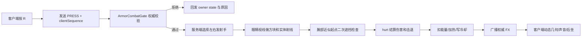

# 凌空战甲武器系统现状与实现设计 v2

> 项目：Flight Armor / Minecraft 1.21.1 / Fabric 0.19.3  
> 文档日期：2026-07-15  
> 当前代码基线：本轮武器实现工作树（腕部脉冲、核心束与俯冲冲击）  
> 前置文档：[飞行装甲攻击系统与分件着甲实现分析](攻击系统与分件着甲实现分析.md)
> 后续设计：[巡航战甲自主战斗实现设计](巡航战甲自主战斗实现设计.md)（设计完成，尚未实现）

## 1. 文档结论

旧文档提出的实施顺序已经落地：项目现已建立服务端权威战斗内核，并在腕部反重力脉冲之外实现了 `G` 键棱形核心蓄力束和俯冲落地重力冲击。客户端只提交按键意图或接收权威表现事件，目标、伤害、击退、能量、热量、冷却与落地速度都由服务端决定。

本轮新增功能的真实状态是：

- `G PRESS / RELEASE / CANCEL` 已接入。按住 `G` 开始蓄力，松开后按服务端实际持续 tick 释放一次性核心束；不足 6 tick 取消，30 tick 达到满档，100 tick 未释放会自动回落。
- 核心束的射程、伤害、击退、能耗和热量按有效蓄力插值，且输出会受当前可用能量限制；它拥有独立 40 tick 冷却。
- `FlightController` 在结束俯冲前保存服务端最后一帧俯冲速度，并自动尝试重力冲击。冲击按 1.00 / 1.35 / 1.70 三档速度选择伤害与半径，逐目标检查资格、距离衰减和方块遮挡。
- 腕炮、核心束和重力冲击共用服务端能量/热量/过热系统，但三种冷却互相独立；这些资源和剩余冷却均已纳入 `SavedData`。
- 核心蓄力/释放与俯冲冲击已有同步姿势、装甲灯光、自定义动态几何光束/压力场、内外声场、命中声、后坐和 HUD 反馈。
- 攻击阶段使用 `serverAttackId + visualRevision` 处理同一攻击内的阶段更新，FX 使用 `serverAttackId + eventIndex` 去重。

功能实现已经接入代码与资源，但本文不把“编译成功”写成“手感完成”。第一/第三人称锚点、核心粗束观感、压力环尺度、蓄力和冲击混音、实际战斗数值以及多人高延迟表现，仍需在游戏内逐项验收和继续调参。

本轮代码继续排除导弹、机枪、自动锁定、方块破坏、持续照射和巡航战甲自主攻击；其中巡航自主攻击已完成[独立实现设计](巡航战甲自主战斗实现设计.md)，但尚未编码。

## 2. 当前实现状态审计

### 2.1 总体状态

| 模块 | 当前状态 | 代码证据或说明 |
|---|---|---|
| 旧武器分析文档 | 已完成设计 | `docs/攻击系统与分件着甲实现分析.md` |
| 服务端战斗内核 | 已实现 | `combat` 包包含统一门禁、状态机、调参、射线、目标策略、伤害类型和持久化 |
| `R` 腕部脉冲 | 已实现 | 单击发射，服务端左右手交替、射线结算和独立 8 tick 冷却 |
| `G` 核心蓄力束 | 已实现 | 客户端发送 PRESS/RELEASE/CANCEL，服务端按真实持续时间结算 |
| 俯冲重力冲击 | 已实现基础闭环 | 非水下俯冲可靠落地前自动触发，按速度分三档；墙撞/实体撞暂未实现 |
| 攻击 C2S 意图包 | 已实现 | `ArmorAttackIntentPayload` 只含序列号、攻击类型和动作 |
| 攻击 S2C 状态/特效包 | 已实现 | owner、visual、fx 三种 payload 已注册并按权限广播 |
| 战斗状态同步 | 已实现 | 同步能量、热量、过热、三种独立冷却、阶段和拒绝原因 |
| 服务端射线检测 | 已实现 | 腕炮和核心束均做眼睛选点及腕口/核心起点二次遮挡校验 |
| 服务端伤害与击退 | 已实现 | 三种自定义伤害类型通过 `hurt()` 结算，击退和范围均有硬封顶 |
| 武器动态几何 | 已实现第二版 | 专用世界渲染层绘制腕炮四棱束、核心多层棱柱/螺旋带、命中符印和 14 tick 力场压力环；不创建任何原版粒子 |
| 武器音效 | 已实现第一版 | 核心蓄力内/外循环、释放、取消、命中及冲击内/外声已注册并有原创素材 |
| 武器 HUD | 已实现 | 显示能量、热量、`R/G/冲击` 冷却和核心蓄力百分比 |
| 攻击姿势 | 已实现第一版 | 腕炮单臂、核心双臂稳定和冲击吸收姿势进入统一姿势合成 |
| 第一人称攻击表现 | 已实现第一版 | 腕炮、核心释放和重力冲击均有第一人称后坐/镜头前手臂变换 |
| 装甲战斗灯光 | 已实现第一版 | 核心、胸部纹路、面部以及冲击时脚底/腿部按攻击阶段响应 |
| 战斗持久化 | 已实现 | 能量、热量、过热、三种剩余冷却、恢复延迟和下一发左右手写入 `SavedData` |
| 多人追踪同步 | 已实现基础路径 | 追踪者接收阶段和 FX；新追踪者可补发仍在进行的视觉阶段 |
| 巡航战甲自主战斗 | 未实现；独立设计已完成 | 当前巡航系统仍只负责移动、召回、停靠和物品保护，后续按[专项设计](巡航战甲自主战斗实现设计.md)分阶段接入 |

### 2.2 可以直接复用的基础

- `FlightArmorMod` 的 payload 注册、服务端 tick、玩家追踪、加入/离开、重生、死亡和换维事件已经接入战斗控制器。
- `ArmorAssemblyController` 与 `ArmorCruiseController` 在进入穿脱或巡航流程前会取消活动攻击，防止蓄力残留。
- `FlightController` 除现有飞行状态外，现会保存最后一帧俯冲速度，并在 `onGround` 停止飞行前调用重力冲击。
- `FlightJointAnimation.poseFor()` 仍是人物皮肤、肘膝弯曲和 OBJ 装甲共用的最终姿势入口；`AttackPoseController` 在该链路上增加武器局部姿势。
- 第一人称 mixin 和 `FlightObjArmorRenderer` 已读取战斗阶段，分别处理后坐、局部变形和战斗灯光。
- 原有“低频反重力场 + 中频装甲机械 + 克制高频纹理”继续作为武器声音的统一音色底座。

### 2.3 当前实现相对设计稿的取舍

1. 三种攻击当前统一要求完整四件战甲，尚未按“胸甲/头盔能力组合”放宽。
2. 腕炮和核心束继续使用碰撞盒附近的服务端近似起点；尚未建立统一的第一/第三人称/服务端 `ArmorAnchorResolver`。
3. 核心束和压力环已经迁移到独立 world render pass；当前使用无纹理 `POSITION_COLOR` 几何层，尚未加入自定义 GLSL 软边、折射或全屏后处理。
4. 核心束允许在水中释放，但目前只切换水下视觉与低通式声音表现，没有独立水下伤害、射程或能耗调参。
5. 重力冲击明确禁止水中触发，且当前只接地面接触；撞墙、撞实体和水面冲击留待后续。
6. 俯冲 AoE 最多处理距离最近的 64 个候选目标，按水平距离衰减并逐个做方块遮挡检查，不破坏方块。
7. 独立腕部发射器 OBJ group 仍未加入；第一版继续使用现有前臂外轨、能量纹路和虚拟腕口。
8. 当前所有视觉与声音实现仍需游戏内手感验收，特别是高 FOV、多人延迟、水中核心束和低端设备动态顶点预算。

## 3. 武器范围与用户操作

### 3.1 当前武器组合

| 武器 | 默认按键 | 交付形式 | 主要用途 |
|---|---|---|---|
| 腕部反重力脉冲 | `R` 单击 | 服务端 hitscan + 短寿命光束 | 日常单体攻击 |
| 棱形核心蓄力束 | `G` 按住/松开 | 服务端蓄力后一次性粗光束 | 高消耗重击 |
| 俯冲重力冲击 | 俯冲接触自动触发 | 服务端范围冲击 | 高速俯冲终结技 |

不接管鼠标左键。左键仍保留原版挖掘、近战和界面交互，避免与其他模组发生输入冲突。

### 3.2 初始调参

#### 腕部反重力脉冲

```text
射程                 28 格
伤害                 6
冷却                 8 tick
能量消耗             10
热量                 12
击退                 0.55
发射手               服务端决定，左右交替
方块破坏             否
穿透                 否
```

水下初始调参：

```text
射程                 20 格
伤害                 5
击退                 0.25
能量消耗             12
```

#### 棱形核心蓄力束

```text
最短蓄力             6 tick
满蓄力               30 tick
射程                 36～52 格
伤害                 5～16
能量消耗             18～45
热量                 25～55
释放后冷却           40 tick
方块破坏             否
```

第一版必须是“蓄力后单次释放”，不做逐 tick 持续照射。

补充规则：蓄力超过 100 tick 尚未释放会自动回落；当前能量不足以支付满档消耗时，服务端会限制本次有效蓄力输出，而不是把能量扣成负数。核心束击退范围为 0.35～1.05，释放后还有 5 tick 发射阶段和 8 tick 恢复阶段。

#### 俯冲重力冲击

```text
接触前速度 < 1.00    不触发
1.00～1.35           伤害 6，半径 2.5
1.35～1.70           伤害 10，半径 4.0
> 1.70               伤害 14，半径 5.5
最大击退             1.2
能量消耗             20
热量                 30
独立冷却             24 tick
最多候选目标         64
方块破坏             否
```

伤害、范围和击退都已硬封顶，不按速度无限平方增长。范围内伤害按水平距离从约 100% 衰减到 55%，每个目标还会单独检查友伤策略和方块遮挡。

## 4. 装备能力与状态矩阵

### 4.1 装备能力

`ModItems.hasFlightGear()` 允许单穿战靴飞行，因此不能作为武器门禁。当前实现为减少装备组合变量，三种攻击都在统一门禁中严格调用 `ModItems.hasFullSet(player)`。

当前能力矩阵：

| 已稳定装备部件 | 腕部脉冲 | 核心束 | 俯冲冲击 |
|---|---:|---:|---:|
| 仅战靴 | 否 | 否 | 否 |
| 仅胸甲 | 否 | 否 | 否 |
| 胸甲 + 头盔 | 否 | 否 | 否 |
| 完整四件 | 是 | 是 | 是 |

后续只有在完整套装的命中、网络、姿势和资源平衡通过游戏内验收后，才考虑拆分 `hasWristEmitter / hasCombatCore / hasTargetingHelmet` 能力。

### 4.2 飞行与攻击模式

| 当前动作 | 腕部脉冲 | 核心束 | 重力冲击 |
|---|---:|---:|---:|
| 地面站立 | 允许 | 允许 | 禁止 |
| 悬停 | 允许 | 允许 | 禁止 |
| 普通方向飞行 | 允许 | 允许 | 禁止 |
| `Ctrl` 加速飞行 | 允许 | 禁止蓄力/释放 | 禁止 |
| 俯冲 | 禁止 | 禁止 | 接触时允许 |
| 水中悬停/飞行 | 允许，使用水下调参 | 允许，当前仅使用水下表现 | 禁止 |

俯冲时人物双臂已经设计为贴近身体，腕炮和核心束在俯冲中直接禁止，避免重新破坏当前手臂观感。

### 4.3 战甲生命周期门禁

| 战甲状态 | 玩家武器 | 原因 |
|---|---:|---|
| 稳定穿戴、无动画 | 按装备能力开放 | 正常状态 |
| 普通分件着甲 | 禁止 | 物品可能已入槽但核心尚未上线 |
| 单件穿上 | 禁止 | 部件正在移动，姿势和能力尚未稳定 |
| 单件脱下/整套收起 | 禁止并取消蓄力 | 装备资格即将变化 |
| 战靴先锁定临时悬停 | 禁止 | 只有悬停授权，没有战斗核心 |
| `CRUISING` | 禁止 | 战甲在独立载体上 |
| `RECALLING` | 禁止 | 战甲正在返航 |
| `PHASING` | 禁止 | 战甲正在跨距或跨维折跃 |
| `OWNER_DOWN` | 禁止 | 玩家死亡，战甲守护待机 |
| `DOCKING` | 禁止 | tick 21 只有战靴视觉接管，tick 32 才完成四件提交 |
| 死亡/旁观/睡眠/乘骑 | 禁止 | 状态不可攻击 |

## 5. 统一服务端攻击门禁

腕炮和核心束使用同一个服务端门禁；重力冲击发生在 `diving=true` 的接触帧，因此使用同一门禁的“排除 diving 检查”生命周期入口，并在控制器内继续检查维度、过热、能量和自身冷却。

```java
public final class ArmorCombatGate {
    public static Result evaluate(
            ServerPlayer player,
            ArmorAttackType type,
            ArmorAttackAction action,
            ArmorCombatState state,
            long now,
            float energyCost
    ) {
        // 腕炮/核心束的唯一权威入口
    }

    public record Result(
            boolean allowed,
            ArmorCombatDenyReason reason
    ) {
    }
}
```

校验顺序：

1. 玩家存在、存活、非旁观、非睡眠、非乘客。
2. 攻击状态保存的维度与玩家当前维度一致。
3. `ArmorAssemblyController.isAnimating(player)` 必须为 `false`。
4. `ArmorCruiseController.hasActiveCruise(player)` 必须为 `false`。
5. 严格检查武器所需的战甲槽位，不能使用 `hasFlightGear()`。
6. 读取服务端飞行控制器状态，检查加速和俯冲规则。
7. 检查攻击阶段，禁止同时蓄力两种武器。
8. 检查能量、热量、过热锁和独立冷却。
9. 检查客户端序列号是否单调递增以及请求频率是否合理。
10. 全部通过后才进入命中与扣能量流程。

当前 `FlightController` 通过只读方法提供 `isDiveActive()` 与 `isBoostActive()`；重力冲击所需的接触前速度保存在飞行服务端状态的 `lastDiveVelocity`，不会采用客户端速度。

## 6. 当前代码结构

```text
src/main/java/dev/codex/flightarmor/combat/
  ArmorCombatController.java
  ArmorCombatGate.java
  ArmorCombatState.java
  ArmorCombatSavedData.java
  ArmorAttackType.java
  ArmorAttackAction.java
  ArmorCombatPhase.java
  ArmorCombatDenyReason.java
  ArmorCombatTuning.java
  CombatTargetPolicy.java
  CombatRaycast.java
  ModDamageTypes.java

src/main/java/dev/codex/flightarmor/network/
  ArmorAttackIntentPayload.java
  ArmorCombatOwnerStatePayload.java
  ArmorCombatVisualStatePayload.java
  ArmorAttackFxPayload.java

src/client/java/dev/codex/flightarmor/client/combat/
  ArmorCombatClient.java
  ArmorCombatFxController.java
  ArmorWeaponSoundController.java
  ArmorCombatHud.java

src/client/java/dev/codex/flightarmor/client/animation/
  AttackPoseController.java
```

职责边界：

- `ArmorCombatController`：服务端攻击状态机、tick、扣能量、取消与广播。
- `ArmorCombatGate`：唯一资格判断。
- `CombatRaycast`：方块、实体、遮挡和最近命中选择。
- `CombatTargetPolicy`：PVP、队伍、同盟、驯服生物和巡航载体过滤。
- `ArmorCombatClient`：按键、轻量预测和权威状态接收。
- `AttackPoseController`：只生成攻击局部姿势，不直接修改模型。
- `ArmorCombatFxController`：保存权威瞬时事件、寿命、数量上限和去重状态，不生成粒子。
- `ArmorCombatFxRenderer`：在 `AFTER_ENTITIES` 世界阶段绘制棱柱、螺旋带、符印和压力场动态顶点。
- `ArmorWeaponSoundController`：管理蓄力循环与一次性发射/命中声。

`ArmorCombatAnchorResolver` 仍是后续优化项；当前服务端使用碰撞盒近似锚点，本地第一人称使用相机空间腕部/核心视觉锚点，第三人称几何束使用权威世界起点。

## 7. 网络协议

### 7.1 C2S：客户端只发送意图

```text
ArmorAttackIntentPayload
  clientSequence : long
  attackType     : enum network id
  action         : PRESS / RELEASE / CANCEL
```

客户端不得上传：

- 伤害值。
- 目标实体 ID。
- 最终命中位置。
- 能量消耗或剩余能量。
- 冷却结束时间。
- 客户端计算的蓄力 tick。
- 发射左手或右手。

客户端朝向也不需要作为权威字段；服务端在处理意图时读取玩家真实视线。若为了调试保留客户端 yaw/pitch，它只能用于日志或预测误差统计。

### 7.2 S2C：所有表现来自权威结果

```text
ArmorCombatOwnerStatePayload
  acceptedClientSequence
  serverAttackId
  energy
  heat
  overheated
  wristPulseCooldownTicks
  coreBeamCooldownTicks
  diveImpactCooldownTicks
  phase
  denyReason

ArmorCombatVisualStatePayload
  attackerId
  serverAttackId
  visualRevision
  attackType
  phase
  firingHand
  serverStartGameTime
  phaseDurationTicks

ArmorAttackFxPayload
  attackerId
  dimension
  serverAttackId
  eventIndex
  attackType
  firingHand
  origin
  endpoint
  impactNormal
  hitKind
  hitEntityId
  charge01
  underwater
```

`serverAttackId + visualRevision` 用于接受同一次攻击从 CHARGING 到 FIRING/RECOVERY/IDLE 的新阶段；`serverAttackId + eventIndex` 是声音、动态几何和后坐的唯一去重键，防止重复播放。

### 7.3 同步规则

- `ArmorCombatOwnerStatePayload` 只发给攻击者本人。
- 持续蓄力状态通过 `ArmorCombatVisualStatePayload` 发给本人和追踪者。
- 瞬时 `ArmorAttackFxPayload` 发给攻击者追踪范围内玩家；必要时再合并终点附近玩家并去重。
- 新玩家开始追踪时补发攻击者当前仍未进入 IDLE 的 visual state，不重播已经结束的一次性 FX。
- 重复、倒序或过快的 intent 直接丢弃，不能重复扣能量或造成伤害。

## 8. 腕部脉冲服务端流程



服务端处理顺序必须是：

1. 使用玩家眼睛位置和服务端视线建立 28 格射线。
2. 先做方块碰撞，得到最远可达端点。
3. 只在眼睛到方块端点之间查询实体。
4. 选择沿射线最近的合法实体或方块结果。
5. 按发射手计算一个服务端近似腕部起点，再到目标点做一次方块遮挡检查。
6. 如果眼睛能越过矮墙、腕部却被墙挡住，则以腕部遮挡点作为最终端点，并取消墙后的实体伤害。
7. 通过原版 `hurt(DamageSource, amount)` 结算。
8. 只有 `hurt()` 成功后才应用击退。
9. 最后扣能量、加热、写入冷却并广播表现。

视觉腕部锚点可以比服务端近似值更精确，但视觉终点必须使用服务端端点。

## 9. 目标选择、PVP 与伤害归属

### 9.1 目标策略

`CombatTargetPolicy` 应集中处理：

```text
自己                    不可命中
死亡/旁观实体           不可命中
玩家                    遵守服务器 PVP 和队伍友伤设置
同盟实体                默认不可伤害
自己的驯服生物          不可伤害
其他可攻击生物          允许
巡航战甲 ArmorStand      第一版完全忽略，不伤害也不作为无敌盾牌
```

巡航载体当前不可被普通交互或攻击。如果让它阻挡光束却又不能受伤，会形成永久无敌盾牌，因此腕炮 MVP 应把巡航载体从实体射线候选中完全排除。以后只有实现战甲耐久与受击状态后，才允许它成为可拦截目标。

队友在关闭友伤时是否阻挡光束应做成配置。推荐默认“阻挡但不受伤”，避免穿过队友命中其身后目标；服务器管理员可改为完全忽略队友。

### 9.2 自定义伤害类型

新增：

```text
data/flight_armor/damage_type/gravity_pulse.json
data/flight_armor/damage_type/core_beam.json
data/flight_armor/damage_type/gravity_impact.json
```

对应资源键：

```text
flight_armor:gravity_pulse
flight_armor:core_beam
flight_armor:gravity_impact
```

hitscan 的 causing entity 必须是攻击玩家。未来若增加弹丸，direct entity 是弹丸，causing entity 是所有者。

必须走原版伤害系统，不能直接修改生命值，这样才能保留：

- 击杀归属与死亡消息。
- 生物仇恨。
- 记分板与统计。
- 护甲、附魔与抗性等原版伤害处理。
- 服务器 PVP 设置。

当前三种战甲伤害都加入 `minecraft:bypasses_cooldown`，避免 8 tick 腕炮冷却被原版 20 tick 受伤无敌时间吞掉；腕炮和核心束同时标记为 projectile，重力冲击不标记为 projectile。这是有意的战斗规则，不应再宣称它们保留原版受伤冷却行为。

## 10. 能量、热量与冷却

### 10.1 服务端状态

```text
energy                    0..100
heat                      0..100
overheated                boolean
腕炮/核心束/冲击 cooldownUntilTick
phase                     IDLE / WINDUP / CHARGING / FIRING / RECOVERY
chargingAttack            attack type
chargeStartGameTime
lastClientSequence
serverAttackId
visualRevision
nextHand                   LEFT / RIGHT
dimension
```

当前规则：

```text
地面或悬停恢复           3.0 点/秒
普通飞行恢复             2.0 点/秒
俯冲恢复                 0.75 点/秒
Ctrl 加速（非俯冲）      2.0 点/秒
蓄力期间恢复             0
过热阈值                 100
重新解锁阈值             60
停止攻击后的散热延迟     20 tick
```

过热只锁定攻击，不取消飞行或让玩家突然坠落。当前散热速度为 4 点/秒，开火后 20 tick 内不恢复也不散热；核心蓄力期间同样暂停恢复。

### 10.2 持久化策略

当前使用 `ArmorCombatSavedData` 按玩家 UUID 保存：

- 能量。
- 热量。
- 过热状态。
- 腕炮、核心束和俯冲冲击的剩余冷却。
- 开火后恢复延迟。
- 下一发腕炮使用哪只手。

加入、重生、换维度、离线与停服路径均会清理瞬时攻击阶段并保留/同步持久资源；部署巡航、死亡自返、断线或重启不能作为刷新能量与冷却的手段。

当前项目尚无永久 `suitId`。如果以后允许玩家同时拥有多套独立战甲，再把战斗状态从 owner UUID 迁移到胸甲或整套战甲的 `suitId` 数据组件；本阶段不提前引入多战甲所有权系统。

## 11. 攻击姿势与人物/装甲联动

### 11.1 当前统一姿势链路

当前 `DiveLegPoseMixin` 在 `HumanoidModel.setupAnim` 的 `TAIL` 写入四肢角度。另加一个攻击 mixin 会再次造成：

- 人物皮肤与 OBJ 前臂方向不一致。
- 肘部弯曲被飞行姿势覆盖。
- 第一人称有后坐，第三人称没有，或反之。
- 俯冲贴身手臂重新飞到身后。

当前结构：

```text
FlightPoseController      生成地面/悬停/飞行基础姿势
AttackPoseController      生成攻击局部覆盖层
FlightJointAnimation      合成唯一最终 FlightPoseFrame
DiveLegPoseMixin          只应用最终结果
FlightObjArmorRenderer    读取同一最终结果
FirstPerson renderer      读取同一攻击进度和发射手
```

攻击状态已经进入统一姿势激活条件，地面攻击不依赖飞行进度也能执行弯肘和核心稳定姿势。

### 11.2 合成规则

- 着甲、脱甲或停靠开始时，服务端先取消攻击，因此它们不与攻击姿势并存。
- 俯冲中禁止腕炮和核心束，继续使用当前贴身收臂姿势。
- 腕炮只覆盖发射侧肩膀、上臂、肘部和少量头部方向。
- 非发射手继续执行飞行配平姿势。
- 双腿与膝盖继续使用当前飞行姿势，不因腕炮同时抬起。
- 核心束允许双臂略向外稳定，但腰胯继续保持刚性连接。
- 左右发射手由服务端选择并同步，客户端不能指定。

建议腕炮姿势：

```text
上臂向瞄准方向抬起       28°～42°
肘部弯曲                 12°～24°
前臂后坐                 4°～8°
恢复时间                 6～9 tick
头部额外追随             不超过 4°
```

### 11.3 第一人称

当前第一人称装甲手臂已接入腕炮、核心释放和冲击后坐。仍需在游戏内继续验收：

- 第一人称发射手抬起与后坐。
- 第一人称光束起点。
- 左右手分别对齐。
- FOV 改变时的锚点稳定。
- 潜行、水中、飞行和物品手持状态兼容。

第一/第三人称都已接入，但“已接入”不代表锚点已经完全校准。

## 12. 武器锚点与装甲变形

当前 `FlightObjArmorRenderer.GroupBinding` 仍是私有 record，并按字符串判断组归属；服务端射线使用碰撞盒附近的腕口/胸口近似起点，动态几何使用权威 payload 终点，并只为本地第一人称修正视觉起点。后续仍建议抽出共享锚点层：

```text
ArmorAnchor
  LEFT_WRIST
  RIGHT_WRIST
  CHEST_CORE

ArmorAnchorResolver
  resolveThirdPersonWorld(...)
  resolveFirstPersonView(...)
  resolveServerApproximation(...)
```

它必须考虑：

- 原版人物骨骼旋转。
- playerAnimator/bendy-lib 的肘部弯曲。
- OBJ 的 1/16 缩放和左右镜像。
- 第一/第三人称差异。
- 当前攻击后坐。

当前腕炮使用前臂末端的虚拟发射点，没有修改模型。后续可通过 `tools/generate_armor_mesh.mjs` 添加：

```text
arm_left_forearm_emitter_frame_gunmetal
arm_left_forearm_emitter_led
arm_right_forearm_emitter_frame_gunmetal
arm_right_forearm_emitter_led
```

已有 `arm_*_forearm_outer_rail_gunmetal` 和 `arm_*_forearm_energy_trace_led` 可在蓄能时做轻微展开与颜色变化。

核心束优先复用：

```text
core_cradle
core_housing
core_reactor_led
```

核心战斗变形已限制为小幅缩放/聚焦和灯光变化，没有把核心整体推出胸甲表面；具体厚度和穿模仍需游戏内验收。

## 13. 光束、动态几何与灯光

### 13.1 腕部脉冲

- 当前为约 5 tick 的四棱锥形短束，包含白色管芯、紫色外场和移动菱形相位环。
- 命中方块时在权威端点绘制平面符印，命中实体时绘制三轴线框笼；不生成火焰、粒子或持久世界实体。
- 24/56/96 格分三级降低几何复杂度，并按视锥裁剪；同屏光束、命中场和冲击场均有硬上限。

### 13.2 核心束

- 蓄力阶段由服务端起始 tick 和持续时长驱动核心颜色、胸部纹路、局部变形及双臂稳定姿势。
- 释放时生成约 8 tick 的一次性多层棱形能量管、双螺旋薄带和移动相位环，不逐 tick 伤害。
- 蓄力提高几何半径、色相、命中透镜、声音强度和权威伤害参数，不破坏方块。
- 取消蓄力时停止循环声并播放回落声，不播放释放/命中效果。

### 13.3 俯冲冲击

- 按三档速度强度生成 14 tick 多边形双层压力环、低矮力场壁、中心压缩菱形和竖直力场鳍片。
- 冲击阶段驱动腿部/膝部吸收姿势、战靴与腿部灯光以及第一人称冲击反馈。
- 特效中心和强度来自服务端 FX；客户端不自行根据本地速度猜测是否命中。

### 13.4 速度颜色与武器颜色

飞行灯光已有速度颜色逻辑，武器不能用亮度降低来表示蓄力或冷却。

推荐：

```text
腕部脉冲           青白
核心低蓄力         青色
核心中蓄力         蓝紫
核心满蓄力         紫白
过热/拒绝          琥珀或红橙
```

所有能量灯保持高亮，以颜色和纹理流速区分阶段。

## 14. 武器声音设计

继续沿用现有声音方向，不复用飞行加速声或着甲锁定声。

当前已注册事件：

```text
armor.weapon.wrist_pulse_fire_int
armor.weapon.wrist_pulse_fire_ext
armor.weapon.wrist_pulse_impact
armor.weapon.core_charge_int_loop
armor.weapon.core_charge_ext_loop
armor.weapon.core_release_int
armor.weapon.core_release_ext
armor.weapon.core_cancel
armor.weapon.core_impact
armor.weapon.gravity_impact_int
armor.weapon.gravity_impact_ext
```

设计原则：

- 腕炮当前直接播放内/外发射声，没有单独预备阶段，音色以低中频压力释放和克制高频边缘为主。
- 腕炮命中实体与方块当前共用一个 impact 事件；按材质拆分尾音属于后续优化。
- 核心蓄力是可无缝循环的低频场，不靠不断升 pitch 制造蓄力感。
- 核心释放比腕炮更宽、更深，但峰值保持余量。
- 俯冲冲击以低频压力波、装甲阻尼和环境回响为主。
- 水下保留完整动态几何，仅改为蓝青色能量薄壳并调整音量/音高；尚未加入独立低通压力素材层。
- 本机使用内部版本，其他玩家使用空间衰减的外部版本。

核心蓄力时可以把飞行 `AIR` 与 `FIELD` 层压低约 2～4 dB，但悬浮低频不能完全消失。

所有素材由 `tools/generate_sound_assets.py` 原创生成，不提取影视作品音频。当前已区分核心蓄力与释放的本机/外部版本、重力冲击的本机/外部版本；拒绝与过热暂时使用文字/HUD 反馈，尚无专用声音事件。

## 15. HUD 与玩家反馈

当前 HUD 位于快捷栏上方的屏幕中部，完整穿戴时显示：

```text
ENERGY  0..100
HEAT    0..100
R 腕炮冷却 tick
G 核心束冷却 tick
冲击冷却 tick
核心蓄力百分比
过热颜色提示
```

规则：

- HUD 只显示服务端同步状态。
- 客户端可以平滑插值，但不能自行增加能量或判定冷却完成。
- 攻击被拒绝时显示短提示，不在每 tick 重复刷屏。
- 过热只显示武器锁定，不显示飞行失效。
- 水下调参、巡航、着甲中等状态通过服务端拒绝原因给出文字提示。

## 16. 与现有系统的取消和交接

### 16.1 必须主动取消攻击的事件

- 开始普通分件着甲。
- 开始单件穿上或脱下。
- `Ctrl+B` 整套收起。
- 完整套装按 `B` 部署独立巡航。
- 进入 `RECALLING / PHASING / OWNER_DOWN / DOCKING`。
- 胸甲或头盔资格丢失。
- 开始俯冲。
- 核心蓄力时开始 `Ctrl` 加速。
- 玩家死亡、断线、换维度、睡眠或成为乘客。

处理原则：

```text
战甲生命周期切换 > 取消攻击状态 > 执行穿脱/巡航事务
```

不能因为玩家正在蓄力而拒绝脱甲或死亡处理；应先由服务端取消蓄力，再继续原有安全事务。

### 16.2 已接入点

- `ArmorCruiseController`：进入巡航/召回事务前取消战斗。
- `ArmorAssemblyController`：进入分件穿脱动画时取消战斗，作为各穿脱入口的共同兜底。
- `ServerLivingEntityEvents.AFTER_DEATH`：取消瞬时攻击阶段但保留持久资源。
- 玩家离开：强制写入持久快照并移除连接内运行态。
- 重生与换维：取消旧阶段、原子更新维度并同步新的 owner state。
- 新玩家开始追踪攻击者：补发仍未结束的 visual state。

## 17. 俯冲重力冲击的特殊接入

当前 `FlightController.tickServer()` 在检测到 `player.onGround()` 后会停止飞行。如果 combat 在后续普通 tick 才检查，俯冲状态和接触前速度已经丢失。

当前已在停止俯冲前交接：

```java
if (state.diving() && contactDetected) {
    ArmorCombatController.tryDiveImpact(
        player,
        state.lastDiveVelocity(),
        contactPosition
    );
}
stopFlight(player, state);
```

服务端当前保存/读取：

- 接触前速度。
- 俯冲状态。
- 接触位置（当前地面法线固定为向上）。
- 当前能量、冷却和完整套装资格。

范围伤害中的每个目标都必须重新经过 `CombatTargetPolicy`，不能因为是 AoE 就绕过队伍或 PVP 规则。

触发后：

- 强制结束俯冲。
- 对玩家自身进行短暂减速，不造成自伤。
- 广播地面压力环、灯光和低频冲击声。
- 不破坏方块。

实体高速碰撞和墙面碰撞尚未实现；当前只处理非水下的可靠地面接触。

## 18. 分阶段实施计划

### 阶段 0：战斗门禁和协议底座（代码已实现）

实现：

- `ArmorAttackType / Action / Phase`。
- `ArmorCombatGate` 与拒绝原因。
- `FlightController` 只读飞行状态与 `lastDiveVelocity` 接触前速度快照。
- C2S intent 与 owner/visual/fx S2C 注册。
- 攻击取消生命周期接入。
- 重复、乱序和频率限制。

仍需游戏内验收：

- 单穿战靴、着甲、脱甲、巡航、DOCKING、死亡状态都返回正确拒绝原因。
- 客户端重复包不会推进状态。
- 按 `B` 或 `Ctrl` 穿脱组合键可以可靠取消正在进行的蓄力状态。

### 阶段 1：腕部脉冲 MVP（代码已实现）

实现：

- `R` 单击输入。
- 28 格服务端 hitscan。
- 方块与实体遮挡比较。
- PVP、队伍、同盟与巡航载体过滤。
- 自定义伤害类型、6 点伤害和击退。
- 8 tick 冷却、基础能量与热量。
- 服务端左右手交替。
- 权威 FX 端点。

仍需游戏内验收：

- 客户端不能伪造目标、伤害、发射手或命中位置。
- 隔墙、矮墙和门后目标不能受伤。
- 重复 intent 不会造成额外伤害。
- 单人和双客户端看到相同终点与发射手。

### 阶段 2：腕炮完整表现（第一版已实现）

实现：

- `AttackPoseController`。
- 地面、悬停、普通飞行和加速中的单臂姿势。
- 第一人称后坐。
- 虚拟腕部锚点。
- 四棱短束、实体线框笼与方块命中符印。
- 内外发射声与命中声。
- 纹路短暂聚能颜色。

仍需游戏内验收：

- 人物皮肤、肘部弯曲、OBJ 前臂和光束起点一致。
- 左右手不同时做相同后坐。
- 远端玩家能看到同一只发射手。
- FOV、水中和飞行时第一人称光束不从屏幕中心或肩膀错误发出。

### 阶段 3：完整能量、热量与 HUD（代码已实现）

实现：

- 服务端恢复和散热。
- 过热与解锁阈值。
- `ArmorCombatSavedData`。
- owner state 同步。
- 能量、热量和冷却 HUD。
- 断线、死亡、巡航和重启不刷新资源。

剩余工作是验证真实存档重启、跨维和异常断线场景，而不是继续增加另一套客户端资源状态。

### 阶段 4：棱形核心蓄力束（第一版已实现）

实现：

- `G PRESS / RELEASE / CANCEL`。
- 服务端真实蓄力 tick。
- 核心灯光、纹路、局部装甲变形和蓄力姿势。
- 蓄力循环声、取消声和释放声。
- 一次性粗光束、伤害与冷却。
- 加速或俯冲开始时权威取消。

尚需实际验收蓄力时长是否舒适、能量限制时输出是否容易理解、核心是否穿模、第一/第三人称束起点是否一致，以及水下混音是否足够清楚。

### 阶段 5：俯冲重力冲击（地面版已实现）

实现：

- `FlightController` 接触前快照交接。
- 速度分段与硬封顶。
- 服务端 AoE 和逐目标友伤判断。
- 强制退出俯冲并减速。
- 压力环、装甲阻尼动作和低频冲击声。
- 不破坏方块。

尚需实际验收三个速度阈值是否能稳定触发、低空俯冲是否容易误触、不同地形的遮挡与环形特效是否自然。墙撞、实体撞和水下冲击不属于当前完成范围。

### 阶段 6：多人和表现打磨（部分完成，持续进行）

已实现：

- 新追踪者恢复持续蓄力状态。
- 权威 visual revision 与一次性 FX 去重。
- 水下核心束的蓝青动态几何与声音变化。

仍需完成：

- 高延迟与乱序实机测试。
- 第一/第三人称锚点校正。
- 独立水下声层与进一步表现。
- 飞行声 ducking 与武器混音。
- 最终伤害、能量、热量和冷却平衡。

当前已完成持续阶段补发、权威事件去重、核心/冲击第一版姿势、灯光和声音；高延迟乱序、多客户端一致性、FOV/锚点、水下表现、性能与最终数值仍未完成游戏内验收。

## 19. 必须测试的场景

以下是发布前验收清单，不代表本文更新时已经全部实机通过。构建检查只能验证代码和资源可打包，不能替代单人/多人游戏内手感、姿势、声音和命中测试。

### 19.1 装备与生命周期

- 单穿战靴按 `R/G`。
- 只穿胸甲使用腕炮。
- 胸甲或头盔正在飞入。
- 胸甲或头盔正在脱出。
- 普通 `B` 补装期间攻击。
- `Ctrl+B` 收起时蓄力。
- `Ctrl+↑/↓` 逐件穿脱时攻击。
- 独立巡航、返航、折跃、OWNER_DOWN 和 DOCKING。
- 死亡后战甲自返与玩家重生。

### 19.2 飞行

- 地面站立。
- 悬停。
- 前后左右飞行。
- `Ctrl` 加速。
- 俯冲。
- 受控下降。
- 水中悬停和水中高速移动。

### 19.3 命中与规则

- 墙后目标。
- 矮墙、门、玻璃和水体。
- 近距离目标与最大射程边缘。
- PVP 关闭。
- 同队关闭友伤。
- 自己的驯服生物。
- 巡航战甲载体。
- 多个实体沿同一射线排列。
- 目标在命中瞬间死亡或换维度。

### 19.4 网络与安全

- 两个客户端同时攻击。
- 重复 PRESS。
- RELEASE 早于 PRESS。
- 旧 sequence 在新攻击后到达。
- 持续高速发包。
- 蓄力中断线。
- 蓄力中换维度。
- 高延迟下客户端预测被服务端拒绝。
- 新玩家中途开始追踪蓄力者。

### 19.5 姿势和表现

- 第一人称左右腕炮。
- 第三人称人物皮肤与 OBJ 前臂。
- 弯肘状态下光束锚点。
- 加速飞行中单臂后坐。
- 攻击后立即悬停、转向或着甲。
- 核心蓄力时腰部不分离。
- 俯冲中腕炮/核心束确实被禁止。

## 20. 当前完成定义与剩余验收

三种攻击的代码闭环已经建立，但只有同时满足以下条件，才可视为面向玩家的第一轮真正完成：

- 服务端权威决定资格、发射手、命中、伤害、击退、能量和冷却。
- 客户端不能通过伪造包获得额外攻击。
- 方块遮挡与 PVP/队伍规则正确。
- 着甲、脱甲、巡航、死亡和换维度会安全取消攻击。
- 地面、悬停、普通飞行、加速和水中规则明确。
- 第一人称、第三人称、人物皮肤、弯肘和 OBJ 装甲动作一致。
- 其他玩家看到相同发射手与权威端点。
- 武器声音与现有反重力装甲音色统一，不重新出现尖锐廉价的电子音。
- 不破坏方块，不引入巡航战甲自主战斗。
- 核心束短按取消、满蓄力、能量限制、100 tick 超时、Ctrl 加速取消和水中释放均符合预期。
- 俯冲冲击三档速度、AoE 遮挡、距离衰减、独立冷却、惯性压低和无自伤均符合预期。
- 存档重启、断线、重生和换维后能量、热量、过热与三种冷却不会被错误刷新。

目前这些机制已有对应实现，尚缺的是完整游戏内验收和持续调参。因此文档状态应表述为“第一版功能已实现、手感未最终定稿”，而不是“尚未开发”，也不能表述为“已经完美”。

## 21. 本轮明确不做

- 导弹和机枪。
- 自动锁定或追踪弹。
- 持续逐 tick 核心光束。
- 方块爆炸或地形破坏。
- 巡航战甲自主寻找目标和攻击。该能力已单独完成[实现设计](巡航战甲自主战斗实现设计.md)，但尚未接入代码。
- 多套战甲永久 `suitId` 与跨玩家所有权。
- 为武器迁移整个装甲模型到 GeckoLib。

这些功能只有在腕部脉冲、核心束和俯冲冲击的服务端内核稳定后，才能单独评估。
