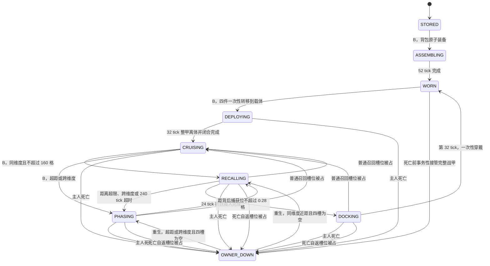

# 战甲独立巡航与整甲召回实现文档

## 1. 实现结论

本功能已经从“战甲贴着主人伴飞、召回后再播放 52 tick 分件着甲”调整为三条互不混淆的流程：

1. 背包着甲流程：玩家未完整穿戴、完整套装位于背包或部分已穿戴时，按 `B` 仍使用原有 52 tick 分件组装；
2. 独立巡航流程：玩家完整穿戴时按 `B`，先进入显式的 32 tick `DEPLOYING`，所有甲片同步展开、整甲整体离体并闭合，再在部署点附近自主巡航；再次按 `B` 后，同维度近距采用可见返航，超距或跨维度采用 `PHASING` 折跃接入，抵达后进入 32 tick 整甲外骨骼包覆，最后一个服务端 tick 一次性穿戴；
3. 死亡自返流程：完整战甲在玩家死亡前或活动巡航期间由载体继续唯一持有，进入 `OWNER_DOWN` 守护待机；玩家重生后根据距离和维度自动选择可见返航或折跃接入。

巡航召回不再调用 `ArmorAssemblyController.beginAssemblyForEquippedSet()`，也不会播放 13 个部件的 52 tick 时间线。

当前实现使用受保护的原版 `ArmorStand` 作为服务端物品载体，客户端隐藏木架，只渲染完整 OBJ 战甲。这样既能得到可见、可移动的整甲实体，也能让四件真实 `ItemStack` 始终有唯一权威位置。

## 2. 原始重复着甲 bug

旧入口在收到 `B` 请求后总是调用 `ArmorAssemblyController.handleRequest()`。当四件战甲本来已经穿好时，原子装备规划没有任何待迁移物品，但仍被当成成功，随后又创建新的 `sequenceId` 和开始时间，因此每按一次 `B` 都会重播整套 52 tick 动画。

修复后的唯一服务端入口是 `ArmorCruiseController.handleRequest()`。它先读取当前巡航阶段和玩家装备状态，再决定 `B` 的上下文语义：

```text
B 请求
  ├─ 正在 52 tick 分件组装 -> 拒绝
  ├─ DEPLOYING              -> 普通按键拒绝；危险下坠则立即制动并转入整甲召回
  ├─ CRUISING               -> 开始整甲召回
  ├─ OWNER_DOWN             -> 槽位为空时手动触发自返，否则继续守护待机
  ├─ RECALLING / PHASING / DOCKING -> 普通按键拒绝；危险下坠只升级紧急救援，不重置现有时间线
  ├─ 已完整穿戴             -> 战甲离体，进入固定区域巡航
  └─ 其他                   -> 交给原 52 tick 背包着甲入口
```

因此，完整穿戴时按 `B` 已不可能重新启动 52 tick 分件动画。

## 3. 状态定义

### 3.1 网络与服务端活动阶段

`ArmorCruisePhase` 包含七个网络阶段：

| 阶段 | 是否存在活动载体 | 四件原物品位置 | 行为 |
| --- | --- | --- | --- |
| `IDLE` | 否 | 玩家、背包或原版掉落 | 仅作为网络清理快照，不存入活动状态表 |
| `DEPLOYING` | 是 | ArmorStand 四个装备槽 | 用 32 tick 表现整甲同步展开、整体离体、交接与闭合；不逐件脱甲 |
| `CRUISING` | 是 | ArmorStand 四个装备槽 | 围绕固定锚点自主巡航，不跟随主人 |
| `RECALLING` | 是 | ArmorStand 四个装备槽 | 从当前世界位置高速飞向主人 |
| `PHASING` | 是，折跃中点会事务性替换载体 | ArmorStand 四个装备槽 | 超过直飞上限或跨维度时收束、迁移并在主人附近重入 |
| `OWNER_DOWN` | 是 | ArmorStand 四个装备槽 | 主人死亡后围绕死亡/载体锚点守护待机，等待重生召回 |
| `DOCKING` | 是 | ArmorStand 四个装备槽 | 用 32 tick 完成整甲捕获稳定、展开、包覆、闭合与上线，尚未真正穿戴 |

公共常量如下，客户端直接读取同一份常量计算插值，不维护第二份时长：

```text
DEPLOYMENT_DURATION_TICKS = 32
DOCKING_DURATION_TICKS = 32
PHASING_DURATION_TICKS = 24
PHASING_MIDPOINT_TICKS = 12
DIRECT_RECALL_DISTANCE = 160.0
RECALL_TIMEOUT_TICKS = 240
```

### 3.2 逻辑稳定状态

以下状态不单独存入 `ArmorCruisePhase`：

| 逻辑状态 | 判定方式 |
| --- | --- |
| `STORED` | 没有活动巡航，正确战甲位于背包或部分已穿戴 |
| `ASSEMBLING` | `ArmorAssemblyController` 正在播放背包到玩家的 52 tick 分件组装 |
| `WORN` | 没有活动巡航、没有正在组装，并且玩家四槽为完整套装 |
| `RECOVERED` | 最终交接、明确回收或故障隔离路径已安全处理物品并清理活动状态 |

`ASSEMBLING` 只服务于背包着甲，不再位于巡航召回链路中。

## 4. B 键上下文规则

| 当前条件 | `B` 的结果 | 是否移动物品 | 是否启动动画 |
| --- | --- | --- | --- |
| 正在 `ASSEMBLING` | 拒绝，保持原序列 | 否 | 不重启 52 tick |
| `DEPLOYING` | 普通状态拒绝重复部署；危险下坠立即制动并召回 | 否 | 普通状态不重置；救援转入整甲返航/折跃 |
| `CRUISING` | 近距转 `RECALLING`，超距或跨维度转 `PHASING` | 否 | 整甲返航或折跃接入 |
| `RECALLING / PHASING / DOCKING` | 普通状态拒绝重复召回；危险下坠升级紧急制动 | 否 | 不重置当前路径和阶段时间 |
| `OWNER_DOWN` 且玩家已重生、四槽为空 | 启动自动或手动召回 | 否 | 近距直飞，远距或跨维度折跃 |
| `OWNER_DOWN` 且四槽被占 | 继续待机 | 否 | 清空槽位后自动重试 |
| 完整穿戴且无活动巡航 | 部署载体并进入 `DEPLOYING`，第 32 tick 转 `CRUISING` | 玩家四槽 -> 载体四槽，一次性事务 | 启动 32 tick 整甲离体，不启动 52 tick |
| 完整套装在背包、装备槽可用 | 交给原子装备入口 | 背包 -> 玩家四槽 | 启动 52 tick 分件着甲 |
| 部分穿戴、缺失件在背包 | 补齐套装 | 缺失件 -> 玩家四槽 | 启动 52 tick 分件着甲 |
| 物品不足或目标槽被占 | 原入口拒绝 | 否 | 否 |

客户端按键仍发送无参数 `ArmorAssemblyRequestPayload`。请求只表示“执行当前上下文中的战甲操作”，具体语义全部由服务端判定，客户端不能自行决定部署、召回或穿戴。

## 5. 状态机



普通召回从 `RECALLING / PHASING / DOCKING` 因槽位竞争中断时回到安全巡航；死亡自返链则回到 `OWNER_DOWN`，避免把死亡保护状态误改成普通巡航。若折跃已经在新维度完成载体迁移，新的安全锚点以新载体当前位置为准，不再尝试物理飞回旧维度。

## 6. 固定区域自主巡航

### 6.1 部署点与锚点

玩家完整穿戴时按 `B`，服务端先撤销战甲飞行授权，再在玩家侧后方创建 ArmorStand，并进入 32 tick `DEPLOYING`：

```text
deployment = player.position
           - forward * 1.55
           + right   * 1.35
           + (0, 0.22, 0)
```

这个部署位置同时成为本次巡航的固定 `patrolAnchor`。完成部署并切换到 `CRUISING` 后，巡航目标不再读取玩家的位置或朝向，玩家走开、飞走或转身都不会把战甲拖到身边。

### 6.2 DEPLOYING：32 tick 整甲离体

`DEPLOYING` 是服务端权威的显式阶段，不通过客户端观察“刚出现的 `CRUISING`”来猜测，因此重连、状态补发或召回回退到巡航不会重播脱甲动画。分镜为：

```text
0—7 tick   全身甲片使用同一展开因子同步解锁并向外让位
8—11 tick  整套外骨骼保持展开，准备一次视觉所有权交接
第 12 tick 玩家覆盖层与巡航载体完成整甲交接，不按装备槽逐件转移
12—13 tick 整甲保持展开并整体飞向服务端部署位置
14—29 tick 整甲继续整体移动，同时所有甲片同步闭合
30—31 tick 在部署锚点稳定并接入巡航悬浮
第 32 tick 阶段转为 CRUISING
```

四件真实 `ItemStack` 不跟随上述视觉分镜逐件搬运。服务端在创建 `DEPLOYING` 前完成快照与校验，并在同一事务中把玩家四槽的原物品一次性转移给 ArmorStand；32 tick 时间线只负责整甲展开、视觉所有权交接、整体移动和闭合。失败时按部署事务完整回滚，任何时刻都不创建第二套物品。

### 6.3 自主轨迹

当前轨迹由服务端游戏时间和序列号确定：

- 水平半径：`2.45` 格；
- 垂直起伏：`±0.14` 格；
- 角速度：每 tick `0.025` 弧度；
- 常态追踪步长：每 tick 最多 `0.105` 格；
- 初始相位：由 `sequenceId` 派生，避免多个载体完全重叠运动。

轨迹可概括为：

```text
angle = sequencePhase + elapsedTicks * 0.025
target.x = anchor.x + cos(angle) * 2.45
target.y = anchor.y + sin(angle * 1.7) * 0.14
target.z = anchor.z + sin(angle) * 2.45
```

ArmorStand 关闭重力和普通物理碰撞，由服务端直接平滑更新位置，并把 `deltaMovement` 保持为零。

### 6.4 区块持续加载

固定巡航意味着主人可能离开载体所在区块。若不处理区块卸载，服务端保存的 ArmorStand 引用会失效，按 `B` 时无法立即召回。

当前实现为每个活动载体建立 `TicketType<UUID>` 区域票据，半径参数为 `2`，对应实体 tick 所需的 level 31。载体跨区块时遵循：

1. 先给新区块添加票据；
2. 再移除旧区块票据；
3. 更新运行时记录的 `ticketLevel` 和 `ticketChunk`。

完成包覆、正常回收和活着时断线会释放票据；死亡进入 `OWNER_DOWN` 时保留活动载体票据，折跃迁移时先加目标票据再释放源票据；停服时释放运行时票据但保留需要持久恢复的载体与索引。所有终止路径都必须验证没有遗留无主强加载票据。

## 7. 近距返航、远距折跃与 32 tick 整甲包覆

### 7.1 RECALLING

`CRUISING` 或重生后的 `OWNER_DOWN` 发起召回前，服务端要求玩家四个装甲槽为空。若载体与玩家在同一维度且距离不超过 `160` 格，进入可见的 `RECALLING`：

1. 阶段切换为 `RECALLING`；
2. 记录新的 `phaseStartGameTime`；
3. 广播巡航快照；
4. 目标统一为玩家背后 `1.55` 格、脚下基准上方 `0.82` 格的着装捕获位；
5. 速度从 `0.24` 格/tick 起步，每 tick 最多增加 `0.045`，最高 `2.35` 格/tick；
6. 距捕获位大于 `16` 格时保持整甲 `76°` 低风阻俯冲；
7. `16 -> 7` 格按 `smoothstep` 连续抬头制动，期望速度由 `2.35` 降至 `0.42` 格/tick；
8. `7 -> 0.28` 格完全转入悬空接近，速度由 `0.42` 降至 `0.32` 格/tick，朝向由航向平滑混合到玩家朝向；
9. 距捕获位不超过 `0.28` 格时进入 `DOCKING`。

服务端运动、客户端姿势、可动甲片和灯光共同读取 `RecallApproachProfile`。返航不再先瞄准玩家脚下再倒飞到背后；`RECALLING` 的终点就是 `DOCKING` 的起点。客户端另用相邻 tick 的载体真实位移驱动速度灯色，不能用目标速度或始终为零的 `deltaMovement` 冒充当前速度。

返航期间每 tick 都会再次检查玩家装甲槽、载体四件套完整性、维度、距离和超时。若途中距离再次超过 `160` 格、玩家换维度，或可见返航超过 `240 tick` 仍未抵达，则改走 `PHASING`，不会无限加载沿途区块或让战甲在远处永远追赶。

### 7.2 PHASING：超距和跨维度折跃接入

`PHASING` 总长 `24 tick`，中点 `12 tick` 执行一次事务性载体迁移：

```text
0—11 tick：旧位置整甲收束，电蓝转折跃紫白
第 12 tick：目标维度预加票据并同步加载目标区块
             -> 在玩家约 20—28 格外选取无碰撞重入点
             -> 生成新载体
             -> 将四个原始 ItemStack 移到新载体
             -> 更新运行时状态与持久索引
             -> 移除旧载体和旧票据
12—23 tick：新位置整甲展开，紫白转重入青
第 24 tick：转为 RECALLING，完成最后一段可见飞行
```

目标票据和新区块必须先准备成功，才能迁移物品并销毁旧载体。新载体生成、四件写入或完整性校验任一失败，都要保留旧载体与旧索引并在后续 tick 重试，不能出现两套载体都持有物品。玩家在折跃中再次切换维度时，以新的玩家维度重新计算接入，而不是让旧目标继续完成。

直飞距离阈值不是表现层参数，而是区块、延迟和服务器负载边界：远距召回通过固定 24 tick 折跃把问题压缩为“源区块 + 目标区块”的事务，不沿数千格路径强加载区块。

### 7.3 DOCKING：32 tick 外骨骼包覆

载体稳定进入玩家背后捕获位的 `0.28` 格容差后保存起始位置和 yaw，并播放独立的新动画：

```text
0—5 tick   悬空捕获、稳定并在玩家背后对正
6—11 tick  外骨骼框架向外解锁
12—19 tick 整套框架从背后包覆玩家
20—27 tick 战靴、腿部、胸臂、头盔依次闭合
28—31 tick 棱形核心、面部、脚底和纹路依次上线
第 32 tick  服务端一次性提交四件真实装备
```

tick 20 后，已经闭合的 OBJ 分区从载体渲染器逐区转交到挂在真实 `PlayerModel` 骨骼上的覆盖层；`DOCKING -> IDLE` 后再用最多 8 tick 的视觉桥等待真实装备包。完整分镜、坐标交接、声音阈值和中断规则见 [整甲召回外骨骼包覆动画设计](整甲召回外骨骼包覆动画设计.md)。

### 7.4 第 32 tick 一次性穿戴

包覆完成前，四件战甲仍全部位于 ArmorStand。第 32 tick 再执行一次最终校验：

- 玩家四个装甲槽必须全部为空；
- ArmorStand 四个槽必须仍是对应的凌空战甲。

校验成功后在同一服务端 tick 内：

1. 从载体四槽取出四个原始 `ItemStack`，同时清空载体槽；
2. 分别写入玩家 `FEET / LEGS / CHEST / HEAD`；
3. 释放区块票据；
4. 删除 owner 对应的持久载体索引；
5. 移除 ArmorStand；
6. 从活动状态表删除本序列；
7. 广播 `IDLE`；
8. 刷新玩家容器并提示核心上线。

这里不复制物品、不创建替代物，也不调用 52 tick 分件组装控制器。玩家只有在最后一次提交完成后才重新获得完整战甲能力。

## 8. 物品唯一归属

### 8.1 不变量

任意正常阶段中，四件原物品只能由一个权威容器持有：

| 阶段 | 玩家装备槽 | 玩家背包 | 巡航载体 | 世界掉落 |
| --- | ---: | ---: | ---: | ---: |
| `WORN` | 4 | 0 | 0 | 0 |
| `DEPLOYING` | 0 | 0 | 4 | 0 |
| `CRUISING` | 0 | 0 | 4 | 0 |
| `RECALLING` | 0 | 0 | 4 | 0 |
| `PHASING` | 0 | 0 | 4，仅中点事务内换载体 | 0 |
| `OWNER_DOWN` | 0 | 0 | 4 | 0 |
| `DOCKING` | 0 | 0 | 4 | 0 |
| 贴合提交完成 | 4 | 0 | 0 | 0 |
| 玩家死亡等待重生 | 0 | 0 | 4 | 0 |

### 8.2 部署事务

部署前先快照玩家四槽。迁移时逐槽执行“清空玩家来源槽 -> 把同一个栈交给载体”。若中途检测到装备变化或抛出异常，则：

- 清空载体槽；
- 用快照恢复玩家四槽；
- 移除载体；
- 不写入持久索引；
- 不创建活动巡航状态。

### 8.3 槽位竞争

召回开始、返航途中、贴合途中和最终提交都会检查玩家四槽：

- 任意槽被其他装备占用时，不覆盖、不丢弃、不强行塞入背包；
- 普通召回回到 `CRUISING`，死亡自返回到 `OWNER_DOWN`；
- 四件凌空战甲继续由载体唯一持有；
- 普通召回载体返回安全巡航锚点，死亡自返载体继续守护待机；
- 若折跃已迁移到新维度，不尝试回到旧世界锚点。

## 9. ArmorStand 载体与交互保护

载体带有两个持久标签：

```text
flight_armor_cruise_carrier
flight_armor_cruise_owner_<owner UUID>
```

载体配置为：

- 无敌、静音、无重力、无普通物理；
- 显示双臂、隐藏底座；
- 四个装备槽持有真实战甲；
- 使用独立悬浮姿势。

服务端在使用实体和攻击实体回调中拦截巡航载体。ArmorStand 自身仍是服务端权威物品容器，客户端渲染、粒子或网络快照都不能修改其中物品。

当前载体不是永久不可伪造的自定义实体。管理员命令或其他模组仍可能绕过普通玩家交互边界；若以后开放多人交易、战甲战斗或远程仓库，需要升级为带持久实例 ID 和 escrow 的自定义实体。

## 10. 网络同步

### 10.1 巡航快照

`ArmorCruiseStatePayload` 字段如下：

```java
UUID playerId
long sequenceId
ArmorCruisePhase phase
UUID carrierId
int carrierEntityId
long phaseStartGameTime
```

位置和装备仍由原版实体同步负责，自定义 payload 只同步身份和阶段。

### 10.2 顺序与补发

- 客户端使用 `sequenceId + phaseStartGameTime` 丢弃旧快照；
- 阶段变化低频广播给所有在线、可接收该 payload 的玩家；
- 开始追踪所有者玩家时补发该所有者状态；
- 开始追踪远离所有者的巡航载体时，通过载体 owner 标签补发状态；
- 新玩家加入时，`syncAllTo()` 补发全部活动巡航状态。

增加“追踪载体”和“加入时全量同步”是固定区域巡航必须具备的路径。载体可能离主人很远，只监听玩家 `START_TRACKING` 会让观察者把 `DEPLOYING / RECALLING / PHASING / OWNER_DOWN / DOCKING` 错当成普通 `CRUISING`。

## 11. 客户端渲染

### 11.1 隐藏木架并复用 OBJ 战甲

`CruiseArmorStandModelMixin` 只隐藏被识别为巡航载体的 ArmorStand 木质身体、支架和底座。四件装备仍进入 Fabric `ArmorRenderer`，由 `FlightObjArmorRenderer` 渲染同一套完整 OBJ、动态结构和发光组。

模型实例会在实体间复用，因此 mixin 每次渲染普通 ArmorStand 时都会显式恢复可见性，避免渲染过一个巡航载体后把全世界普通盔甲架一起隐藏。

### 11.2 各阶段造型

| 阶段 | 结构展开进度 | 速度视觉 | 姿势 |
| --- | ---: | ---: | --- |
| `DEPLOYING` | `0 -> 同步展开 -> 0` | 整甲离体插值 | 全身同步解锁 -> 单次视觉交接 -> 整体闭合 |
| `CRUISING` | `0.68` | `0.12` | 非对称反重力悬浮 |
| `RECALLING` | `0.26 -> 0.50 -> 0.68` | 相邻 tick 真实位移 | `76°` 俯冲 -> `14°` 迎角 -> 直立悬空，四肢由收拢连续展开 |
| `PHASING` | `0.68 -> 0 -> 0.30` | `0.82 -> 0.16` | 前半收束、后半重入展开 |
| `OWNER_DOWN` | `0.46` | `0.04` | 低能耗守护悬停，琥珀呼吸灯 |
| `DOCKING` | `0.68 -> 0` | 悬停档 -> 0 | 从悬空末帧无缝进入 32 tick 外骨骼展开、包覆和顺序闭合 |

DOCKING 进度以服务端 `phaseStartGameTime` 为时间基准，低帧率不会延长动画，迟到的观察者会直接恢复到正确进度。

tick 20—31 的装甲不能继续只依附 ArmorStand。已闭合分区由载体渲染器退出，并由挂在玩家真实 `PlayerModel` 上的覆盖层接管；覆盖层使用头、身体、左右臂和左右腿的当前骨骼，因此转头、手臂联动、肘部和膝盖弯曲不会与人物分离。每个 OBJ 分区同一帧只能由一侧绘制。

### 11.3 发光变化

贴合过程中所有发光组始终使用 `FULL_BRIGHT`，只以颜色表达阶段，不降低亮度：

```text
远距速度色 -> 近距悬停青 -> 锁定紫 -> 接触暖白 -> 常态高亮青
```

颜色使用多段 `smoothstep` 连续插值，胸口核心、面部灯、脚底灯和装甲纹路均由同一阶段进度驱动。

### 11.4 8 tick 视觉桥与 40 tick 载体墓碑

玩家装备同步、ArmorStand 移除和 `IDLE` payload 可能在客户端相差一帧。若仅依赖实体标签，旧载体可能在玩家已经穿好后再闪现一帧，形成“双甲”。

客户端收到 `DOCKING -> IDLE` 时，玩家覆盖层最多保持最终闭合态 `8 tick`，直到真实装备同步已经出现在玩家四槽。真实装备一到，覆盖层立即退出，让普通 ArmorRenderer 在同一最终姿势上接管；这条桥只遮住网络空窗，不复制或持有物品。

同时为旧 `carrier UUID` 建立 40 tick 墓碑；`PHASING` 中点更换 carrier UUID 时也对旧载体建立同样墓碑：

- `isCruiseCarrier()` 不再把它作为活动载体；
- ArmorStand mixin 仍隐藏其木架；
- OBJ 渲染器直接跳过该旧实体；
- 声音控制器不再从该 UUID 播放循环；
- 实体正式移除或墓碑到期后自然清理。

视觉桥和墓碑都只处理网络帧顺序，不持有物品，也不会改变服务端状态。

## 12. 声音

巡航和整甲贴合复用统一声音系统，但不进入 `ArmorAssemblySoundController` 的 13 部件/52 tick 时间线。

| 阶段 | 声音行为 |
| --- | --- |
| `CRUISING` | 载体位置上的外部核心、悬浮和低量力场循环 |
| `RECALLING` | 按载体真实位移增强空气剪切；进入 7 格悬空段后由同一距离进度交叉淡出剪切层并接入悬浮层 |
| `PHASING` | 旧载体处收束、12 tick 折跃脉冲、新载体处重入；旧 UUID 循环立即淡出 |
| `OWNER_DOWN` | 低频守护核心与很弱的琥珀能量呼吸，不播放返航层 |
| `DOCKING` 0—5 | 捕获位悬空稳定，返航循环已经淡出 |
| `DOCKING` 6—27 | 框架解锁、包覆、靴腿/胸臂/头盔独立阈值锁定 |
| `DOCKING` 28—31 | 核心预充、面部上线、脚底/纹路扫过、核心在线 |
| 第 32 tick | 只做服务端物品提交，不重播机械闭合 |

服务端通过 `setPos` 驱动载体并保持速度向量为零，因此客户端声音控制器用相邻 tick 的实体位置差估算真实移动速度，并和可用的 `deltaMovement` 取较大值。

一次性声音以 `(sequenceId, stageId)` 去重。同一序列的重复快照和重复按 `B` 不会重播锁定或核心上线声；迟加入的观察者只恢复当前循环层，不补播已经错过的一串机械声。完整阈值见独立动画设计文档。

## 13. 故障与生命周期

### 13.1 掉线

活着的玩家正常断线时，若当前不是 `OWNER_DOWN`，控制器先从载体取出实际存在的物品，再按以下顺序交付：

1. 对应玩家装备槽为空时优先恢复原槽；
2. 否则放入玩家背包；
3. 背包也无法容纳时，在玩家位置生成一次掉落；
4. 删除持久索引；
5. 释放票据、移除载体、广播 `IDLE`。

`OWNER_DOWN` 或死亡过程中断线不能把战甲塞回死亡玩家的物品栏。载体与索引继续留在世界，等待玩家上线和重生后自返。

### 13.2 死亡前接管与 OWNER_DOWN

| 场景 | 处理 |
| --- | --- |
| 玩家正完整穿戴且没有活动载体 | 在 `ServerPlayer#die` 原版掉落前生成载体；新载体成功持有四件后才清空玩家装备槽并进入 `OWNER_DOWN` |
| `DEPLOYING / CRUISING / RECALLING / PHASING / DOCKING` 中死亡 | 不移动四件真实物品；现有载体在当前位置进入 `OWNER_DOWN` |
| 载体生成或迁移失败 | 不清空玩家槽，完整交还原版死亡流程，禁止半接管 |
| `OWNER_DOWN` 中再次收到死亡事件 | 幂等忽略，不创建第二载体 |

`OWNER_DOWN` 以进入该阶段时的载体位置为锚点，在约 `0.62` 格的小范围内守护悬停，使用琥珀/金色高亮。四件物品不进入死亡掉落，也不受本次 `keepInventory` 的普通装备处理；这是“战甲死亡后会自行回来”的明确玩法语义，而不是原版掉落语义。

### 13.3 重生后自动召回

`AFTER_RESPAWN` 只做重生所有者绑定和最早下一 tick 的恢复调度：

1. 新玩家实体已存活且四个装甲槽为空：自动调用召回决策；
2. 同维度且距离不超过 `160` 格：`OWNER_DOWN -> RECALLING`；
3. 超距或重生到其他维度：`OWNER_DOWN -> PHASING -> RECALLING`；
4. 装甲槽被其他物品占用：继续 `OWNER_DOWN`，提示清空后自动重试；
5. 自动返航途中再次死亡：立即回到 `OWNER_DOWN`，不丢物品、不生成第二载体。

玩家不需要回死亡点按 `B`。`B` 在 `OWNER_DOWN` 中只作为手动重试入口，真正的恢复条件仍由服务端槽位、维度和载体完整性判定。

### 13.4 活着时换维度

不让原 ArmorStand 直接穿传送门。主人换维度时保留四件原物品和源载体，进入 `PHASING`；中点在新维度安全位置生成新载体并事务性迁移四件，之后完成可见返航。折跃迁移必须先获得目标区块票据，成功提交后才释放源票据。

### 13.5 当前停服恢复能力

- 正常停服时，在线所有者的战甲归还玩家；
- 离线或 `OWNER_DOWN` 所有者的四件原物品留在可持久化 ArmorStand 中，运行时状态被删除并释放区块票据；
- 启动时先接管已加载实体，同时读取世界级 `SavedData` 定位索引；
- 对尚未加载的远区块，按索引中的维度、区块和 carrier UUID 添加临时票据并精确加载；
- 尚未及时恢复的实体以后触发 `ServerEntityEvents.ENTITY_LOAD` 时仍会再次校验接管；
- 通过 owner 标签、`OWNER_DOWN` 标签和索引阶段恢复状态，以持久锚点重建区域票据。

载体装备和 owner 标签由原版实体 NBT 保存。发现同一 owner 的第二个载体时，控制器不会擅自删除可能持有真实物品的实体，而是记录错误并隔离保留，等待人工处理。

### 13.6 已实现的持久索引

当前已加入世界级 `ArmorCruiseSavedData`。索引只保存定位和状态，不复制四件物品；四件真实 `ItemStack` 始终只在玩家装备槽或 ArmorStand 实体 NBT 中：

```text
ownerUuid -> {
    carrierUuid,
    dimensionId,
    chunkX,
    chunkZ,
    phaseName,
    anchorX/Y/Z,
    sequenceId,
}
```

写入时机：

1. 部署或死亡接管：新载体生成、四件完整写入并校验成功后，原子写入索引；
2. 载体跨区块：先更新票据，再更新索引中的区块坐标；
3. `PHASING` 中点：新载体已持有四件后，将索引从旧 UUID/维度/区块原子切到新载体，再移除旧载体；
4. 进入 `OWNER_DOWN`：持久阶段改为 `OWNER_DOWN`；
5. 第 32 tick 穿戴或明确安全回收：玩家槽位写入成功后删除索引；
6. 异常卸载：保留索引，禁止把旧 Java 实体引用中的物品再取一遍。

启动和玩家上线恢复：

1. 按索引取得目标维度与区块，而不是遍历所有已加载实体；
2. 添加临时恢复票据并加载目标区块；
3. 只接受 UUID、owner 标签、完整四件套都匹配的载体；
4. 将 `DEPLOYING / RECALLING / PHASING / DOCKING` 等瞬时阶段在崩溃恢复时规范化为安全的 `CRUISING` 或 `OWNER_DOWN`；
5. 重建运行时状态和常驻票据，再释放临时恢复票据；
6. 玩家已经重生且槽位为空时，立即按距离/维度选择 `RECALLING` 或 `PHASING`。

索引与实体不一致时以“禁止复制、保留实物”为第一原则：找不到实体时保留索引并重试；发现多个带物品载体时全部隔离并记录 UUID，不自动删除任何可能持有真物品的实体；索引绝不能保存 `ItemStack` 副本。

### 13.7 异常卸载

区域票据正常工作时载体不应异常卸载。若仍检测到 `UNLOADED_TO_CHUNK` 或 `UNLOADED_WITH_PLAYER`：

- 不从已卸载的旧 Java 实体引用提取物品，防止和磁盘实体重复；
- 删除当前运行时状态并释放票据；
- 广播 `IDLE`；
- 保留持久索引中的 carrier UUID、维度、区块和稳定阶段；
- 物品继续留在世界存档实体中；
- 由持久索引主动加载目标区块并重新接管。

没有持久索引时只能等待区块被动加载；实现索引后才具备主动恢复和远距离死亡自返能力。

## 14. 与飞行能力的关系

- 战甲部署前调用 `FlightController.remove(player)`，立即撤销完整套装带来的当前飞行状态；
- `DEPLOYING / CRUISING / RECALLING / PHASING / OWNER_DOWN / DOCKING` 中四件都不在玩家身上，因此不能继续把该套战甲当作已穿戴装备；
- 第 32 tick 一次性穿戴成功后，完整套装能力恢复；
- 背包 52 tick 分件着甲仍在核心上线前由 `ArmorAssemblyController.isAssembling()` 阻止飞行；
- 单独穿凌空战靴可飞行的既有规则不变，单靴不会创建完整巡航载体。

## 15. 主要实现文件

| 文件 | 职责 |
| --- | --- |
| `cruise/ArmorCruisePhase.java` | 七阶段枚举、32 tick 整甲部署与包覆、24 tick 折跃和直飞边界公共常量 |
| `cruise/ArmorCruiseController.java` | B 键状态机、固定巡航、远距折跃、死亡自返、区块票据和物品事务 |
| `cruise/ArmorCruiseSavedData.java` | owner 到载体维度/区块/UUID 的世界级持久索引与恢复协调 |
| `network/ArmorCruiseStatePayload.java` | 巡航阶段快照 |
| `FlightArmorMod.java` | payload 注册、服务端 tick、追踪补发、死亡/重生/换维度生命周期事件 |
| `mixin/ServerPlayerDeathMixin.java` | 原版装备掉落前事务性接管完整穿戴战甲 |
| `client/cruise/ArmorCruiseClient.java` | 客户端状态镜像、PHASING/DOCKING 进度、8 tick 视觉桥和 40 tick 墓碑 |
| `client/render/obj/FlightObjArmorRenderer.java` | 六阶段 OBJ 结构、载体到玩家的分区接管和发光颜色 |
| `mixin/CruiseArmorStandModelMixin.java` | 隐藏木架并控制整甲骨架收拢 |
| `client/audio/ArmorSoundController.java` | 巡航空间声、折跃、死亡守护和 32 tick 独立整甲声音 |
| `docs/整甲召回外骨骼包覆动画设计.md` | 新整甲动画的逐 tick 分镜与三段渲染权交接规范 |

## 16. 验收矩阵

### 16.1 主流程

- [ ] 完整穿戴按一次 `B`：玩家四槽一次性转给唯一载体并进入 `DEPLOYING`，不会逐槽播放脱甲；
- [ ] `DEPLOYING` 严格持续 32 tick，所有甲片同步展开、整甲交接、整体离体并闭合后才进入固定区域 `CRUISING`；
- [ ] 玩家离开 50 格以上：载体仍绕原锚点巡航，不贴身跟随；
- [ ] 同维度 160 格内再次按 `B`：只进入一次 `RECALLING`，速度从慢到快并受最大速度限制；
- [ ] 距背后捕获位 0.28 格内：进入 `DOCKING`，不会先冲到玩家脚下再倒飞；
- [ ] 包覆严格持续 32 tick，按悬停稳定、外张、包覆、靴腿/胸臂/头闭合、灯光上线顺序播放；
- [ ] 第 32 tick 结束时一次性穿齐四件；
- [ ] 整个巡航召回链路不产生新的 `ArmorAssemblyStatePayload` 和 52 tick 分件动画；
- [ ] 背包有完整套装时按 `B` 仍能启动原 52 tick 分件着甲。

### 16.2 超距和跨维度

- [ ] 同维度距离 `159 / 160 / 161` 格分别验证直飞边界，无来回抖动；
- [ ] 载体与玩家距离数千格时进入 `PHASING`，不强加载沿途区块；
- [ ] 不同维度召回走 24 tick 折跃，在第 12 tick 前后物品总数始终为 4；
- [ ] 折跃先加载目标区块并生成新载体，提交后才移除旧载体和旧票据；
- [ ] 目标重入点碰撞时尝试备选位置，所有位置不可用时保留源载体并重试；
- [ ] 折跃中玩家再次换维度，旧目标被取消，最终只在最新维度出现一套战甲；
- [ ] 可见返航超过 240 tick 或中途重新超距时自动转 `PHASING`；
- [ ] 远距载体旧 UUID 在客户端被墓碑抑制，不闪木架、不出现两套 OBJ。

### 16.3 死亡与重生自返

- [ ] 完整穿戴状态死亡：原版掉落前成功创建一个 `OWNER_DOWN` 载体，死亡掉落中没有这四件战甲；
- [ ] `DEPLOYING / CRUISING / RECALLING / PHASING / DOCKING` 每一阶段死亡，四件仍唯一留在载体且进入 `OWNER_DOWN`；
- [ ] `keepInventory=true/false` 都符合战甲守护自返语义，不复制掉落；
- [ ] 同维度近距重生后自动可见返航，无需回死亡点按 `B`；
- [ ] 远距或异维度重生后自动 `PHASING -> RECALLING -> DOCKING`；
- [ ] 重生时四槽被占，载体继续守护待机；清空后下一 tick 自动重试；
- [ ] 死亡自返途中再次死亡，不创建第二载体并重新进入 `OWNER_DOWN`；
- [ ] `OWNER_DOWN` 中断线再上线，状态和 owner 绑定仍正确。

### 16.4 持久索引与重启

- [x] `SavedData` 索引包含 owner、carrier UUID、维度、区块、阶段、锚点和序列，且不保存 `ItemStack`；
- [ ] 部署、跨区块、折跃中点、进入 `OWNER_DOWN`、最终穿戴和回收的索引更新顺序通过故障注入；
- [ ] 玩家死在无人加载的遥远区块后停服；重启后不靠玩家接近死亡点也能按索引主动加载并召回；
- [ ] 玩家死在其他维度后停服；在主世界重生并重启后仍能折跃回来；
- [ ] 分别在 `DEPLOYING / RECALLING / PHASING / DOCKING` 强制崩溃，重启后规范化到安全的 `CRUISING` 或 `OWNER_DOWN`；
- [ ] 索引存在但实体暂未加载时不生成替代战甲、不删除索引，并可重试恢复；
- [ ] 实体存在但索引缺失时进入隔离恢复，不自动复制；
- [ ] 同 owner 多个带物品载体时记录全部 UUID 并隔离，绝不自动删除可能持有真物品的实体；
- [ ] 恢复结束后临时票据释放、活动票据正确，物品总数仍为 4。

> 持久索引的代码路径已经完成；未实际执行过的停服、远区块与故障注入条目仍保持未勾选，发布说明不得把这些未运行用例写成已验证。

### 16.5 输入幂等与物品唯一性

- [ ] 非危险状态下，`DEPLOYING / RECALLING / PHASING / DOCKING` 连续按 `B` 不重置时间线、不创建第二个载体；
- [ ] 危险下坠时，上述四阶段按 `B` 只建立或幂等复用紧急 attempt，不重置阶段、不重复迁移；
- [ ] `OWNER_DOWN` 连续按 `B` 不创建第二载体；
- [ ] `ASSEMBLING` 连续按 `B` 不重置原 52 tick 序列；
- [ ] 重复或乱序 S2C 快照不会重播整甲锁定和核心上线声音。
- [ ] `DEPLOYING / CRUISING / RECALLING / PHASING / OWNER_DOWN / DOCKING` 中玩家四槽为 0、载体总计为 4；
- [ ] 最终提交后玩家四槽为 4、载体四槽为 0 且实体移除；
- [ ] 部署中途失败能完整回滚；
- [ ] 召回前槽位被占时拒绝，不移动战甲；
- [ ] 在 DOCKING 的 `0 / 5 / 6 / 11 / 12 / 19 / 20 / 27 / 28 / 31` tick 穿入其他装备，均不覆盖、不吞物品；
- [ ] 普通召回冲突回安全巡航，死亡自返冲突回 `OWNER_DOWN`。

### 16.6 视觉与声音

- [ ] 木质 ArmorStand、支架和底座不可见，普通盔甲架不受影响；
- [ ] `DEPLOYING` 全身同步展开、单次交接并整体闭合；`CRUISING` 展开悬浮；`RECALLING` 在 16/7 格边界依次完成俯冲、抬头、悬停；`PHASING` 收束重入；`OWNER_DOWN` 守护悬停；
- [ ] 返航速度灯色按相邻 tick 真实位移从慢到快变化，近距悬停时回到高亮青，不在进入 `DOCKING` 时跳色；
- [ ] 近距悬停声接管空气剪切声，不能在姿态已直立时仍维持高速风噪；
- [ ] DOCKING 从载体到 PlayerModel 覆盖层逐区接管，人物转头、左右臂独立动作和肘膝弯曲时装甲不分离；
- [ ] 玩家移动和转身时贴合目标持续更新；瞬移或换维度会中断重算，不拉成橡皮筋；
- [ ] 灯色按电蓝、紫、暖白、青连续变化且全程高亮；
- [ ] `DOCKING -> IDLE` 的 8 tick 视觉桥在装备包提前到达时立即结束；
- [ ] 40 tick 墓碑同时抑制旧载体木架、OBJ 和循环声；
- [ ] 完成帧没有双甲、空甲、骨骼跳变或木架闪现；
- [ ] 巡航声音跟随载体，返航随真实速度增强，32 tick 各阈值一次性触发；
- [ ] 巡航召回不播放 13 部件分件飞入和锁定全套声音。

### 16.7 区块、多人和网络

- [ ] 主人离开固定锚点区块后载体仍可 tick 并立即召回；
- [ ] 载体跨区块时新旧票据无一 tick 空窗，结束后无残留票据；
- [ ] 观察者只靠近载体、不追踪 owner 时仍能获得正确阶段；
- [ ] 中途加入或重新追踪的客户端恢复当前进度，不从 0 重播；
- [ ] 50、150、300 ms 延迟和状态包重复/乱序下，动画进度仍以服务端时间为准；
- [ ] 七个阶段分别测试掉线、换维度、死亡与停服，物品总数始终为 4；
- [ ] 多名玩家同时巡航、死亡和折跃时，owner 与 carrier 不串线。

## 17. 兼容边界

### 17.1 客户端与服务端

- 物品权威、状态机、死亡接管、区块票据和持久索引在服务端；
- OBJ、PlayerModel 覆盖层、灯光、墓碑和声音需要客户端也安装本模组；
- 纯服务端安装可以保证物品逻辑，但不能得到新的整甲包覆视觉，不能把它当作完整兼容模式。

### 17.2 死亡、墓碑与保留物品模组

本功能在 `ServerPlayer#die` 的原版装备掉落前接管完整战甲，且有意让战甲不进入本次死亡掉落。这会和以下模组产生语义重叠：

- 墓碑/尸体模组扫描死亡装备；
- 自定义 `keepInventory`、灵魂绑定或死亡惩罚；
- 替换 `ServerPlayer#die`、取消死亡或延迟掉落的 mixin。

兼容时必须保证只有一方取得四件真实物品。若死亡事件已被取消，接管事务也必须回滚；不能同时把战甲写入墓碑和 `OWNER_DOWN` 载体。

### 17.3 玩家模型与渲染模组

PlayerModel 覆盖层依赖标准 `AbstractClientPlayer` 渲染层和六个 Humanoid 骨骼锚点。替换整个玩家渲染器、改变骨骼层级或隐藏原模型的模组可能需要专用适配。姿势模组可以继续驱动手脚，但覆盖层必须在其最终骨骼姿势上渲染，不能提前缓存一套僵直姿势。

光影包、渲染优化和透明排序可能改变 emissive 观感；功能只保证 `FULL_BRIGHT` 输入，不保证所有第三方 shader 下颜色完全一致。

### 17.4 装备槽与物品模组

- 当前只认原版 `FEET / LEGS / CHEST / HEAD`，不支持 Curios/Trinkets 等额外槽；
- 其他模组在召回期间占用原版四槽时会安全中断，不做强制覆盖；
- 管理员命令、NBT 编辑器或其他模组可绕过普通玩家交互保护，因此 ArmorStand 载体不是安全仓库；
- 当前按“完整四件凌空战甲”识别，没有永久 armor instance ID，多套同类战甲的跨玩家交易仍需额外所有权设计。

### 17.5 区块、维度与多人

- `PHASING` 是事务性载体迁移与视觉折跃，不是让同一个 ArmorStand 物理穿越维度；
- 目标维度必须已注册并允许加载，世界边界和高度边界内还要找到无碰撞重入点；
- 大量玩家同时独立巡航会创建对应区域票据，应提供服务器配置的并发上限或降级策略；
- 一个 owner 只能有一个活动载体；检测到多个带物品载体时必须隔离，不能自动合并或删除。

## 18. 当前完成边界

运行时链路的目标交互是：

```text
完整穿戴
  -> B：战甲离体
  -> 固定区域自主巡航
  -> B：近距整甲高速返航 / 超距与跨维度 PHASING
  -> 32 tick 外骨骼包覆
  -> 第 32 tick 一次性穿戴

死亡或巡航中死亡
  -> OWNER_DOWN 守护待机
  -> 重生后自动近距返航 / PHASING
  -> 32 tick 外骨骼包覆
  -> 恢复穿戴
```

仍保留的独立流程是：

```text
战甲在背包或部分已穿
  -> B：原子收集
  -> 52 tick 分件着甲
```

当前代码已经有显式 `DEPLOYING`、`PHASING`、`OWNER_DOWN`、死亡/重生事件入口、世界级 `SavedData` 定位索引、两条 32 tick 公共时间线、PlayerModel 覆盖层、8 tick 视觉桥和旧载体墓碑。远区块与停服恢复已有主动加载路径，但仍需按 16.4 的矩阵做实际存档重启和故障注入验证，才能把“所有异常下必返”作为发布保证。

当前仍不包含巡航战甲自主战斗、攻击目标选择、13 个真实世界实体分件离体、跨玩家交易所有权或永久战甲实例 ID。其中自主战斗的状态机、目标策略、资源账本和生命周期边界已在[巡航战甲自主战斗实现设计](巡航战甲自主战斗实现设计.md)中单独设计，但尚未接入代码；这些能力不能用纯客户端特效伪造。
