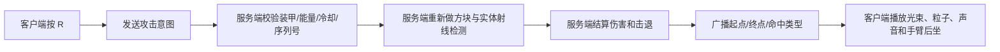
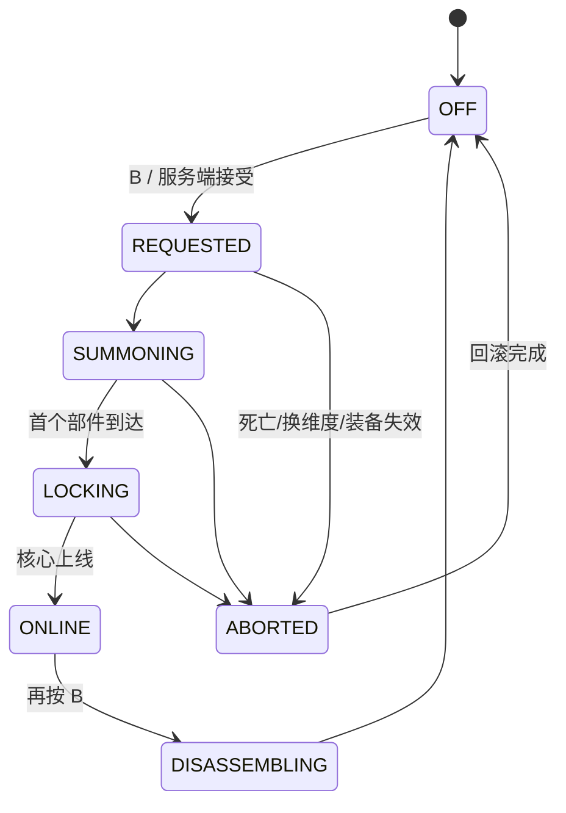

# 飞行装甲攻击系统与分件着甲实现分析

> 适用项目：Flight Armor / Fabric 1.21.1  
> 文档日期：2026-07-13  
> 当前基线：`2.5.1`、原生 OBJ 装甲渲染、playerAnimator + bendy-lib

## 1. 结论

攻击系统和“装甲部件从远处飞来、逐段吸附到角色身上”的动画都能实现，而且不必立即替换现有 OBJ 技术。

推荐顺序：

1. 先实现服务端权威的腕部反重力脉冲，验证输入、射线命中、伤害、冷却和多人同步。
2. 再实现胸口棱形核心蓄力束和俯冲冲击。
3. 分件着甲先做“物品已装备、模型视觉上飞入”的版本；观感确认后，再考虑真实装备栏迁移。
4. 攻击姿态、飞行姿态和着甲姿态必须最终合成同一个 `FlightPoseFrame`，否则会再次出现人物皮肤、肘膝和装甲不同步。

不建议第一版引入导弹、机枪或会破坏方块的大爆炸。腕部脉冲、核心光束和重力冲击更符合当前反重力装甲风格，也更容易做好多人安全性。

## 2. 当前项目可以直接复用的结构

### 2.1 客户端输入

`FlightArmorClient` 已经集中处理空格、WASD、Shift、Ctrl 和俯冲键，并具有状态变化立即发包、相同状态定期心跳的模式。

攻击不要继续塞进飞行输入包。建议新增独立入口：

```text
client/combat/ArmorCombatClient.java
client/combat/AttackPoseController.java
client/assembly/ArmorAssemblyClient.java
```

建议按键：

| 按键 | 功能 | 原因 |
|---|---|---|
| R | 腕部脉冲 | 单击动作，不抢占原版左键 |
| G | 核心蓄力束 | 适合按住蓄力、松开发射 |
| B | 召回/解除装甲 | 与飞行键、俯冲键分离 |

第一版不建议接管鼠标左键。左键同时承担挖掘、原版近战和界面操作，过早覆盖会产生大量兼容问题。

### 2.2 网络

项目已经使用 Fabric 的 `CustomPacketPayload`、`PayloadTypeRegistry`、`ClientPlayNetworking` 和 `ServerPlayNetworking`。Fabric 官方文档要求 payload 在相应方向注册，并明确提醒服务端必须验证客户端包中的内容；官方示例也会在服务端重新查找实体并验证距离，而不是直接相信客户端目标。[Fabric Networking 官方文档](https://docs.fabricmc.net/develop/networking)

版本注意：较新的 Fabric 文档使用 `serverboundPlay/clientboundPlay` 命名，而 Fabric API 1.21.1 源码使用 `playC2S()/playS2C()`；本项目必须继续以 [Fabric API 1.21.1 的 PayloadTypeRegistry](https://github.com/FabricMC/fabric-api/blob/1.21.1/fabric-networking-api-v1/src/main/java/net/fabricmc/fabric/api/networking/v1/PayloadTypeRegistry.java) 为准。

建议新增协议：

```text
ArmorAttackIntentPayload       C2S  玩家只发送攻击意图
ArmorAttackFxPayload           S2C  服务端确认后的光束、命中与声音事件
ArmorCombatStatePayload        S2C  能量、热量、冷却、蓄力进度

ArmorAssemblyRequestPayload    C2S  召回或解除请求
ArmorAssemblyStatePayload      S2C  当前着甲状态快照
ArmorAssemblyEventPayload      S2C  单个部件锁定事件
```

`ArmorAttackIntentPayload` 可以包含：

```text
attackType
action = PRESS / RELEASE / CANCEL
sequenceId
clientYaw
clientPitch
```

客户端朝向只用于立即播放预测动画。服务端必须重新读取玩家眼睛位置、实际视线、装甲、能量、冷却和目标遮挡；客户端不得上传伤害值或最终命中位置。

### 2.3 服务端控制器

建议与 `FlightController` 分离：

```text
combat/ArmorCombatController.java
combat/ArmorCombatState.java
combat/ArmorAttackType.java
combat/CombatTuning.java

assembly/ArmorAssemblyController.java
assembly/ArmorAssemblyState.java
assembly/AssemblyPhase.java
assembly/AssemblyPart.java
```

`ModItems.hasFlightGear()` 当前包含“完整套装或只穿飞行鞋”。攻击不能直接使用这个条件，否则单穿鞋也能发射腕炮。应拆出：

```java
hasCombatCore(player)       // 穿胸甲
hasWristEmitter(player)     // 手臂甲属于胸甲槽
hasFullCombatSuit(player)   // 四件完整装甲
```

## 3. 推荐攻击手段

### 3.1 腕部反重力脉冲：第一阶段 MVP

表现为一条非常短的高亮能量束，不生成持续飞行的实体。

建议初始参数：

```text
伤害                 6
射程                 28 格
冷却                 8 tick
能量消耗             10
击退                 0.55
发射手               左右交替
是否破坏方块         否
```

实现流程：



方块命中和实体命中应分别计算，再选择沿射线距离更近的结果。攻击只在服务端造成伤害；客户端光束即使命中预测略有误差，也只影响一帧表现。

### 3.2 胸口棱形核心蓄力束：第二阶段

`G PRESS` 开始，`G RELEASE` 结束。服务端以真实 tick 计算蓄力，客户端只预测核心颜色、人物姿态和声音。

建议：

```text
最短蓄力             6 tick
满蓄力               30 tick
基础伤害             5
满蓄力伤害           16
射程                 36～52 格
能量消耗             18～45
热量                 蓄力越高越多
```

可先做一次性粗光束；只有在确定要持续照射时，才增加每 tick 命中的通道攻击。持续光束需要处理移动目标、遮挡变化、每目标受击间隔和多人带宽，复杂度明显更高。

### 3.3 俯冲重力冲击：第三阶段

仅在服务端满足以下条件时触发：

- 正处于俯冲模式。
- 真实速度超过阈值。
- 玩家碰到实体或地面。
- 能量和独立冷却满足要求。

伤害可以按速度分段，而不是无限平方增长：

```text
速度 < 1.0            不触发
1.0～1.35             小范围冲击
1.35～1.70            中范围冲击
> 1.70                最大范围，但伤害硬封顶
```

触发后应强制退出俯冲并短暂减速。第一版不破坏方块，避免误伤建筑和服务器卡顿。

### 3.4 后续可选攻击

| 方案 | 实现形式 | 优点 | 风险 |
|---|---|---|---|
| 重力脉冲 | 玩家周围 AABB 查询 | 适合被包围时脱身 | 容易误伤，必须处理队友 |
| 锁定能量体 | 自定义弹丸实体 | 有追踪感、可躲避 | 实体同步和碰撞复杂 |
| 飞行撞击 | 服务端速度碰撞 | 与飞行系统结合紧密 | 墙体、延迟和误触发难处理 |
| 连续核心束 | 世界渲染 + 逐 tick 命中 | 观感最强 | 带宽、遮挡、伤害频率最复杂 |

## 4. 能量、热量和冷却

不需要新增消耗道具。建议使用装甲内部能量和热量：

```text
energy               0～100
heat                 0～100
cooldownUntilTick
chargeStartTick
chargingAttack
lastSequenceId
nextHand
```

建议规则：

- 能量自动恢复；高速飞行时恢复略慢，悬停时恢复正常。
- 热量不会立即清空，而是延迟数 tick 后下降。
- 过热只锁定攻击，不取消飞行，避免玩家在空中突然失去控制。
- 客户端 HUD 显示的是服务端同步状态，不自行决定能否攻击。

MVP 可以先存在 `Map<UUID, ArmorCombatState>`。如果以后需要跨重登保留能量，再将稳定数据放到胸甲数据组件；不要每 tick 改写 `ItemStack`。

## 5. 攻击动画如何与现有人物弯肘系统兼容

当前 `DiveLegPoseMixin` 在 `HumanoidModel.setupAnim` 的 TAIL 最后写入四肢角度。因此另加一个普通 mixin 改手臂，很可能仍会被覆盖。

正确做法：

1. `AttackPoseController` 维护攻击手、蓄力、后坐和恢复进度。
2. `FlightPoseController` 先计算飞行姿态，再把攻击姿态混入手臂、肘部和少量头部旋转。
3. 最终仍只输出一个 `FlightPoseFrame`。
4. `FlightJointAnimation` 和 `FlightObjArmorRenderer` 继续读取同一个肘部角度。

姿态优先级：

```text
着甲锁定姿势 > 攻击姿势 > 俯冲姿势 > 悬空移动姿势
```

腕炮姿态只覆盖一条手臂；另一条手臂继续执行飞行稳定姿态。胸炮可以让双臂轻微向外展开，但腰、腿和膝盖继续由飞行姿态控制。

建议新增 OBJ 分组：

```text
arm_left_forearm_emitter_frame_gunmetal
arm_left_forearm_emitter_led
arm_right_forearm_emitter_frame_gunmetal
arm_right_forearm_emitter_led
core_reactor_aperture_led
```

光束本身不要做成装甲 OBJ：

- 瞬时腕炮：S2C 事件后生成粒子线或短寿命光束。
- 连续核心束：独立 world render pass。
- 可躲避、可追踪的攻击：自定义弹丸实体和实体渲染器。

## 6. 可参考项目与许可证结论

### 6.1 Spell Engine：最值得研究的攻击管线

[Spell Engine 1.21.1 源码](https://github.com/ZsoltMolnarrr/SpellEngine/tree/1.21.1)覆盖 Direct、Projectile、Beam/Target、Meteor、Cloud 等交付形式，也包含冷却、消耗、友敌判断、归属、弹射、穿透、追踪、粒子、声音和客户端预测。其 README 明确列出目标选择、投射物特性、Impact 行为、成本系统与网络同步；这套“攻击定义 → 目标 → 交付 → Impact → 成本”的分层很适合本项目借鉴。

许可证为 [GPL-3.0](https://raw.githubusercontent.com/ZsoltMolnarrr/SpellEngine/1.21.1/LICENCE)。当前 Flight Armor 使用 CC0；如果直接复制 GPL 代码并发布，许可证义务会改变。因此推荐只研究架构后独立实现，或者把 Spell Engine 作为明确依赖并评估 GPL 兼容性，不要直接粘贴其实现。

可借鉴：

- 攻击数据、目标选择、交付方式、命中效果、成本相互分离。
- 冷却和持续状态由服务端持有并同步。
- 弹丸归属、友敌关系、穿透和范围效果集中处理。
- 表现资源使用数据驱动，逻辑不硬编码每一种颜色和声音。

### 6.2 Zapinators：精简激光投射物样板

[Zapinators](https://github.com/Namefix/Zapinators)是 Fabric + NeoForge 的激光武器项目，当前源码目标为 Minecraft 1.21.4，不可直接复制进 1.21.1，但项目结构较小，适合观察自定义激光实体。

- [AbstractLaserGunItem](https://github.com/Namefix/Zapinators/blob/main/common/src/main/java/com/namefix/item/AbstractLaserGunItem.java)只在服务端生成激光实体，并由物品组装颜色、伤害、速度、尺寸和穿透规则。
- [LaserProjectile](https://github.com/Namefix/Zapinators/blob/main/common/src/main/java/com/namefix/entity/LaserProjectile.java)负责每 tick 运动、方块/实体碰撞和穿透计数，客户端同步数据只保留颜色、尺寸等表现字段。
- 普通实体投射物位置交给原版实体追踪，不需要再做一套每 tick 坐标包。

许可证为 [GPL-3.0](https://github.com/Namefix/Zapinators/blob/main/LICENSE)。适合研究“服务端弹丸 + 原版实体同步”的模式；如果 Flight Armor 继续保持 CC0，推荐独立实现而不是复制。

### 6.3 Apoli：MIT 许可的能力与冷却骨架

[Apoli 1.20 分支](https://github.com/apace100/apoli/tree/1.20)不是 1.21.1 项目，但其主动能力状态非常适合作为结构参考，且许可证是 [MIT](https://github.com/apace100/apoli/blob/1.20/LICENSE)。

- [CooldownPower](https://github.com/apace100/apoli/blob/1.20/src/main/java/io/github/apace100/apoli/power/CooldownPower.java)只保存最后使用时间与冷却时长，用世界时间计算可用性。
- [ActiveCooldownPower](https://github.com/apace100/apoli/blob/1.20/src/main/java/io/github/apace100/apoli/power/ActiveCooldownPower.java)在服务端按 `canUse → activeFunction → use` 执行。
- [FireProjectilePower](https://github.com/apace100/apoli/blob/1.20/src/main/java/io/github/apace100/apoli/power/FireProjectilePower.java)把延迟、发射间隔和数量实现成服务端 tick 状态机。
- 客户端只上传能力 ID，服务端从玩家真实能力容器取实例并执行；这比上传伤害、冷却或目标结果更安全。

如果要借鉴具体代码，Apoli 比 GPL 或限制性许可证项目更容易与当前工程兼容，但仍需保留其版权和 MIT 许可声明。

### 6.4 Better Combat：近战动画和命中盒思路，但不可复制

[Better Combat 1.21.1 源码仓库](https://github.com/ZsoltMolnarrr/BetterCombat/tree/1.21.1)展示了组合攻击、upswing、动画、声音以及 OBB/SAT 近战命中盒，还会把武器属性从服务端同步到客户端。它适合研究“攻击时间轴和动画时机”，但本项目不需要直接接入其近战系统。

其许可证是 [All Rights Reserved](https://raw.githubusercontent.com/ZsoltMolnarrr/BetterCombat/1.21.1/LICENSE)，所以它是“源码可见”，不是允许自由复用的开源实现。只能观察公开设计和 API 行为，不能复制代码。它的文档还明确提示：自定义攻击键、攻击时机和玩家模型修改可能产生语义冲突；Flight Armor 已经控制玩家模型，因此直接依赖会增加兼容成本。

### 6.5 Simply Swords：能力武器案例，但许可证限制严格

[Simply Swords 源码仓库](https://github.com/Sweenus/SimplySwords)可以观察武器能力、特效和跨加载器工程组织。但其 [Timefall Development License](https://raw.githubusercontent.com/Sweenus/SimplySwords/Architectury-1.21/LICENSE)限制发布、分发、移植和资产使用，并不是标准开源许可证。适合了解功能拆分，不适合复制代码、声音或纹理。

### 6.6 Palladium：最接近动力装甲能力框架，但需要移植和许可证审慎处理

[Palladium 原仓库](https://git.threetag.net/ThreeTAG/Palladium)是本次找到最接近动力装甲/超级能力框架的项目。其 1.20 分支包含飞行与悬停姿态、飞行中瞄准、连续能量束、能量槽、自定义投射物、GeckoLib 装甲和装甲动画控制器。

特别值得研究：

- `FlightHandler`、`FlightAnimation`、`HoveringAnimation` 和 `AimAnimation`：飞行与瞄准姿态分层。
- `EnergyBeamAbility` 与 `client/energybeam/*`：掌心或胸口锚点、连续光束和客户端渲染。
- `EnergyBar*`：最大值、消耗和自动回充。
- `CustomProjectile` 与 `CustomProjectileRenderer`：投射物逻辑和外观分离。
- `ArmorAnimationAbility`、`AddonGeoArmorItem`：遍历装备槽并触发装甲动画 controller。

[仓库许可证文件](https://git.threetag.net/ThreeTAG/Palladium/src/branch/1.20/main/LICENSE)为 GPL-3.0，[gradle.properties](https://git.threetag.net/ThreeTAG/Palladium/src/branch/1.20/main/gradle.properties)显示主线仍是 Minecraft 1.20.1。其 CurseForge 项目页同时显示 All Rights Reserved，公开元数据存在不一致；因此发布前不能只根据某一个页面判断授权，最安全做法仍是只研究架构并独立实现，或向作者确认具体代码/资产授权。

它不能直接放进 Fabric 1.21.1；即使按 GPL 分支移植，也要承担 GPL 派生作品义务。可借鉴其概念：套装只提供能力容器，攻击能力由独立定义和状态机驱动。

### 6.7 GeckoLib：真正开放的骨骼动画备选

[GeckoLib](https://github.com/bernie-g/geckolib)是 MIT 许可证的多加载器动画引擎，支持复杂关键帧、缓动、并行动画控制器、声音和粒子关键帧；官方也提供[装甲渲染](https://wiki.geckolib.com/docs/geckolib5/armor/intro/)和[动画控制器](https://wiki.geckolib.com/docs/geckolib5/concepts/animation/controller/overview/)文档。

但当前项目的 103 个 OBJ 分组、公共关节变换和程序化变形已经足以完成第一版分件着甲。现在切换 GeckoLib 会重做模型、骨骼和渲染器，成本高于收益。推荐先用原生 OBJ 验证玩法；只有当后续需要大量美术人员用 Blockbench 制作关键帧时，再评估迁移。

### 6.8 旧 Iron Man 项目不适合作为主实现

[Iron-Man-Reborn](https://github.com/Redstoneguy129/Iron-Man-Reborn)是 MPL-2.0 的 Forge 1.15.2 工程，提交和内容都很少；[IronManMod/IronMan](https://github.com/IronManMod/IronMan)更早，面向 Forge 1.7.2。两者迁移到 Fabric 1.21.1 的成本高于基于当前代码重写，也缺少现代动画与网络架构。

代码许可证也不等于获得电影名称、造型、贴图、声音或商标授权。实现时应保留“分件召回着甲”的机制，但继续使用原创装甲造型和自制资源。

## 7. 分件召回着甲能否实现

可以。这里实现的是“分件召回、吸附、锁定”的通用动画机制，不照搬电影中的具体造型或镜头。

### 7.1 当前最重要的限制

Fabric `ArmorRenderer` 只有在对应装备槽已经有装甲物品时才会调用。装备栏为空时，当前 `FlightObjArmorRenderer` 无法显示还没穿上的甲片。

因此有两条路线：

#### 路线 A：视觉组装，推荐先做

服务端确认召回后立即装备四件物品；客户端先隐藏全部 OBJ 组，再让每个逻辑部件从远处飞到最终位置。

优点：

- 不需要新世界实体。
- 不存在物品复制、背包满、死亡掉落和中途断线回滚问题。
- 仍能获得完整的分件飞来视觉。

#### 路线 B：真实物品迁移

每个部件到达后才真正写入装备槽。尚未装备的部分需要独立 `ArmorAssemblyRenderer`，不能依赖现有 `ArmorRenderer`。

还必须处理：物品预留、背包满、取消、死亡、换维度、断线、掉落、被其他玩家拾取以及重复请求。建议视觉组装稳定后再做。

### 7.2 不要让 103 个组各自乱飞

将它们归并为约 13 个逻辑部件：

```text
LEFT_BOOT / RIGHT_BOOT
LEFT_LEG / RIGHT_LEG
TORSO / BACK / CORE
LEFT_FOREARM / RIGHT_FOREARM
LEFT_UPPER_ARM / RIGHT_UPPER_ARM
HELMET_SHELL / HELMET_FACE
```

建议把渲染器私有 `GroupBinding` 重构为共享 `ArmorGroupClassifier`：

```text
anchor
equipmentSlot
limbSegment
assemblyPart
materialChannel
dynamicChannel
```

飞行变形、关节绑定、攻击发射器和着甲顺序便能复用同一分类结果。

### 7.3 状态机



每个部件还具有：

```text
HIDDEN → IN_FLIGHT → ALIGNING → LOCKED
```

建议总时长约 52 tick：

```text
0～8      鞋底重力场出现
6～15     左右战靴错峰锁定
11～22    小腿和大腿吸附
17～29    背甲、胸甲锁定
22～35    前臂、上臂和肩甲锁定
30～42    后脑壳和头盔主体闭合
37～47    面甲与目镜闭合
44～52    棱形核心上线，全甲点亮
```

左右部件错开 2～4 tick，避免完全镜像同步而显得机械僵硬。

### 7.4 飞入动画

新增：

```java
applyAssemblyTransform(poseStack, group, binding, partProgress, sequenceSeed);
```

建议调用顺序：

```text
人物骨骼变换
1/16 模型缩放
肘膝关节变换
分件飞入变换
飞行展开变换
攻击后坐/蓄力变换
```

轨迹使用二次或三次贝塞尔：

```text
P0  角色外侧 12～28 像素的起点
P1  略高、略后方的弧形控制点
P2  装甲最终位置
```

时间分段：

```text
0%～72%    快速弧线接近
72%～92%   减速对正
92%～100%  短促压入并轻微回弹
```

锁定瞬间只播放一次局部灯光、火花和金属吸附声。使用 `sequenceId + lockedPartBitmask` 防止渲染帧重复触发音效。

### 7.5 人物接受装甲的动作

- 双脚略微分开。
- 双臂离身体 15～25°，左右不完全同步。
- 前臂在各自锁定阶段短暂抬起。
- 胸甲锁定时肩膀后张。
- 头盔闭合前抬头约 4°。
- 核心上线后回到站立或悬空姿态。

人物动作仍混入统一 `FlightPoseFrame`，从而保证皮肤、肘膝和 OBJ 装甲一致。

### 7.6 网络同步

不要每 tick 同步 13 个浮点进度。服务端只发送：

```text
playerId
sequenceId
phase
serverStartTick
duration
lockedPartBitmask
assembling / disassembling
```

客户端根据服务端起始 tick 自行插值。新玩家开始追踪时，沿用当前 `syncVisualStateTo()` 的思路补发完整快照。

着甲未完成时：

- 禁止攻击。
- 禁止启动完整飞行；可在战靴锁定后允许非常弱的悬浮。
- 死亡、换维度、装甲丢失或服务端拒绝时进入 `ABORTED`。
- 客户端不能在重连后自行恢复旧动画，必须以服务端快照为准。

## 8. 推荐实施计划

### 阶段 A：攻击最小验证

1. 注册 `R` 和攻击 intent payload。
2. 服务端实现 28 格 hitscan、6 点伤害、8 tick 冷却。
3. 广播短光束、命中粒子和声音。
4. 左右手交替，并将攻击姿态混入 `FlightPoseFrame`。
5. 验证单人、水中、悬空、地面和多人。

### 阶段 B：分件着甲最小验证

1. 注册 `B` 和组装状态 payload。
2. 先只验证 `LEFT_BOOT → TORSO → RIGHT_FOREARM → HELMET_FACE → CORE` 五段。
3. 使用“先装备、视觉飞入”方案。
4. 加入局部 LED、锁定声和一次性火花。
5. 确认动作观感后扩展到全部逻辑部件。

### 阶段 C：高级攻击

1. 胸口核心蓄力束。
2. 能量、热量与 HUD。
3. 俯冲重力冲击。
4. 最后再评估持续光束、追踪能量体和真实物品迁移。

## 9. 验收标准

### 攻击

- 客户端伪造目标或伤害值不会生效。
- 穿飞行鞋但没有胸甲时不能攻击。
- 冷却、能量和过热由服务端决定。
- 光束能被方块遮挡，不会隔墙命中。
- 人物手臂、弯肘和前臂装甲始终一致。
- 其他玩家能看到相同的攻击方向、发射手和命中特效。

### 分件着甲

- 所有玩家看到相同顺序和大致时间点。
- 左右部件错峰，不会 103 个组同时像碎片爆炸。
- 中途死亡、换维度或断线不会复制装甲。
- 新进入追踪范围的玩家能从正确阶段继续观看。
- 核心最后上线，随后才允许攻击和完整飞行。

## 10. 最终建议

攻击先做腕部 hitscan，着甲先做视觉组装。这两项都能直接建立在现有 Fabric 网络、OBJ 分组和统一人物姿势上。

当前不建议为分件着甲立刻迁移 GeckoLib；也不建议复制 Spell Engine、Better Combat 或 Simply Swords 的实现。最稳妥的路线是参考其公开架构和功能边界，在当前 CC0 项目中独立实现服务端权威攻击与装甲状态机。
