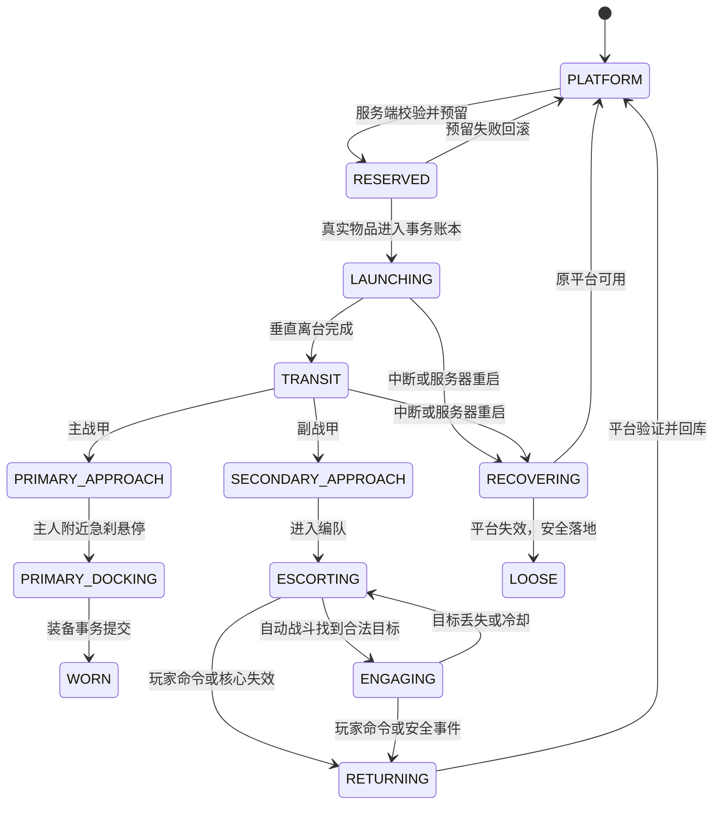

# 装甲核心槽与多平台主副召回设计

> 状态：`2.17.0` 第一阶段已实现。正文保留完整目标架构；本节记录已落地范围与仍待扩展部分。

## 0. `2.17.0` 实现状态

已完成：

- 新增不占原版装甲槽和快捷栏的独立装甲核心槽，按 `K` 打开。
- 导航核心具有 `coreId + ownerId + nonce` 身份，取下后网络保留，换成另一枚核心不会继承旧绑定。
- 充能平台改为四个真实容器槽，普通右键打开，潜行右键切换整体/分件陈列。
- `ArmorOwnershipSavedData` 改为按 `suitId` 保存多套战甲；每座平台另有永久 `platformId`，原位置更换平台不会继承旧引用。
- 核心可绑定多座平台；菜单支持选择、设为主甲、主召回、副召回和全部召回。
- 普通 `B` 从平台召回时必须装备有效核心，并且只使用当前核心指定的主战甲绑定；身上整套释放巡航和背包快速着甲不受此限制。
- “全部召回”把一套主战甲交给现有高速召回/着装控制器，其余真实四件直接转移到以 `suitId` 为键的副战甲载体。
- 副战甲执行垂直离台、远距高速过渡或近距悬空接近，抵达后进入编队并自动攻击敌对目标。
- 副战甲支持跨维度跟随、区块卸载后重接管、服务器重启实体恢复、木架隐藏、飞行结构变形和随阶段变化的满亮灯色。
- 平台容器禁止认主件与无身份件混装，提交前检查同 `suitId/slot` 的重复部件；访客打开平台不会取得草稿所有权。

当前第一阶段边界：

- 主战甲继续使用成熟的 `ownerId` 控制器，副战甲使用独立的 `suitId` 控制器，避免重写死亡接管、防坠和着装闭环。
- 多套副战甲目前共享主人的能量、热量和武器冷却账本，但会分别搜索目标并轮流自动开火；完全独立资源账本留到第二阶段。
- 已在巡航中的副战甲暂不支持从核心菜单单独返还原平台或转换为主甲；该闭环需要新增副甲返航事务。

测试操作：

1. 在创造物品栏取得“战甲导航核心”和充能平台。
2. 按 `K`，把核心放入左侧独立核心槽。
3. 普通右键平台，在四槽中放齐同型号的战靴、护腿、胸甲和头盔；完整后会自动认主并绑定。
4. 多放几座平台并重复上一步；也可在核心菜单看向六格内的完整平台后点击“绑定眼前平台”。
5. 在列表选择战甲，设置主甲，或点击“全部召回”；所选主甲着装，其余战甲自动进入副巡航与战斗。

## 1. 结论

该功能可以实现，但不能只给现有 `B` 键多加几个分支。当前代码的认主索引、巡航状态、持久化索引和战斗资源都按“每名玩家最多一套战甲”设计；要支持一个核心绑定多座平台、主战甲着装和多套副战甲同时巡航，必须先把这些索引改为以 `suitId` 为主键。

推荐实现结果如下：

- 玩家拥有一个服务器权威的独立“装甲核心槽”，不占快捷栏和四个原版装甲槽。
- 核心可以绑定多套已经认主、放齐四件的充能平台战甲。
- 核心菜单可以重命名套装、指定主战甲、选择单套召回、选择副战甲召回或召回全部。
- “召回全部”时只有一套主战甲可以进入玩家装备槽；其余套装作为副战甲进入护卫巡航并自动打开战斗模式。
- 核心只是导航和授权介质，不保存四件战甲本体。真实物品始终只存在于平台、玩家、巡航载体或短期事务账本中的一个位置。
- 所有菜单动作只发送意图，平台位置、套装身份、所有权、可召回状态和战斗权限均由服务端重新验证。

## 2. 目标与非目标

### 2.1 目标

1. 一个玩家可拥有并管理多套不同型号的认主战甲。
2. 每套战甲可以绑定一座确定的充能平台。
3. 召回时必须先从平台垂直离台，再根据距离进入近距悬空航路或远距高速俯冲航路。
4. 主战甲抵达玩家后进入整体或分件着装流程，取决于平台的陈列模式。
5. 副战甲抵达后进入玩家周围的护卫编队，并自动启用现有自主战斗逻辑。
6. 支持死亡、断线、跨维度、平台被破坏、核心丢失、区块卸载和服务器重启恢复。
7. 不破坏现有身份防复制、平台回滚、战靴先行悬空和巡航载体持久化原则。

### 2.2 第一阶段不做

- 不允许同一套战甲同时成为主战甲和副战甲。
- 不允许副战甲把物品复制给玩家或同时出现在两名玩家身边。
- 不做客户端决定命中、伤害或套装位置。
- 不依赖 Trinkets 等必须额外安装的第三方模组。
- 不在第一版支持任意数量的活跃副战甲；默认上限需要可配置。

## 3. 当前实现基线与必须重构的地方

### 3.1 当前认主数据只能保存一套

`ArmorOwnershipSavedData` 当前是：

```text
Map<ownerId, Binding>
```

一个 `ownerId` 只能对应一个 `suitId`，并且平台入库会拒绝同一玩家的第二套战甲。因此仅增加菜单无法绑定多座平台。

新结构必须改为：

```text
Map<suitId, SuitBinding>
Map<ownerId, Set<suitId>>
```

`suitId` 成为物品、平台、巡航载体和核心菜单之间唯一稳定的套装身份。

### 3.2 当前巡航状态只能保存一套

`ArmorCruiseController` 和 `ArmorCruiseSavedData` 当前都以 `ownerId` 为主键：

```text
Map<ownerId, CruiseState>
Map<ownerId, Locator>
```

这意味着一个玩家同时只能存在一具巡航载体。多副战甲需要改为：

```text
Map<suitId, CruiseState>
Map<suitId, Locator>
Map<ownerId, Set<suitId>> activeSuitIndex
```

所有“按玩家查找巡航战甲”的入口需要变为返回集合，所有“召回这一套”的入口必须显式携带 `suitId`。

### 3.3 当前战斗资源按拥有者唯一

现有巡航战斗存在“拥有者唯一资源账本”和 actor 锁。多套副战甲同时开火时，如果继续只按 `ownerId` 记账，会出现一套战甲锁住其他全部战甲或共享同一冷却的问题。

推荐改为：

```text
CombatActorKey(ownerId, suitId)
```

每套副战甲拥有独立能量、热量、冷却与攻击状态；友军识别和伤害归属仍记录实际玩家 `ownerId`。

## 4. 玩家操作

### 4.1 默认按键

- `K`：打开装甲核心菜单（按键可在控制设置中修改；`G` 已由现有核心束蓄力占用）。
- 普通 `B`：保持现有上下文功能。未穿戴战甲时，如果核心只绑定一套可用主战甲，直接召回；绑定多套时召回菜单中指定的主战甲。
- `Ctrl+B`：保持现有衣柜收纳逻辑，不承担多套选择。
- 核心菜单中的“召回选中”：把当前选中套装作为主战甲召回并着装。
- 核心菜单中的“作为副战甲召回”：召回选中套装并进入护卫巡航，不占玩家装甲槽。
- 核心菜单中的“召回全部”：主战甲着装，其余在线且通过校验的绑定套装全部作为副战甲召回。

### 4.2 平台绑定

为了不与平台现有“空手右键切换整体/分件陈列”冲突，绑定不占用普通右键：

1. 玩家装备装甲核心。
2. 打开核心菜单。
3. 准星对准 6 格内的完整充能平台。
4. 点击“绑定所看平台”。
5. 服务端重新射线检测目标平台，并验证平台拥有者、四件完整性、统一 `suitId` 和身份数据。

客户端不能把任意坐标作为可信平台位置发送给服务端。

## 5. 装甲核心独立槽

### 5.1 推荐实现

实现一个模组自有、服务器权威的单格物品库存：

```text
ArmorCoreInventory
└── slot 0: 只接受 ArmorNavigationCoreItem
```

它通过玩家持久数据保存，并由自定义 `ArmorCoreMenu` / `ArmorCoreScreen` 操作。这样不需要第三方依赖，也不会直接修改原版 `InventoryMenu` 的槽位数量和网络序号。

玩家物品栏界面可以增加一个只读核心图标和“打开核心面板”按钮，但实际插入、取出仍在自定义菜单中完成，避免与其他修改背包界面的模组冲突。

### 5.2 槽位规则

- 只允许一个核心处于装备状态。
- 核心具有 `coreId`、`ownerId`、格式版本和实例随机数。
- 首次装备未认主核心时由服务端认主。
- 已认主给其他玩家或格式损坏的核心不能装备。
- 存在活动召回事务或副战甲时，不允许直接取下核心；菜单必须先执行“全部返航”，等待状态稳定后才能取下。
- 默认死亡后保留核心槽，避免玩家死亡导致全部副战甲失控。
- `/clear`、数据修复或管理员操作造成核心消失时，活动副战甲进入安全返航，不继续主动攻击。

### 5.3 为什么绑定不能只写在核心 ItemStack 上

创造模式、指令或其他模组可能复制 ItemStack。如果平台清单全部写在物品 NBT 中，复制核心就可能得到两份控制权。

核心物品只携带身份：

```text
CoreIdentity {
  version,
  coreId,
  ownerId,
  instanceNonce
}
```

真正的绑定表保存在世界级 `ArmorCoreSavedData` 中。服务端还要记录当前有效的 `instanceNonce`，旧副本只能显示“核心副本已失效”，不能发出召回命令。

## 6. 权威数据结构

### 6.1 核心记录

```java
record CoreRecord(
    UUID coreId,
    UUID ownerId,
    long revision,
    UUID primarySuitId,
    Map<UUID, CoreSuitEntry> suits,
    UUID activeInstanceNonce
) {}
```

### 6.2 核心中的套装条目

```java
record CoreSuitEntry(
    UUID suitId,
    String displayName,
    PlatformRef platform,
    SuitRole preferredRole,
    boolean includeInRecallAll,
    long lastValidatedRevision
) {}
```

`preferredRole` 只表示菜单偏好。一次召回命令中的实际主副角色仍由服务端生成的命令快照决定，避免菜单中途变化影响正在执行的事务。

### 6.3 平台引用

```java
record PlatformRef(
    UUID platformId,
    ResourceKey<Level> dimension,
    BlockPos pos
) {}
```

每个充能平台新增永久 `platformId`。只比较维度与坐标不够，因为玩家破坏旧平台后在同一位置放置新平台时，不应自动继承旧绑定。

### 6.4 套装权威位置

```java
enum SuitLocation {
    CARRIED,
    PLATFORM,
    TRANSFER_LEDGER,
    CRUISE_CARRIER,
    LOOSE
}
```

```java
record SuitBinding(
    UUID suitId,
    UUID ownerId,
    SuitLocation location,
    PlatformRef platform,
    UUID carrierId,
    long revision
) {}
```

任何物品迁移都必须比较旧 `revision` 并以 CAS 方式提交，不能用“先删旧记录，再尝试创建新记录”的非原子流程。

## 7. 菜单设计

核心菜单建议分为三块：

```text
┌─────────────────────────────────────────────────────────┐
│ 装甲核心槽  核心状态/拥有者/在线套装数量                 │
├─────────────────────────────────────────────────────────┤
│ 套装列表                                                 │
│ ● 主战甲  苍穹-01  主世界 (120, 64, -38)  [平台待机]     │
│ □ 副战甲  哨兵-02  下界   (18, 72, 41)    [可召回]       │
│ □ 副战甲  迅捷-03  末地   (...)            [离线]         │
├─────────────────────────────────────────────────────────┤
│ [绑定所看平台] [设为主战甲] [单独召回] [副战甲召回]      │
│ [召回全部]     [全部返航] [重命名]     [解除绑定]         │
└─────────────────────────────────────────────────────────┘
```

套装状态至少包括：

- 平台待机
- 平台区块未加载但索引有效
- 预留/离台
- 召回途中
- 主战甲着装中
- 玩家穿戴
- 副战甲护卫巡航
- 副战甲交战中
- 返航途中
- 平台失效
- 物品身份异常

按钮是否可用由服务端快照决定，客户端灰掉按钮只是体验优化，不是安全门禁。

## 8. 主副角色规则

### 8.1 主战甲

- 一次召回命令最多一套。
- 目标是玩家四个装甲槽。
- 平台整体陈列时，整甲单体飞来并执行外骨骼包覆。
- 平台分件陈列时，四组真实逻辑部件分别飞来，战靴先锁定并接管悬空。
- 玩家装甲槽被非目标物品占用时不开始事务，不能把原物品挤到地面。

### 8.2 副战甲

- 不进入玩家装备槽。
- 每套使用独立巡航载体和独立 `suitId` 状态。
- 抵达后进入编队槽位，例如玩家左右后方和上方，槽位由 `suitId` 稳定排序，避免每 tick 换位。
- 自动战斗默认使用 `GUARD` 模式，只攻击符合现有敌对、视线和友伤规则的目标。
- 玩家进入和平模式、死亡、核心失效或跨维度迁移失败时停止开火。
- 副战甲不能执行俯冲地面冲击，避免多套同时造成不可控范围伤害；第一版只开放腕部脉冲，核心束在能量和射界重构完成后再开启。

### 8.3 召回全部

“全部”表示核心中勾选 `includeInRecallAll` 且当前可验证的套装，不表示忽略离线、损坏或身份冲突的套装。

执行顺序：

1. 读取核心记录并冻结一次命令快照。
2. 验证主战甲唯一；没有指定主战甲时选择最近的可用套装。
3. 验证玩家四个装甲槽可接收主战甲。
4. 为所有可用套装创建预留，不立即生成视觉副本。
5. 主战甲进入玩家召回路线。
6. 其余套装进入副战甲召回路线。
7. 单套失败只回滚该套；主战甲失败时不阻止已经安全生成的副战甲，但菜单必须明确报告部分成功。

## 9. 单套状态机



主战甲 `WORN` 后由现有玩家飞行状态机管理；副战甲永远不能进入 `WORN`。

## 10. 平台离台与召回航路

所有平台召回先执行可识别的离台动作，不能从托位直接斜线穿向玩家。

### 10.1 公共离台阶段

- 0～2 tick：垂直升高约 1.2～1.8 格。
- 同时完成灯光唤醒、身体朝向锁定和轻微装甲收束。
- 整体模式只移动一具完整战甲；分件模式先同步抬升，再在离台末端分流。

### 10.2 近距离航路

建议阈值：水平距离不超过 24 格且高度差不超过 12 格。

- 保持直立或轻微前倾的悬空平飞。
- 使用平滑三次曲线接近主人。
- 距主人 4～7 格进入青色悬停刹车环，再开始着装或编队锁定。

### 10.3 远距离航路

- 离台后先爬升取得安全高度。
- 中段收束身体并进入高速俯冲姿态，使用长白紫残影表达高速度。
- 距主人 16 格进入金色压缩刹车，距 7 格恢复直立悬停。
- 不能以高速一步穿过主人；服务端载体继续使用安全步长和捕获边界。

### 10.4 跨维度航路

- 原维度仍播放短暂垂直离台与相位收束。
- 服务端迁移真实物品载体后，在主人维度 80～96 格外重入。
- 重入后使用远距离俯冲和近身急刹，不在玩家碰撞箱中心直接出现。

## 11. 多套召回事务与防复制

### 11.1 核心不变量

对任意 `suitId`，四件真实 ItemStack 同一时刻只能存在于以下一个位置：

```text
PLAYER XOR PLATFORM XOR TRANSFER_LEDGER XOR CARRIER XOR LOOSE
```

客户端轨迹、残影和预览实体全部是渲染代理，不持有可掉落物品。

### 11.2 为什么需要事务账本

召回多套时会跨多个平台、区块甚至维度，无法用单次内存操作完成真正的数据库式原子事务。推荐使用持久 `ArmorTransferSavedData`：

```java
record TransferEntry(
    UUID commandId,
    UUID suitId,
    TransferRole role,
    TransferPhase phase,
    List<ItemStack> armor,
    PlatformRef origin,
    UUID targetOwner,
    long revision
) {}
```

平台提取成功后，四件物品先进入该账本；载体生成或玩家装备提交成功后再删除账本记录。服务器在两个提交点之间崩溃时，重启恢复任务仍能找到真实物品。

### 11.3 预留与提交

1. 对每套战甲读取 `SuitBinding.revision`。
2. 将状态 CAS 为 `TRANSFER_LEDGER` 并写入 `commandId`。
3. 从平台提取四件，校验身份和统一型号。
4. 写入持久事务条目。
5. 生成主/副目标。
6. 目标安全接管物品后更新位置并删除事务条目。

任何阶段失败都不能重新 `copy()` 出一套作为补偿，只能移动原物品或按事务快照恢复原物品。

## 12. 网络协议

建议新增：

```text
C2S OpenArmorCoreMenuIntent
C2S ArmorCoreActionIntent(sessionId, actionSequence, action, selectedSuitIds)
S2C ArmorCoreSnapshot(sessionId, revision, coreSummary, suitEntries)
S2C ArmorCoreActionResult(sessionId, actionSequence, result, perSuitResults)
S2C MultiRecallVisualState(commandId, suitId, role, phase, origin, routeType, sequence)
```

安全要求：

- C2S 不携带可信拥有者、伤害值、平台物品或最终平台坐标。
- `sessionId` 在菜单打开时由服务端生成，关闭菜单或换核心后立即失效。
- `actionSequence` 防止双击、重发和乱序操作重复执行。
- 每套召回还有独立 `sequence`，后到的旧视觉包不能覆盖新状态。
- S2C 列表可以分页；第一版绑定上限较小时也应保留协议版本字段。

## 13. 生命周期和异常规则

### 13.1 玩家死亡

- 核心槽默认保留。
- 主战甲正在召回时继续执行紧急防坠无意义，应改为尸体附近悬停或回平台。
- 所有副战甲立刻停止主动攻击，进入 `OWNER_DOWN` 守护或安全返航。
- 玩家重生后可在核心菜单重新选择召回，不自动把多套战甲全部传送到出生点。

### 13.2 玩家断线

- 停止战斗和长期区块票据。
- 载体与事务索引持久化。
- 能安全返回已加载平台的副战甲可以返航；否则原地进入低功耗持久待机。

### 13.3 核心被取下或失效

- 有活动副战甲时禁止直接取下，提示先“全部返航”。
- 如果由指令或数据错误强制移除，副战甲停止攻击并尝试返航。
- 同 `coreId` 的旧复制品不能重新取得控制权。

### 13.4 平台被破坏

- 平台中的真实物品按现有逻辑掉落。
- 对应 `CoreSuitEntry` 标记为失效，而不是自动寻找同坐标的新平台。
- 如果战甲正在巡航，平台被破坏不销毁战甲；返航时进入 `LOOSE` 安全落地或等待玩家指定新平台。

### 13.5 区块卸载和跨维度

- 菜单展示可以依赖持久索引，不为浏览列表加载区块。
- 只有确认召回后才给目标平台添加短期区块票据。
- 票据有明确超时，失败后必须释放。
- 平台加载后必须再次比较 `platformId`、`suitId`、拥有者和 revision。

## 14. 旧存档迁移

现有世界只有每名玩家一条旧 `Binding`。升级时：

1. 保留旧数据文件作为读取源，不原地覆盖后立即删除。
2. 将旧 `ownerId -> Binding` 转为 `suitId -> SuitBinding`。
3. 创建 `ownerId -> Set<suitId>` 二级索引。
4. 已有平台战甲先标记为“未分配核心”，物品不移动。
5. 玩家首次装备新核心时，服务端自动导入该玩家所有未分配的合法套装。
6. 已有巡航载体从实体四件物品中读取统一 `suitId`，再迁移 locator 主键。
7. 迁移完成后写入数据版本；重复启动不能再次生成新 `suitId`。

如果迁移记录和平台实体冲突，以真实平台/载体中的四件物品为事实来源，将冲突记录标记待修复，不能生成补偿副本。

## 15. 性能和数量上限

建议默认配置：

```text
max_bound_suits_per_core = 8
max_active_secondary_suits = 4
max_simultaneous_launches_per_tick = 2
platform_recall_ticket_timeout_ticks = 200
secondary_target_scan_interval_ticks = 8
```

“召回全部”可以包含最多 8 套绑定，但同一时刻最多 4 套进入活跃战斗；超出部分在主人附近或平台上保持低功耗待机。配置可以提高，但不能取消硬安全上限。

多副战甲不应每 tick 全量扫描实体。沿用巡航战斗文档中的分帧扫描、目标缓存和射界检查，并按 `suitId` 对扫描 tick 错峰。

## 16. 实施顺序

### 阶段 0：数据迁移与测试夹具

- 把认主数据和巡航索引从 owner 主键迁移为 suit 主键。
- 保持现有单套行为完全不变。
- 增加一名玩家两套战甲不会互相拒绝的服务端测试。

### 阶段 1：核心槽

- 新增核心物品、核心独立库存、持久化和死亡复制规则。
- 新增核心菜单空壳和单格槽。
- 完成核心实例 nonce 与复制品失效校验。

### 阶段 2：多平台绑定与菜单

- 平台新增 `platformId`。
- 实现绑定、解绑、重命名、主战甲选择和状态快照。
- 完成区块未加载、平台被替换和跨维度列表显示。

### 阶段 3：选择单套主召回

- 让现有平台召回显式接收 `suitId`。
- 打通整体/分件模式、垂直离台、远近航路和着装。
- 保留战靴先行悬空和完整回滚。

### 阶段 4：单套副战甲

- 新增副战甲角色和护卫编队。
- 平台直接把真实四件移交巡航载体，不经过玩家装备槽。
- 自动进入 `GUARD`，先只实现移动和目标选择，再开放腕部脉冲。

### 阶段 5：召回全部

- 新增多套命令快照和持久事务账本。
- 主战甲与多副战甲并行起飞但错峰抵达。
- 实现逐套结果报告、部分失败回滚和全部返航。

### 阶段 6：完整生命周期

- 死亡、断线、跨维度、核心失效、平台破坏和服务器重启恢复。
- 多人追踪同步和性能压测。

## 17. 预计代码改动

### 17.1 新增

```text
item/ArmorNavigationCoreItem.java
core/ArmorCoreInventory.java
core/ArmorCoreSavedData.java
core/ArmorCoreController.java
core/ArmorCoreMenu.java
core/ArmorCoreAction.java
core/ArmorTransferSavedData.java
client/core/ArmorCoreScreen.java
client/core/ArmorCoreClient.java
network/ArmorCoreActionPayload.java
network/ArmorCoreSnapshotPayload.java
network/ArmorCoreActionResultPayload.java
network/MultiRecallVisualStatePayload.java
```

### 17.2 重构

```text
platform/ArmorOwnershipSavedData.java
platform/ChargingPlatformBlockEntity.java
platform/ChargingPlatformController.java
cruise/ArmorCruiseController.java
cruise/ArmorCruiseSavedData.java
cruise/ArmorCruiseCombatController.java
combat/ArmorCombatSavedData.java
network/ArmorCruiseStatePayload.java
client/cruise/ArmorCruiseClient.java
client/platform/PlatformRecallClient.java
```

## 18. 验收矩阵

### 18.1 核心槽

- 生存模式插入、取出、死亡和重生后物品数量正确。
- 非核心物品不能放入。
- 他人核心和旧 nonce 核心不能使用。
- 活动副战甲存在时不能无提示取下核心。

### 18.2 多平台

- 同一玩家绑定 2～8 套合法战甲。
- 同一套不能绑定两座平台。
- 平台被破坏并原位置重放后旧绑定失效。
- 未加载和跨维度平台只在召回时加载，不因打开菜单常驻区块。

### 18.3 主副召回

- 整体主战甲完整飞来，分件主战甲分别飞来。
- 主战甲始终只有一套进入玩家槽位。
- 副战甲不覆盖玩家装甲槽。
- 全部召回时主战甲失败、某副战甲失败和部分平台离线均能逐套报告并正确回滚。
- 近距走悬空平飞，远距走爬升、高速俯冲、急刹和悬停。

### 18.4 战斗

- 多套副战甲拥有独立能量、热量和冷却。
- 不攻击主人、同主人的其他战甲和友军。
- 主人死亡、断线、和平模式或核心失效时停止攻击。
- 目标扫描和网络包量在四套副战甲同时活动时仍满足预算。

### 18.5 物品安全

- 每个 `suitId` 的每个槽位始终只有一个真实 ItemStack。
- 服务器在平台提取后、载体生成前崩溃可以恢复。
- 跨维度迁移中断不会同时留下新旧载体。
- 旧存档迁移不会生成新套装或覆盖真实平台物品。

## 19. 最终实现建议

不要先做菜单外观再改底层索引。正确顺序是：

1. 先将所有权、巡航和战斗状态改成 `suitId` 主键，并保证单套回归测试通过。
2. 再实现核心槽和多平台列表。
3. 先打通一主一副的完整闭环。
4. 最后扩展“召回全部”和多副战甲并发。

这样每个阶段都能维持物品唯一性和可运行版本，不会出现菜单已经列出多套战甲、服务端却仍只能保存一套，最终导致覆盖、丢失或复制的情况。
